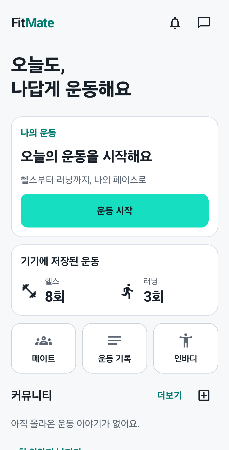
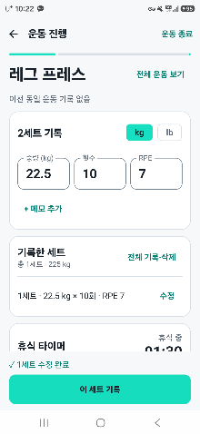
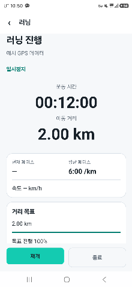
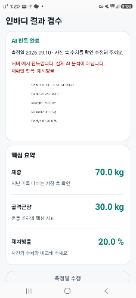
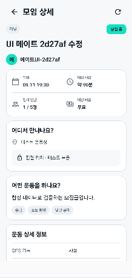
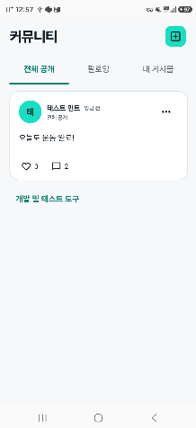

# FitMate

운동 루틴을 만들고, 직접 기록한 운동과 Galaxy Fit3 데이터를 한곳에서 돌아볼 수 있는 Android 앱입니다. 혼자 운동하는 흐름과 운동 메이트를 구하는 흐름을 함께 구현했습니다.

## 주요 기능

| 기능 | 사용 흐름 |
| --- | --- |
| **루틴과 운동 기록** | 운동 목표와 숙련도에 맞는 루틴을 선택하고, 운동별 무게·횟수·세트를 기록합니다. 러닝은 거리·시간·랩을 별도로 기록합니다. |
| **Galaxy Fit3 연동** | Fit3에서 Samsung Health로 동기화된 운동 기록을 사용자 권한 동의 후 읽습니다. FitMate의 운동 세션과 연결해 활동 시간, 칼로리, 심박수 등 가져올 수 있는 지표를 리포트에 함께 표시합니다. |
| **운동 추천과 리포트** | 목표·숙련도·운동 이력에 맞춰 다음 운동을 추천하고, 완료한 운동의 기록을 요약합니다. |
| **인바디 기록** | 인바디 결과지 이미지를 AI로 판독하고, 사용자가 결과를 확인한 뒤 체성분 기록으로 저장합니다. |
| **운동 메이트와 커뮤니티** | 모집글을 올리고 문의 채팅으로 일정을 조율합니다. 모집자는 참가 요청을 수락하거나 거절할 수 있습니다. 커뮤니티 게시물, 댓글, 팔로우, DM도 지원합니다. |

## 실제 화면

최종 발표 자료에 포함된 실제 앱 화면을 발췌했습니다.

<table>
  <tr>
    <th>홈</th>
    <th>헬스 세트 기록</th>
    <th>러닝</th>
  </tr>
  <tr>
    <td></td>
    <td></td>
    <td></td>
  </tr>
  <tr>
    <td>운동 시작과 운동 기록 진입</td>
    <td>합성 계정·실서버 연결 시연</td>
    <td>예시 GPS 데이터로 시연</td>
  </tr>
  <tr>
    <th>인바디 결과 검수</th>
    <th>메이트 모집 상세</th>
    <th>커뮤니티</th>
  </tr>
  <tr>
    <td></td>
    <td></td>
    <td></td>
  </tr>
  <tr>
    <td>MOCK 판독 결과로 구현 화면 시연</td>
    <td>합성 계정·실서버 연결 시연</td>
    <td>합성 UI 데이터로 시연</td>
  </tr>
</table>

## 구현에서 다룬 문제

- **웨어러블 데이터와 앱 세션 연결** · Galaxy Fit3 → Samsung Health → Android 앱 → 백엔드 순서로 데이터를 가져옵니다. 운동 시간대가 겹치는 기록을 기준으로 연결하고, Samsung Health를 사용하지 않는 세션도 직접 기록만으로 완료할 수 있습니다.
- **운동 기록의 상태 관리** · 운동 세션의 시작·일시 정지·재개·완료를 API로 모델링했습니다. 이전 운동 기록을 참고해 세트를 입력하고, 완료한 루틴을 기준으로 다음 분할 순서를 계산합니다.
- **메이트 마지막 자리 신청 처리** · 모집글, 문의방, 참가 신청을 각각 관리하면서 서버에서 수락 시 정원을 확인합니다. 마지막 자리의 동시 수락, 채팅 재전송과 읽음 처리, 알림 저장을 통합 테스트로 다룹니다.

## 기술 스택과 코드 구조

| 경로 | 기술과 역할 |
| --- | --- |
| [`android/`](android/) | Kotlin, Jetpack Compose, Samsung Health Data SDK · 화면, 운동 기록, 기기 데이터 조회 |
| [`backend/`](backend/) | Kotlin, JDK 17, Spring Boot 3.4, Spring Security, Spring Data JPA · REST API, JWT 인증, 운동·메이트·커뮤니티 기능 |
| [`db/migration/`](db/migration/) | MySQL, Flyway · 스키마 변경과 기준 데이터 |
| AI 연동 | OpenAI API · 인바디 이미지 판독, 운동 추천과 리포트 설명 생성 |

## 로컬 실행

백엔드는 JDK 17과 Docker가 필요합니다. `FITMATE_JWT_SECRET`에 32바이트 이상의 임의 문자열을 로컬 환경변수로 설정한 뒤, 저장소 루트에서 다음 명령을 실행합니다.

```bash
cd backend
docker compose up -d
bash ./gradlew bootRun
```

Windows에서는 `bash ./gradlew` 대신 `.\gradlew.bat`을 사용합니다. MySQL 연결 설정은 `FITMATE_DB_URL`, `FITMATE_DB_USERNAME`, `FITMATE_DB_PASSWORD`로 지정할 수 있습니다. OpenAI 연동을 사용할 때는 `OPENAI_API_KEY`를 로컬 환경변수로 설정합니다.

Android는 Android Studio에서 `android/`를 열고, [Samsung Health SDK 설정](android/app/libs/README.md)에 따라 SDK를 준비한 뒤 디버그 빌드의 API 주소를 로컬 백엔드에 맞춥니다. Galaxy Fit3 연동을 확인하려면 Samsung Health에서 기기 동기화와 운동 읽기 권한을 설정합니다.

백엔드 단위 테스트는 `backend/`에서 `bash ./gradlew test`로 실행합니다. MySQL 통합 테스트에는 별도 테스트 DB와 `FITMATE_TEST_DB_URL`이 필요합니다.
