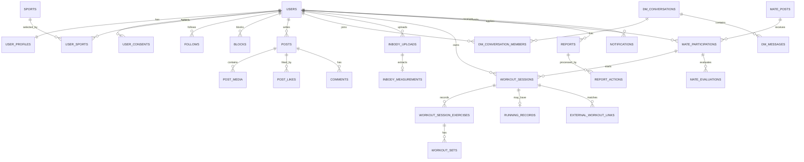
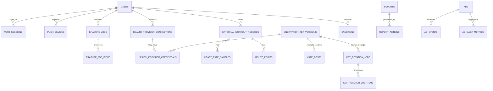
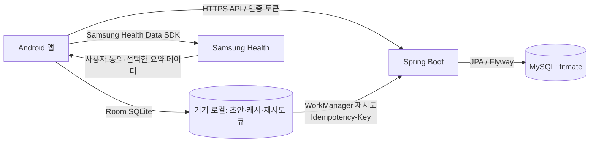

# Fitmate DB 설계 및 초기화 전 기획

- 작성일: 2026-09-03
- 최종 수정일: 2026-09-03
- 버전: v0.4
- 상태: 검토 중
- 근거: `docs/프로젝트제출용/3주차/기능명세서_v1.2.pdf` (2026-09-02)

## 1. 목적과 범위

이 문서는 기능명세서 v1.2를 구현 가능한 관계형 데이터 모델로 해석한 **DB 생성 전 설계 기준**이다. 실제 DDL, 마이그레이션 파일, 시드 데이터는 이 문서의 검토·확정 뒤에 만든다.

포함 범위는 회원·동의·인바디·커뮤니티·DM·신고/차단·운동/러닝·Samsung Health Data·메이트 모집·평가·알림·관리자·광고다. 단체 채팅, 실시간 위치 공유, 워치 심박수 스트리밍, 직접 Bluetooth 통신은 기능명세서의 범위 제외 항목이므로 모델을 만들지 않는다.

## 2. 확정 제안과 전제

| 항목 | 제안 | 이유 |
|---|---|---|
| 서버 DBMS | MySQL 8.4 LTS 권장(최소 8.0.16), InnoDB, `utf8mb4` | Spring Boot/JPA 지원, 트랜잭션·외래키·JSON·공간 인덱스를 안정적으로 사용 |
| Android 로컬 DB | Room(SQLite) | 오프라인 운동 진행·임시 캐시·재시도 큐만 저장하고, 서버 MySQL의 복제본으로 쓰지 않음 |
| ID | 서버 업무 ID는 Java UUID를 `BINARY(16)`으로 저장하고, 오프라인 생성 ID도 UUID로 통일 | 모바일 임시 생성·분산 확장에 안전하고 ID 추측을 줄임 |
| 시간 | MySQL `datetime(3)`를 UTC로 저장, 표시 시 사용자 시간대 변환 | Samsung Health의 시간 범위 매칭과 지역 모임의 일관성 확보 |
| 삭제 | 사용자 작성 콘텐츠는 soft delete, 민감 원본/탈퇴 개인정보는 정책에 따른 hard delete 또는 익명화 | 신고·감사 이력은 유지하면서 삭제권을 지원 |
| 파일 | 이미지·원본은 DB BLOB이 아닌 비공개 객체 저장소, DB에는 메타데이터와 object key만 저장 | 대용량, 악성파일 검사, 만료·파기 처리에 적합 |
| 상태값 | MySQL `CHECK` + Spring enum/상태 전이 서비스로 관리 | 허용 상태를 제한하면서 enum 변경 마이그레이션 위험을 낮춤 |
| 민감정보 | `health_` 테이블군 + MySQL 최소권한 계정 + Spring 서비스 권한 분리 | 인바디·운동 생체값·GPS를 일반 운영 조회에서 분리 |
| 위치 | 모임의 목록용 대략 지역과 확정자용 정확 위치를 분리 | 위치 노출 최소화 요구 충족 |

`created_at`, `updated_at`(UTC)은 변경되는 모든 업무 테이블에 둔다. MySQL의 `TIMESTAMP`는 서버 세션 time zone 영향을 받을 수 있으므로 업무 시각은 `DATETIME(3)`로 통일하고, Spring Boot의 JDBC/Hibernate time zone도 UTC로 고정한다. 상태 변경 시각이 필요한 테이블은 별도 `*_at` 컬럼을 둔다. 표준 문자열은 `varchar` 길이보다 업무 검증을 우선하고, 긴 본문·메모는 `text`를 사용한다.

### 2.1 공통 컬럼 규칙

| 구분 | 표준 |
|---|---|
| PK | `id binary(16) primary key` (애플리케이션에서는 `UUID`) |
| 사용자 참조 | `user_id binary(16) not null` + InnoDB FK |
| 금액 | `numeric(12,2)` + ISO 4217 통화 코드. 원화만 허용 시 `numeric(12,0)` + `KRW` |
| 수치 | 체중/거리 등은 `numeric`, 계산용 원본은 단위를 컬럼명에 명시 (`*_kg`, `*_meters`, `*_bpm`) |
| 좌표 | `decimal(9,6)`(비식별 경로) 또는 MySQL `POINT SRID 4326`(정확 거리 정렬이 확정된 경우) |
| 파일 | 파일명·MIME·크기·해시·`storage_key`만 저장. 공개 URL과 원본 파일은 저장하지 않음 |
| 삭제 | `deleted_at`, `deleted_by`가 있는 행은 일반 조회에서 제외. 사용자 식별값을 익명화할 때 감사용 원문은 남기지 않음 |
| 낙관적 잠금 | 신청 수락, 모집 인원, 광고 노출 등 경쟁 갱신 테이블에는 `version bigint not null default 0` (`@Version`) |

### 2.2 MySQL 구현 유의사항

- MySQL에서 schema는 database와 동의어다. 서비스 데이터를 여러 database로 나누지 않고 물리 DB `fitmate` 1개로 시작하며, 표 이름에 `core_`, `social_`, `fitness_`, `health_`, `ops_` 접두사를 붙인다. 아래의 `users`, `posts` 같은 이름은 논리명이며 실제 이름은 각각 `core_users`, `social_posts`다.
- MySQL 8.0.16 이상에서 `CHECK`가 동작하지만, 상태 전이·상호 차단·정원 계산 같은 다중 행 규칙은 Spring Boot 서비스 트랜잭션에서 보장한다.
- partial index가 없으므로, 활성 행만 unique여야 하는 경우 `active_*` stored generated column을 만들고 unique index를 건다. 예: 탈퇴하지 않은 닉네임만 `active_nickname`에 값을 두고 탈퇴 행은 `NULL`로 둔다.
- 대소문자/공백 정규화가 필요한 이메일·닉네임은 `email_normalized`, `nickname_normalized`를 별도 저장해 unique index를 건다. collation에만 의존하지 않는다.
- UUID는 `UUID_TO_BIN(?, 1)`/`BIN_TO_UUID(id, 1)` 또는 JPA `AttributeConverter`로 변환한다. 모든 FK의 타입·byte order는 PK와 동일해야 한다.
- DB trigger는 사용하지 않는다. 상태 전이, 차단 교차 검사, DM 요청 1회 제한, 정원 수락은 Spring 서비스의 명시적 트랜잭션과 행 잠금으로 구현해 Flyway·테스트·장애 분석 경로를 단일화한다.
- refresh token 재발급은 기존 `auth_sessions` 행을 revoke하고 후속 행을 만드는 rotation이다. 이미 revoke된 token hash가 다시 제출되면 탈취 의심으로 기록하고, 해당 사용자의 모든 refresh session을 revoke한 뒤 `users.auth_version`을 증가시켜 모든 access token을 즉시 무효화한다. 사용자는 모든 기기에서 다시 로그인해야 한다.
- `revoked_access_tokens`는 access JWT의 `jti`와 `expires_at`만 보관하는 단기 blacklist다. `expires_at` index와 시간별 삭제 job으로 만료 행을 제거하며, 인증 검증은 만료 전까지 blacklist·`auth_version`·세션 revoke 여부를 확인하므로 정리 지연이 보안을 약화하지 않는다.

### 2.3 민감 데이터 암호화와 키 관리

- 암·복호화는 Android가 아닌 Spring Boot의 `SensitiveDataEncryptionService`에서만 수행한다. MySQL에는 평문 키나 평문 토큰을 저장하지 않는다.
- 정확 집결 위치와 외부 연동 credential은 레코드별 256-bit DEK로 AES-256-GCM 암호화한다. 각 행에는 `ciphertext`, 12-byte `nonce`, `wrapped_dek`, `encryption_key_version`, `aad_version`을 보관한다.
- DEK는 KMS의 용도별 CMK로 envelope encryption 한다. `ops_encryption_key_versions`에는 KMS key reference, 용도, 상태, 활성/폐기 시각만 기록하며 키 재료는 절대 DB에 넣지 않는다. KMS 공급자는 배포 클라우드와 함께 P0로 확정한다.
- AAD는 `fitmate:{table}:{row-id}:{field}:v{aad_version}`로 서버에서 조합한다. 그래서 다른 사용자·테이블·컬럼으로 암호문을 바꾸어 끼우는 공격을 검증 단계에서 막는다.
- 새 암호화는 활성 key version만 쓴다. key rotation 시 `key_rotation_jobs`가 이전 key version별 대상 행을 keyset cursor로 작은 batch씩 잠그고 복호화·새 DEK 재암호화·검증한다. 행 단위 성공/실패와 cursor를 저장해 재시도 가능하게 하고, 구 key는 모든 대상 재암호화·복구 검증·백업 보관기간 경과 뒤에만 폐기한다. 그때까지 복호화는 신·구 key version을 모두 지원한다.
- 현재 Samsung Health Data SDK 연동은 단말 권한 기반이므로 서버 credential 행을 만들지 않는다. OAuth형 외부 provider를 추가할 때만 `health_provider_credentials`에 access/refresh token 암호문을 저장한다.

## 3. 논리 도메인 경계와 접근 원칙

| 물리 접두사 | 주요 데이터 | 접근 원칙 |
|---|---|---|
| `core` | 계정, 프로필, 동의, 관심 종목, 알림 | 일반 서비스 API만 본인/공개 범위에 맞춰 접근 |
| `social` | 팔로우, 게시물, 댓글, DM, 차단, 신고 | 차단·공개 범위를 모든 조회의 선행 조건으로 적용 |
| `fitness` | 루틴, 운동 세션, 세트, 러닝, 메이트 | 개인 운동 상세는 소유자만 읽기 |
| `health` | 인바디, 외부 건강기록, 심박·경로 | 일반 관리자 차단. 정해진 서비스 계정과 본인만 접근 |
| `ops` | 제재, 공지, 감사 로그, 광고 | 역할 기반 접근. 관리자 행위는 감사 로그 필수 |

Spring Boot API만 MySQL에 접속한다. Android 앱은 MySQL에 직접 접속하지 않는다. MySQL 계정은 애플리케이션 실행 계정, 마이그레이션 계정, 읽기 전용 운영 계정으로 분리하고, `health_` 테이블은 일반 운영 조회용 계정에 권한을 주지 않는다. 모든 사용자 요청은 서버의 인증된 `actor_user_id`로 권한을 판정하며, 클라이언트가 전달한 다른 `user_id`를 신뢰하지 않는다.

## 4. 개념 ERD

아래 ERD는 핵심 관계만 표시한 것이다. 파일, 알림, 감사 로그, 광고 상세는 뒤의 테이블 정의를 따른다.



### 4.1 건강·인증·운영 보조 ERD



## 5. 서버 MySQL과 Android 로컬 DB의 분리

두 DB를 분리하는 것이 맞다. **서버 MySQL은 모든 공유·권한·영구 데이터의 유일한 기준 원장**이고, **Android Room은 사용자의 기기에서만 필요한 임시 작업공간**이다. Room의 데이터는 언제든 서버에서 다시 받아 복구하거나 로그아웃 시 지울 수 있어야 한다.



### 5.1 저장 책임

| 데이터 | 서버 MySQL (Spring Boot) | Android Room(SQLite) | 비고 |
|---|---|---|---|
| 계정·비밀번호·동의·권한·제재 | 원본 저장 | 저장하지 않음 | refresh token은 Android Keystore 키로 보호한 `EncryptedSharedPreferences`에만 저장 |
| 프로필·팔로우·차단·게시물·댓글·좋아요 | 원본 저장 | 목록 화면용 제한 캐시만 선택 | 캐시는 계정 전환/로그아웃 시 삭제 |
| DM | 원본 저장 | 기본적으로 저장하지 않음; 작성 중 초안만 임시 저장 | 전체 DM 오프라인 열람은 MVP에서 제외 |
| 메이트 글·신청·참가 상태·평가 | 원본 저장 | 작성 초안과 최근 조회 캐시만 | 오프라인 신청은 서버 승인 전 `PENDING_SYNC`일 뿐 참가 확정이 아님 |
| 운동 세션·세트·러닝 결과 | 최종 원본 저장 | 운동 중 초안 및 미전송 완료 기록 | 네트워크가 끊겨도 운동 기록은 로컬에 남아야 함 |
| Samsung Health/인바디 | 동의받은 최종 요약·사용자 확정값만 저장 | 현재 동기화 후보/업로드 작업만 최소 보관 | 심박 원본·경로·인바디 이미지의 로컬 장기 보관 금지 |
| 알림 | 원본 inbox·발송 이력 저장 | 최근 알림 표시 캐시 | 읽음/삭제는 서버에 동기화 |
| 운동·지역·약관 사전 | 원본 및 버전 저장 | 읽기 전용 캐시 | 서버의 `data_version`이 바뀌면 갱신 |

### 5.2 Android Room 테이블 초안

Room 테이블은 `local_` 접두사를 사용하며, 서버 MySQL 테이블을 그대로 복제하지 않는다. 아래 항목만 1차 구현 범위로 둔다.

| Room 테이블 | 핵심 컬럼 | 수명·동기화 규칙 |
|---|---|---|
| `local_account_scope` | `server_user_id`, `last_signed_in_at`, `cache_schema_version` | 현재 로그인 계정 1건. 계정 변경/로그아웃 시 다른 `local_*` 행을 모두 삭제 |
| `local_workout_drafts` | `local_id`, `server_session_id nullable`, `entry_type`, `status`, `started_at_utc`, `ended_at_utc`, `updated_at_utc`, `sync_state` | 운동 시작 즉시 생성. 온라인이면 서버 세션 ID를 연결하고, 오프라인이면 `local_id`를 서버 생성 요청의 idempotency key로 사용 |
| `local_workout_draft_exercises` | `local_id`, `workout_draft_id`, `exercise_id`, `sequence_no`, 스냅샷명 | 로컬 운동 초안의 자식. 서버 응답 후 운동 세션 운동 행으로 upsert |
| `local_workout_draft_sets` | `local_id`, `draft_exercise_id`, `set_no`, 중량/반복/RPE/메모, `is_completed` | 세트 기록의 유실 방지. 초안 업로드 완료 뒤 안전 시점에 정리 |
| `local_running_drafts` / `local_running_laps` | 목표·랩·거리·페이스·일시정지 정보 | 러닝 중 지속 저장. 경로 원본은 장기 Room 저장 대상이 아님 |
| `local_pending_operations` | `operation_id`, `type`, `payload_json`, `idempotency_key`, `attempt_count`, `next_retry_at`, `last_error` | WorkManager가 순서·재시도 관리. 성공한 요청만 삭제, 영구 실패는 사용자에게 재시도/폐기 선택 제공 |
| `local_health_import_candidates` | `provider`, `source_record_id`, 시작/종료/종목/요약값, `selected_for_upload` | Samsung Health에서 읽은 후보의 짧은 캐시. 동의 철회·연동 해제·업로드 완료 후 파기 |
| `local_media_upload_queue` | `local_id`, `content_uri`, `sha256`, MIME/크기, `upload_state` | 실제 파일은 앱 전용 암호화 파일 영역에만 보관. 서버 업로드·검사 완료 후 로컬 파일과 행 삭제 |
| `local_reference_cache` | `cache_key`, `version`, `payload_json`, `expires_at` | 종목·운동사전·약관 메타데이터 등 비민감 읽기 캐시 |
| `local_feed_cache` / `local_notification_cache` | `server_id`, `payload_json`, `cached_at`, `expires_at` | 화면 성능용 캐시. 캐시는 서버 권한을 대신하지 않으며 재조회 때 다시 필터링 |
| `local_dm_drafts` | `conversation_id`, `body`, `updated_at` | 작성 중인 메시지 초안만. 실제 대화 내용·첨부는 기본적으로 캐시하지 않음 |

Room에는 `password_hash`, 인증 토큰, 다른 사용자의 정확 위치, 전체 DM, 인바디 원본 이미지, 심박 샘플·GPS 경로를 넣지 않는다. 꼭 로컬 보관이 필요한 민감 파일은 Android Keystore로 보호한 키와 암호화 파일을 사용하고, Room에는 경로/작업 상태만 둔다.

### 5.3 오프라인 동기화 계약

1. Android는 MySQL에 직접 쓰지 않고 Spring Boot API만 호출한다. 네트워크 실패는 `local_pending_operations`에 적재하고 WorkManager가 지수 백오프로 재시도한다.
2. 생성 요청에는 클라이언트가 만든 UUID `Idempotency-Key`를 포함한다. 서버의 `ops_idempotency_keys`는 `(user_id, idempotency_key)`를 unique로 보장하고, 같은 요청을 다시 받아도 최초 결과를 반환한다.
3. 운동 세트·랩은 append/upsert 가능한 이벤트로 서버에 전달한다. 서버는 `client_updated_at`과 행 `version`을 검사해 중복을 제거한다. 서버가 확정한 `workout_session_id`를 이후 로컬 초안에 기록한다.
4. 프로필·루틴·게시물처럼 같은 필드를 여러 기기에서 수정할 수 있는 리소스는 `If-Match`/`version`을 사용한다. 충돌하면 서버가 자동 덮어쓰지 않고 최신 서버 값과 로컬 초안을 보여 준다.
5. 팔로우, 차단, 메이트 신청/수락, 신고, 광고 노출은 서버 검증이 필수다. 오프라인 요청은 "전송 대기"일 뿐 성공 상태로 표시하지 않는다. 특히 메이트 정원은 서버 트랜잭션만 최종 결정한다.
6. 연동 해제, 로그아웃, 탈퇴 요청이 성공하면 해당 사용자 범위의 Room 캐시·대기 작업·암호화 파일을 즉시 지운다. 서버 측 파기는 별도 완료 상태를 API로 돌려준다.

### 5.4 Spring Boot 서버에 추가할 동기화 테이블

| MySQL 테이블 | 핵심 컬럼 | 제약·목적 |
|---|---|---|
| `ops_idempotency_keys` | `id`, `user_id`, `idempotency_key`, `request_hash`, `response_status`, `response_body`, `expires_at` | `(user_id, idempotency_key)` unique. 재전송이 같은 본문인지 `request_hash`로 확인 |
| `ops_sync_failures` | `id`, `user_id`, `operation_type`, `client_operation_id`, `failure_code`, `occurred_at` | 영구 실패 분석용. 민감 payload와 인증 정보는 기록하지 않음 |
| `core_data_versions` | `resource_type`, `version`, `updated_at` | 종목·운동 사전 등 Room 읽기 캐시 갱신 여부 판단 |

## 6. 서버 MySQL 논리 테이블 설계

### 6.1 계정, 프로필, 동의 (`core_`)

| 테이블 | 핵심 컬럼 | 관계·역할 | 핵심 제약 |
|---|---|---|---|
| `users` | `id`, `email`, `password_hash`, `account_status`, `auth_version`, `email_verified_at`, `last_login_at`, `withdrawn_at` | 계정의 원본. 모든 사용자 도메인의 부모 | 이메일은 소문자 정규화 후 활성 계정 기준 unique. 비밀번호 해시만 저장. 전체 기기 로그아웃·비밀번호 변경 시 `auth_version` 증가 |
| `auth_sessions` | `id`, `user_id`, `token_family_id`, `refresh_token_hash`, `device_id`, `issued_at`, `expires_at`, `last_used_at`, `revoked_at`, `revoke_reason`, `replaced_by_session_id` | refresh token 단위의 서버 세션 | refresh token 평문 저장 금지, hash unique. `ROTATED`, `LOGOUT`, `REUSE_DETECTED` 등의 사유 기록. 재사용 탐지 시 모든 family/session revoke 및 `auth_version` 증가 |
| `revoked_access_tokens` | `jti(PK)`, `user_id`, `session_id`, `expires_at`, `revoked_at` | 짧은 수명의 access JWT 즉시 무효화 목록 | `expires_at` index의 TTL cleanup 대상. access token에는 `jti`, `session_id`, `auth_version`을 포함하고 만료 전 서버가 blacklist·세션·version을 검사 |
| `push_devices` | `id`, `user_id`, `installation_id`, `platform`, `token_ciphertext`, `token_hash`, `token_nonce`, `wrapped_dek`, `encryption_key_version`, `last_seen_at`, `revoked_at` | FCM 등 Push 발송 대상 기기 | `(user_id, installation_id)` unique, 활성 `token_hash` unique. 발송 worker만 복호화 권한 보유 |
| `auth_events` | `id`, `user_id nullable`, `event_type`, `session_id nullable`, `ip_hash`, `user_agent_summary`, `occurred_at` | 로그인·로그아웃·토큰 재사용·비밀번호 변경 보안 이력 | 토큰·원본 IP·비밀번호는 저장하지 않음 |
| `user_profiles` | `user_id(PK/FK)`, `nickname`, `display_name`, `birth_date`, `gender`, `visibility`, `bio`, `weight_unit`, `timezone_id`, `version` | 사용자 1:1 공개 프로필 | 활성 사용자 간 닉네임 unique. `timezone_id`는 IANA 이름. 수정 API는 `version` 일치 필수 |
| `regions` | `id`, `parent_id`, `name`, `level`, `code`, `is_active` | 활동·광고·모집 지역의 표준 사전 | `(parent_id, name)` unique, 행정구역 코드 unique |
| `user_activity_regions` | `user_id`, `region_id`, `is_primary` | 사용자 N:M 활동 지역 | `(user_id, region_id)` unique. MySQL generated column `primary_user_id`로 사용자별 주 활동지역 1개 unique |
| `facilities` | `id`, `name`, `region_id`, `address_summary`, `is_active` | 이용 헬스장/운동시설 사전 | `(region_id, normalized_name)` unique. 정확 좌표는 필요 확정 전 저장하지 않음 |
| `user_facilities` | `user_id`, `facility_id`, `is_primary` | 이용 시설을 복수 등록 가능하게 설계 | `(user_id, facility_id)` unique. generated column으로 주 이용시설 1개 unique |
| `sports` | `id`, `code`, `name`, `display_order`, `is_active` | 관심 종목·모집 종목의 공통 사전 | `code` unique. 비활성 종목은 신규 선택/작성 불가 |
| `user_sports` | `user_id`, `sport_id`, `skill_level` | 사용자의 복수 운동 종목 | `(user_id, sport_id)` unique |
| `user_goals` | `user_id`, `goal_code` | 다중 운동 목표 | `(user_id, goal_code)` unique; 허용값은 `DIET`, `MUSCLE_GAIN`, `FITNESS`, `RECORD_IMPROVEMENT`, `HABIT` |
| `user_available_times` | `id`, `user_id`, `weekday_local`, `start_local_time`, `end_local_time`, `timezone_id` | 운동 가능 시간 | UTC로 변환해 저장하지 않는 반복 로컬 시간. IANA `timezone_id` 기준 `weekday_local 0..6`, 시작 < 종료 |
| `terms_documents` | `id`, `type`, `version`, `content_uri`, `effective_at`, `is_required` | 약관/동의 문서의 버전 원본 | `(type, version)` unique. 이미 동의받은 문서는 수정 금지, 새 버전으로 등록 |
| `user_consents` | `id`, `user_id`, `terms_document_id`, `consented_at`, `withdrawn_at`, `evidence` | 사용자 동의 이력 | `(user_id, terms_document_id)` unique. 철회는 행 삭제가 아닌 `withdrawn_at` 기록 |
| `notification_settings` | `user_id(PK/FK)`, `in_app_enabled`, `push_enabled`, `dm_push_enabled`, `mate_push_enabled`, `community_push_enabled`, `version` | 전역/범주별 알림 설정 | 기본값은 명세 확정 후 설정. 수정 API는 `version` 일치 필수 |
| `health_provider_connections` | `id`, `user_id`, `provider`, `connection_status`, `granted_scopes`, `connected_at`, `revoked_at`, `last_synced_at` | Samsung Health Data 등 외부 건강 데이터 연결 상태 | `(user_id, provider)` unique. 연결 메타데이터만 보관 |
| `health_provider_credentials` | `connection_id(PK/FK)`, `token_ciphertext`, `token_nonce`, `wrapped_dek`, `encryption_key_version`, `expires_at`, `rotated_at`, `revoked_at` | OAuth형 외부 provider의 서버 credential | 현재 Samsung SDK에는 행을 만들지 않음. health sync worker만 복호화 가능 |

### 6.2 파일과 인바디 (`core_`, `health_`)

| 테이블 | 핵심 컬럼 | 관계·역할 | 핵심 제약 |
|---|---|---|---|
| `media_assets` | `id`, `owner_user_id`, `storage_key`, `content_type`, `byte_size`, `sha256`, `scan_status`, `deleted_at` | 프로필·게시물·DM·인바디 원본이 참조하는 파일 메타데이터 | `storage_key`, `sha256` unique. 허용 MIME/용량, 악성검사 `CLEAN` 전 일반 노출 금지 |
| `health.inbody_uploads` | `id`, `user_id`, `original_asset_id`, `source_type`, `processing_status`, `ocr_result_json`, `failure_reason`, `reviewed_at`, `deleted_at` | 인바디 이미지 판독 작업 단위 | 원본 파일은 본인과 판독 worker만 접근. `COMPLETED`/`REVIEW_REQUIRED`일 때만 측정값 확정 가능 |
| `health.inbody_measurements` | `id`, `inbody_upload_id`, `user_id`, `measured_at`, 신장/체중/체성분 컬럼, `is_user_corrected` | 업로드 1건의 확정 측정값 | `inbody_upload_id` unique. 사용자와 업로드의 소유자 일치 검증. 수치 단위와 범위 체크, 미지원 측정치는 NULL 허용 |

`inbody_measurements`의 주요 수치는 `height_cm`, `weight_kg`, `skeletal_muscle_mass_kg`, `body_fat_mass_kg`, `body_fat_percent`, `bmi`, `fat_free_mass_kg`, `body_water_l`, `protein_kg`, `mineral_kg`, `obesity_degree_percent`, `whr`, `visceral_fat_level`, 좌/우 팔·몸통·좌/우 다리 근육량, 부위별 지방량, `bmr_kcal`, `inbody_score`, `recommended_weight_kg`, `weight_control_kg`이다. 모든 선택 수치는 NULL을 허용한다. 음수 불가, 백분율은 `0..100`을 MySQL `CHECK`로 검사하고, 미래 측정일 방지는 비결정 함수가 불가하므로 Spring 서비스 검증으로 처리한다.

### 6.3 소셜, 커뮤니티, DM (`social_`)

| 테이블 | 핵심 컬럼 | 관계·역할 | 핵심 제약 |
|---|---|---|---|
| `follows` | `follower_id`, `followee_id`, `status`, `responded_at` | 사용자 간 팔로우/요청 | `(follower_id, followee_id)` unique, 자기 자신 금지. 공개 계정은 생성 즉시 `ACCEPTED`; 비공개는 `PENDING` |
| `blocks` | `blocker_id`, `blocked_id`, `blocked_at`, `unblocked_at` | 상호 기능 차단의 근거 | `(blocker_id, blocked_id)` unique, 자기 차단 금지. 활성 차단은 `unblocked_at is null` |
| `posts` | `id`, `author_id`, `title nullable`, `body`, `visibility`, `content_status`, `published_at`, `deleted_at`, `version` | 커뮤니티 게시물 | 본문 길이 제한. 비공개 글은 맞팔만 조회. 수정/삭제 API는 `version` 일치 필수. Korean `FULLTEXT(title, body) WITH PARSER ngram` 사용 |
| `post_media` | `post_id`, `asset_id`, `display_order` | 게시물 N:이미지 | `(post_id, display_order)` unique, 첨부 자산은 `CLEAN`이어야 함 |
| `post_workout_shares` | `post_id`, `workout_session_id`, `share_level` | 게시물에 선택한 운동 요약 첨부 | 게시물 작성자=운동 소유자. 상세 생체값/정확경로 공유 금지 |
| `post_likes` | `post_id`, `user_id` | 좋아요 | `(post_id, user_id)` unique. 차단 관계·비공개 권한 미충족 시 생성 불가 |
| `comments` | `id`, `post_id`, `author_id`, `parent_comment_id`, `body`, `content_status`, `deleted_at`, `version` | 댓글/답글 | 부모 댓글은 같은 게시물이어야 함. 답글 깊이는 MVP에서 1단계로 제한. 삭제/운영 변경은 `version` 일치 필수 |
| `dm_conversations` | `id`, `user_a_id`, `user_b_id`, `conversation_type`, `request_status`, `requester_id`, `request_first_message_sent_at`, `request_message_count`, `created_at` | 1:1 DM 또는 메시지 요청의 식별자 | 정렬된 사용자 쌍 `(user_a_id,user_b_id)` unique, 두 사용자는 서로 달라야 함. `PENDING` 요청은 요청자·메시지 1개만 허용 |
| `dm_conversation_members` | `conversation_id`, `user_id`, `last_read_message_id`, `left_at`, `muted_at` | 대화방 참가자별 상태 | 대화방마다 정확히 두 멤버. `(conversation_id,user_id)` unique |
| `dm_messages` | `id`, `conversation_id`, `sender_id`, `message_type`, `body`, `asset_id`, `message_status`, `sent_at`, `deleted_at` | 메시지 | 발신자는 멤버여야 함. `TEXT`는 본문 필수, `IMAGE`는 `asset_id` 필수. 보낸 메시지만 soft delete 가능 |

DM의 읽음 여부는 메시지별 boolean을 중복 저장하지 않고 `dm_conversation_members.last_read_message_id`를 사용해 계산한다. 메시지 요청 생성은 한 서버 트랜잭션에서 대화방 행을 `FOR UPDATE`로 잠그고, `PENDING`·요청자 일치·`request_message_count = 0`일 때만 메시지를 insert한 뒤 count를 1로 바꾼다. 두 번째 요청 메시지는 서버가 409으로 거절한다. 수락 뒤에만 일반 DM 전송을 연다. 공개 계정 일반 DM의 신규 계정 발신 횟수 제한은 `rate_limit_events`(Redis 등 단기 저장소 우선)로 처리하며, 영구 업무 테이블로 쌓지 않는다.

### 6.4 신고, 차단, 운영 안전 (`social_`, `ops_`)

| 테이블 | 핵심 컬럼 | 관계·역할 | 핵심 제약 |
|---|---|---|---|
| `reports` | `id`, `reporter_id`, `reason_code`, `description`, `status`, 대상별 FK 5개, `submitted_at` | 프로필/게시물/메이트글/댓글/DM 메시지 신고 | `reported_user_id`, `post_id`, `mate_post_id`, `comment_id`, `dm_message_id` 중 정확히 1개만 non-null. 대상 유형과 FK가 일치해야 함 |
| `report_evidence` | `report_id`, `asset_id`, `display_order` | 신고 증빙 | 신고자 소유 또는 신고 대상의 접근 가능한 파일만 첨부 |
| `report_actions` | `id`, `report_id`, `admin_user_id`, `action_type`, `result_note`, `acted_at` | 검토·처리 이력 | 신고 상태 전이는 상태표에 따라 처리. 일반 DM은 신고 대상 메시지와 최소 주변 문맥만 snapshot/권한부여 |
| `sanctions` | `id`, `user_id`, `type`, `reason_code`, `starts_at`, `ends_at`, `status`, `related_report_id`, `admin_note` | 경고/기간 정지/영구 정지 | 기간 정지는 `ends_at > starts_at`, 영구 정지는 `ends_at null`. 활성 제재 중복은 MySQL generated column unique 또는 서비스 트랜잭션으로 방지 |
| `sanction_appeals` | `id`, `sanction_id`, `appellant_id`, `body`, `status`, `resolved_by`, `resolved_at` | 제재 이의신청 | 제재당 활성 이의신청 1건. 신청자는 제재 대상자와 같아야 함 |
| `content_moderations` | `id`, `target_type`, `target_id`, `action`, `reason`, `admin_user_id` | 게시물/댓글/메이트글 숨김·삭제 이력 | 실제 대상 테이블에 `content_status`를 갱신하고, 행위는 감사 로그에도 남김 |

신고 대상처럼 다형 참조가 필요한 곳은 대상 ID 하나만 저장하는 방식보다, 위처럼 대상별 FK와 `((reported_user_id is not null) + (post_id is not null) + (mate_post_id is not null) + (comment_id is not null) + (dm_message_id is not null)) = 1` CHECK를 사용한다. 여기에 `target_type`과 해당 FK의 조합을 CHECK로 맞춘다. 그래서 DB가 존재하지 않는 대상의 신고를 허용하지 않는다.

### 6.5 운동, 루틴, 러닝, 외부 건강 기록 (`fitness_`, `health_`)

| 테이블 | 핵심 컬럼 | 관계·역할 | 핵심 제약 |
|---|---|---|---|
| `exercise_catalog` | `id`, `sport_id`, `name`, `body_part`, `equipment_type`, `instruction_asset_id`, `reference_url`, `is_active` | 표준 운동 사전과 대체 운동 | `(sport_id, normalized_name)` unique. 외부 영상 URL은 검증된 HTTPS만 허용 |
| `routines` | `id`, `owner_user_id nullable`, `name`, `source_type`, `difficulty`, `is_template`, `is_active`, `version` | 시스템 템플릿/사용자 저장 루틴 | 시스템 템플릿은 `owner_user_id null`, 사용자 루틴은 소유자 필수. 수정 API는 `version` 일치 필수 |
| `routine_items` | `id`, `routine_id`, `exercise_id`, `sequence_no`, `target_sets`, `target_reps_min/max`, `target_weight_kg`, `target_rpe`, `rest_seconds`, `version` | 루틴 속 운동 순서 | `(routine_id, sequence_no)` unique. 목표 수치 음수 금지. 수정 API는 `version` 일치 필수 |
| `workout_sessions` | `id`, `user_id`, `entry_type`, `routine_id`, `mate_participation_id`, `status`, `started_at`, `ended_at`, `health_data_enabled`, `report_status`, `cancel_reason` | 공통 운동 모듈의 개인 단위 세션 | `entry_type=SOLO`이면 `mate_participation_id null`, `MATE`이면 필수. 상태 전이와 시간 순서 검증 |
| `workout_session_exercises` | `id`, `workout_session_id`, `exercise_id`, `display_name_snapshot`, `body_part_snapshot`, `sequence_no`, `completed_at` | 세션 중 추가·변경된 운동의 스냅샷 | `(workout_session_id, sequence_no)` unique. 카탈로그 변경 후에도 당시 기록 보존 |
| `workout_sets` | `id`, `session_exercise_id`, `set_no`, `weight_kg`, `repetitions`, `duration_seconds`, `rest_seconds`, `rpe`, `is_completed`, `memo` | 세트별 기록 | `(session_exercise_id, set_no)` unique. 중량/반복/시간/휴식 음수 금지, `rpe 1..10 or null` |
| `running_records` | `workout_session_id(PK/FK)`, `run_type`, 목표값, `route_visibility`, `auto_pause_enabled`, `total_distance_meters`, `avg_pace_sec_per_km`, `best_pace_sec_per_km`, `condition_score`, `memo` | 러닝 세션의 선택 상세 | 러닝 세션만 참조하도록 Spring 서비스 검증. 조건점수 범위와 목표 유형별 필수값 체크 |
| `running_laps` | `id`, `workout_session_id`, `lap_no`, `started_at`, `ended_at`, `distance_meters`, `duration_seconds`, `avg_pace_sec_per_km` | 1km/구간 랩 | `(workout_session_id, lap_no)` unique, 시작 < 종료 |
| `health.external_workout_records` | `id`, `user_id`, `provider`, `source_app_id`, `source_record_id`, `exercise_type`, `started_at`, `ended_at`, 거리/칼로리/심박/속도/고도, `source_last_modified_at`, `synced_at`, `raw_payload_ref` | Samsung Health에서 온 외부 원본의 정규화 요약 | `(user_id, provider, source_app_id, source_record_id)` unique. 제공되지 않은 측정값은 NULL 허용 |
| `health.external_workout_links` | `workout_session_id`, `external_workout_record_id`, `match_status`, `match_method`, `matched_by_user_id`, `matched_at` | Fitmate 세션과 외부 운동의 매칭 | 외부 원본은 한 개인 세션에만 확정 연결. 자동 매칭이 불확실하면 `REVIEW_REQUIRED` |
| `health.heart_rate_samples` | `external_workout_record_id`, `measured_at`, `bpm`, `min_bpm`, `max_bpm` | 그래프가 실제 필요할 때만 저장 | `(external_workout_record_id, measured_at)` unique, bpm 양수. 보관기간 만료 시 파기 |
| `health.route_points` | `external_workout_record_id`, `sequence_no`, `measured_at`, `latitude`, `longitude`, `altitude_meters`, `accuracy_meters` | GPS 경로 | `(external_workout_record_id, sequence_no)` unique. 경로 수집 동의와 경로 권한이 있을 때만 저장 |

운동 세션의 직접 입력과 외부 데이터를 분리한다. 세트·메모·운동 구성은 `fitness`의 Fitmate 기록이고, 외부 심박/거리/경로는 `health`의 출처 보존 데이터다. 외부 원본의 ID와 출처 앱을 unique로 묶어 중복 동기화를 차단한다. 현재 Android 코드가 읽는 운동 UID, 출처 앱, 시작·종료 시각, 거리, 칼로리, 심박수, 속도, 고도, 케이던스와 자연스럽게 대응한다.

### 6.6 같이 운동하기와 평가 (`fitness_`)

| 테이블 | 핵심 컬럼 | 관계·역할 | 핵심 제약 |
|---|---|---|---|
| `mate_posts` | `id`, `author_id`, `sport_id`, `title`, `body`, `scheduled_start_at`, `scheduled_end_at`, `region_id`, `location_summary`, `exact_location_ciphertext`, `exact_location_nonce`, `exact_location_wrapped_dek`, `encryption_key_version`, `aad_version`, `capacity`, `difficulty`, `estimated_cost`, `currency`, `visibility`, `status`, `detail_json`, `version` | 모집 게시물 겸 모임의 공통 정보 | `capacity >= 2`, 종료가 시작 후, 정확 위치는 확정 참가자만 서버에서 복호화. Korean `FULLTEXT(title, body) WITH PARSER ngram`; 일반 필터용 종목·지역·일시·난이도는 정규 컬럼 |
| `mate_participations` | `id`, `mate_post_id`, `user_id`, `status`, `applied_at`, `responded_at`, `withdrawn_at`, `completed_at` | 신청부터 참석까지의 사용자별 상태 | `(mate_post_id,user_id)` unique, 작성자는 일반 신청 불가. 수락은 잠금으로 정원 초과 방지 |
| `mate_post_changes` | `id`, `mate_post_id`, `changed_by`, `change_type`, `before_json`, `after_json`, `notified_at` | 일정/장소/상태 변경 이력 | 확정자에게 알림을 생성한 뒤 `notified_at` 기록 |
| `mate_evaluations` | `id`, `mate_post_id`, `evaluator_id`, `evaluatee_id`, `punctuality_score`, `manners_score`, `content_match_score`, `would_exercise_again_score`, `private_note`, `status` | 운동 완료 후 상호 평가 | 4개 점수는 `tinyint unsigned not null check 1..5`. `(mate_post_id,evaluator_id,evaluatee_id)` unique, 본인 평가 금지, 둘 다 `COMPLETED` 참여자여야 함 |
| `workout_share_preferences` | `mate_participation_id(PK/FK)`, `share_completed`, `share_duration`, `share_distance` | 메이트에게 허용한 운동 요약 범위 | 심박·칼로리·상세세트·정확경로 컬럼을 만들지 않아 기본 비공개를 강제 |

`detail_json`에는 종목별 입력만 둔다. 예: 헬스의 루틴 상태·기구·초보 동행, 러닝의 목표거리·목표페이스·우천 처리, 라켓 종목의 코트/장비/비용, 기타 종목의 기준명·값이다. 이 JSON은 `sport_id`별 JSON Schema로 API에서 검증하고 `detail_schema_version`을 저장한다. 목록 필터·정렬에 필요한 항목은 JSON에서 꺼내지 않고 공통 컬럼 또는 후속 생성 컬럼으로 승격한다.

### 6.7 알림, 관리자, 광고 (`core_`, `ops_`)

| 테이블 | 핵심 컬럼 | 관계·역할 | 핵심 제약 |
|---|---|---|---|
| `notifications` | `id`, `user_id`, `type`, `payload_json`, `read_at`, `deleted_at`, `created_at` | 앱 내 알림 inbox | 참조 대상은 payload에 식별자만 보관하고 화면 진입 시 권한을 재검사 |
| `push_delivery_logs` | `id`, `notification_id`, `push_device_id`, `channel`, `provider_message_id`, `status`, `sent_at`, `failed_at`, `failure_code` | Push 발송 결과 | `push_devices`의 암호화된 token을 발송 worker만 사용 |
| `admin_roles` | `user_id`, `role`, `granted_by`, `granted_at`, `revoked_at` | 관리자 역할 부여 이력 | 활성 역할 중복 금지. `SUPER_ADMIN`, `ADMIN`, `MODERATOR`만 허용 |
| `notices` | `id`, `title`, `body`, `audience`, `starts_at`, `ends_at`, `is_pinned`, `status`, `author_admin_id` | 공지사항 | 시작 < 종료, 긴급·상단 고정은 별도 권한 필요 |
| `audit_logs` | `id`, `actor_type`, `actor_id`, `action`, `target_type`, `target_id`, `reason`, `before_json`, `after_json`, `occurred_at`, `request_id` | 관리자·보안·개인정보 작업 감사 | append-only. 수정/삭제 권한 없음, 민감 본문·비밀번호·토큰은 기록 금지 |
| `encryption_key_versions` | `id`, `purpose`, `kms_key_reference`, `status`, `activated_at`, `retired_at` | KMS key version 메타데이터 | 키 재료·DEK·credential 평문은 저장 금지. `purpose`별 활성 key version은 1개 |
| `key_rotation_jobs` | `id`, `purpose`, `source_key_version_id`, `target_key_version_id`, `status`, `cursor_value`, `started_at`, `completed_at`, `attempt_count`, `last_error_code` | 구 key 암호문을 새 key로 재암호화하는 재개 가능한 batch 작업 | source/target은 서로 달라야 하며, 대상 key는 `ACTIVE`. 완료 전 source key를 `RETIRED`로 바꾸지 않음 |
| `key_rotation_job_items` | `id`, `key_rotation_job_id`, `target_table`, `target_id`, `status`, `processed_at`, `last_error_code` | 재암호화 대상의 행 단위 결과 | `(key_rotation_job_id, target_table, target_id)` unique. 성공 행의 새 key version 검증 뒤 완료 처리 |
| `erasure_jobs` | `id`, `user_id`, `request_type`, `target_scope`, `status`, `requested_at`, `started_at`, `completed_at`, `attempt_count`, `last_error_code` | 탈퇴·동의 철회·건강 데이터 삭제의 비동기 작업 | 같은 사용자/범위의 실행 중 job 중복 금지. 오류 원문·민감 payload 저장 금지 |
| `erasure_job_items` | `id`, `erasure_job_id`, `resource_type`, `status`, `processed_count`, `last_error_code`, `completed_at` | 삭제 job의 리소스별 진행 상태 | 항목 상태가 모두 완료될 때만 부모 `COMPLETED` |
| `advertisers` | `id`, `name`, `business_identifier`, `contact_summary`, `status` | 직접 제휴 광고주 | 비즈니스 식별 정보의 접근을 ops로 제한 |
| `ads` | `id`, `advertiser_id`, `title`, `description`, `asset_id`, `destination_url`, `coupon_code`, `placement`, `starts_at`, `ends_at`, `daily_cap_per_user`, `status`, `reviewed_by` | 광고/제휴 콘텐츠 | `RUNNING`은 검토 승인·정상 기간·CLEAN 이미지·허용 HTTPS URL 필수 |
| `ad_target_regions` / `ad_target_sports` | `ad_id`, `region_id` / `sport_id` | 지역·관심 종목 타겟 | 각각 복합 PK. 인바디·건강 필드를 타겟 속성으로 금지 |
| `ad_events` | `id`, `ad_id`, `user_id nullable`, `event_type`, `occurred_at`, `dedupe_key` | 노출/클릭/쿠폰 사용 집계 | `(ad_id, dedupe_key)` unique로 중복 집계 방지. 사용자 식별 보관기간 제한 |
| `ad_daily_metrics` | `ad_id`, `metric_date`, `impression_count`, `click_count`, `coupon_redemption_count` | 대시보드용 일 단위 집계 | `(ad_id, metric_date)` unique. 원본 `ad_events`에서 batch upsert |
| `coupon_redemptions` | `id`, `ad_id`, `user_id`, `redeemed_at`, `code_snapshot` | 쿠폰 사용 이력 | 사용자당 쿠폰 정책은 광고별 unique/횟수 제한으로 별도 확정 |

## 7. 관계와 삭제 정책

| 부모 → 자식 | 관계 | 부모 삭제/탈퇴 시 정책 |
|---|---|---|
| `users → user_profiles` | 1:1 | 탈퇴 확정 시 프로필 익명화 또는 hard delete |
| `users → posts/comments/messages` | 1:N | 작성자 FK는 보존하되 화면에는 "탈퇴한 사용자"로 표시. 콘텐츠의 삭제/보존 기준은 개인정보 정책 확정 필요 |
| `posts → media/likes/comments` | 1:N | 글 삭제 시 일반 노출은 차단, 신고·감사 근거는 보존기간까지 접근 제한 |
| `users ↔ users` (follow/block) | N:M | 탈퇴 계정과의 활성 관계는 해제·익명화 |
| `dm_conversations → messages` | 1:N | 대화방 나가기는 멤버별 `left_at`; 상대방 메시지를 지우지 않음 |
| `inbody_uploads → measurements` | 1:0..1 | 원본 이미지는 파기 가능. 측정값은 사용자가 기록 삭제하면 함께 hard delete |
| `workout_sessions → sets/laps` | 1:N | 사용자 요청 삭제 시 건강·운동 상세를 cascade hard delete, 공유 게시물은 첨부 해제 |
| `mate_posts → participations → workout_sessions` | 1:N:0..N | 모임 취소는 세션을 강제 삭제하지 않고 개인 세션의 독립 기록을 유지 |
| `external_workout_records → samples/routes` | 1:N | 외부 연동 해제·삭제 요청 시 자식부터 hard delete |
| `reports → actions` | 1:N | 신고 원문은 운영 보관기간 동안 제한 보존, 이후 식별자 익명화/파기 |
| `users → auth_sessions/push_devices` | 1:N | 로그아웃·비밀번호 변경·탈퇴 시 세션 revoke 및 기기 token 폐기. 탈퇴 완료 뒤 암호문/해시는 파기 |
| `erasure_jobs → erasure_job_items` | 1:N | 자식은 부모 작업 완료 뒤 보관기간에 따라 최소 이력만 남기고 파기 |

DB의 `ON DELETE CASCADE`는 명백한 종속 데이터(세트, 랩, 파일 연결)에만 사용한다. 사용자·게시물·신고·제재처럼 법적/운영 이력이 얽힌 항목은 서비스 트랜잭션으로 파기·익명화 절차를 명시적으로 실행한다.

## 8. 상태값과 상태 전이

### 8.1 상태 사전

| 도메인 | 값 | 의미 |
|---|---|---|
| 계정 | `ACTIVE`, `SUSPENDED`, `BANNED`, `WITHDRAWN` | 정상, 기간/일시 정지, 영구 정지, 탈퇴 |
| 인바디 판독 | `UPLOADED`, `PROCESSING`, `COMPLETED`, `REVIEW_REQUIRED`, `FAILED` | 업로드, AI 처리, 사용자 확정 가능, 검수 필요, 실패 |
| 팔로우 | `PENDING`, `ACCEPTED`, `REJECTED`, `CANCELED` | 요청 대기, 수락, 거절, 요청자 취소 |
| 콘텐츠 | `ACTIVE`, `HIDDEN`, `DELETED` | 일반 노출, 운영 숨김, 작성자/운영 삭제 |
| DM 요청 | `NOT_APPLICABLE`, `PENDING`, `ACCEPTED`, `REJECTED`, `BLOCKED` | 일반 DM/요청 대기/수락/거절/차단 |
| DM 메시지 | `SENT`, `FAILED`, `DELETED_BY_SENDER` | 전송됨, 업로드/발송 실패, 발신자 삭제 |
| 신고 | `RECEIVED`, `REVIEWING`, `RESOLVED`, `REJECTED` | 접수, 검토, 처리 완료, 반려 |
| 운동 세션 | `READY`, `IN_PROGRESS`, `PAUSED`, `SYNC_WAITING`, `REVIEW_REQUIRED`, `COMPLETED`, `CANCELED` | 명세서의 공통 상태 |
| 리포트 | `PENDING`, `BASIC_READY`, `DETAILED_READY`, `FAILED` | 생성 대기, 직접기록 기반, 외부데이터 반영, 생성 실패 |
| 외부 기록 매칭 | `PENDING`, `MATCHED`, `REVIEW_REQUIRED`, `IGNORED`, `FAILED` | 매칭 대기, 확정, 사용자 선택 필요, 미연결 선택, 실패 |
| 메이트 글 | `DRAFT`, `RECRUITING`, `FULL`, `CLOSED`, `COMPLETED`, `CANCELED` | 명세서의 모집 상태 |
| 메이트 신청 | `PENDING`, `ACCEPTED`, `REJECTED`, `CANCELED`, `WITHDRAWN`, `COMPLETED` | 명세서의 신청/참가 상태 |
| 평가 | `SUBMITTED`, `HIDDEN` | 제출됨, 운영상 숨김 |
| 광고 | `DRAFT`, `PENDING`, `RUNNING`, `PAUSED`, `ENDED`, `REJECTED` | 명세서의 광고 상태 |
| 제재 | `ACTIVE`, `EXPIRED`, `REVOKED` | 적용 중, 기간 만료, 취소 |
| 이의신청 | `RECEIVED`, `REVIEWING`, `ACCEPTED`, `REJECTED` | 접수, 검토, 인용, 기각 |
| 파일 검사 | `PENDING`, `CLEAN`, `REJECTED`, `DELETED` | 검사 대기, 사용 가능, 거부, 파기 |
| 파기 작업 | `QUEUED`, `RUNNING`, `COMPLETED`, `FAILED`, `CANCELED` | 요청 대기, 처리 중, 완료, 재시도 필요 실패, 사용자/운영 취소 |
| 키 재암호화 작업 | `QUEUED`, `RUNNING`, `COMPLETED`, `FAILED`, `CANCELED` | 재암호화 대기, batch 실행, 검증 완료, 재시도 필요 실패, 운영 취소 |

### 8.2 반드시 서버 트랜잭션으로 지킬 전이

```text
운동 세션
READY -> IN_PROGRESS -> PAUSED -> IN_PROGRESS
IN_PROGRESS|PAUSED -> SYNC_WAITING -> COMPLETED
IN_PROGRESS|PAUSED -> REVIEW_REQUIRED -> COMPLETED
READY|IN_PROGRESS|PAUSED|SYNC_WAITING|REVIEW_REQUIRED -> CANCELED

메이트 글
DRAFT -> RECRUITING -> FULL | CLOSED | CANCELED
FULL -> RECRUITING (수락 참가자 철회로 빈자리 발생 시) | CLOSED | CANCELED
RECRUITING|FULL|CLOSED -> COMPLETED | CANCELED

메이트 신청
PENDING -> ACCEPTED | REJECTED | CANCELED
ACCEPTED -> WITHDRAWN | COMPLETED

신고
RECEIVED -> REVIEWING -> RESOLVED | REJECTED

광고
DRAFT -> PENDING -> RUNNING | REJECTED
RUNNING -> PAUSED | ENDED
PAUSED -> RUNNING | ENDED

파기 작업
QUEUED -> RUNNING -> COMPLETED | FAILED
FAILED -> QUEUED (재시도) | CANCELED

키 재암호화 작업
QUEUED -> RUNNING -> COMPLETED | FAILED
FAILED -> QUEUED (재시도) | CANCELED
```

상태 전이는 클라이언트의 임의 UPDATE를 허용하지 않는다. 상태 변경 API가 현재 상태, 행 버전, 행위자 권한, 관련 시간 조건을 한 트랜잭션에서 검사하고 상태 이력/알림/감사 로그를 함께 기록한다.

## 9. 무결성·보안 제약조건

### 9.1 DB CHECK/UNIQUE/FK로 강제할 항목

- 이메일·닉네임·사용자별 관심 종목·팔로우 쌍·차단 쌍·좋아요·메이트 신청·평가·세트 순서·랩 순서는 중복을 허용하지 않는다.
- 팔로우, 차단, DM 대화, 평가는 자기 자신을 대상으로 만들 수 없다.
- 게시물·댓글·DM·메이트 신청·평가·팔로우는 양방향 활성 차단 관계가 있으면 생성할 수 없다. 이 교차행 규칙은 DB trigger가 아닌 Spring 서비스 트랜잭션에서 검사한다.
- `mate_participations` 수락 시 `SELECT ... FOR UPDATE`로 모집 글을 잠그고, `ACCEPTED` 인원 + 작성자 수가 `capacity`를 넘지 않게 한다. 정원을 채운 같은 트랜잭션에서 글을 `FULL`로 바꾼다.
- 정확한 집결 위치, 외부 경로, 심박/칼로리, 인바디 원본과 측정값은 광고 타겟·일반 관리자 조회 쿼리에 join할 수 있는 view를 제공하지 않는다.
- 외부 운동 원본은 `(user_id, provider, source_app_id, source_record_id)` unique, 경로·심박 샘플은 원본 행 삭제에 종속된다.
- 모든 수치의 단위를 컬럼명으로 고정한다. 음수 거리/무게/칼로리/반복/휴식/용량은 거부하며, 시작 시각은 종료 시각보다 앞서야 한다.
- `status` 컬럼은 상태 사전에 열거된 값만 허용한다. 논리 삭제된 콘텐츠는 다시 `ACTIVE`로 복구하지 않고 운영 복구 절차와 감사 로그를 거친다.
- `version`은 `user_profiles`, `notification_settings`, `routines`, `routine_items`, `posts`, `comments`, `mate_posts`에 둔다. 해당 리소스의 수정·삭제 API는 `WHERE id = ? AND version = ?` 또는 JPA `@Version`으로 갱신하고, 불일치 시 409를 반환한다.

### 9.2 애플리케이션/권한 계층에서 지킬 항목

- 비공개 프로필 상세는 승인된 팔로워만, 비공개 게시물은 **상호 팔로우**만 본다. 맞팔 해제 시 즉시 조회 권한을 잃는다.
- 공개 계정에는 일반 DM, 비공개 계정에는 맞팔 일반 DM·일방 팔로워의 1회 메시지 요청만 허용한다. 차단 시 기존 대화는 차단한 사용자의 목록에서 숨긴다.
- 인바디 AI 결과는 `REVIEW_REQUIRED` 또는 `COMPLETED`에서 사용자가 수정·확정한 뒤 리포트/추천에만 사용한다. 의료 진단으로 사용하지 않는다.
- 게시물 운동 공유는 `share_level`이 허용하는 집계값만 직렬화한다. 메이트 상대에게는 별도 `workout_share_preferences`의 세 항목만 노출한다.
- 관리자 2차 인증, rate limit(로그인/DM/글쓰기), 악성 파일 검사, URL 안전성 검사, 감사 로그 append-only는 DB 제약만으로 대체하지 않는다.
- 탈퇴, 동의 철회, 건강 데이터 삭제는 비동기 파기 작업을 생성하고 완료 여부·오류를 감사 로그에 남긴다. 보관기간은 법률 검토 후 정책값으로 확정한다.

## 10. 인덱스와 조회 계획

초기 스키마에는 아래 최소 인덱스를 포함한다. 추측성 인덱스는 넣지 않고 부하 측정 뒤 추가한다.

| 조회 | 인덱스 제안 |
|---|---|
| 로그인/닉네임 확인 | `active_email_normalized`, `active_nickname_normalized` generated column unique index |
| 인증 세션 | `auth_sessions(user_id, revoked_at, expires_at)`, `auth_sessions(token_family_id, revoked_at)`, `revoked_access_tokens(expires_at)` |
| 피드 | `posts(author_id, content_status, published_at desc, id desc)`와 `(content_status, visibility, published_at desc, id desc)` 복합 index |
| 커뮤니티·모집 검색 | `posts(title, body)`, `mate_posts(title, body)`에 Korean `FULLTEXT ... WITH PARSER ngram`; 결과에 상태·공개범위 필터를 추가 적용 |
| 댓글 | `comments(post_id, content_status, created_at asc, id asc)`, 답글 조회용 `comments(parent_comment_id, created_at asc)` |
| 팔로잉/차단 판정 | `follows(follower_id, followee_id, status)`, 활성 `blocks(blocker_id, blocked_id)` |
| DM 목록/페이징 | `dm_conversation_members(user_id, left_at)`, `dm_messages(conversation_id, sent_at desc, id desc)` |
| 메이트 목록 | `mate_posts(status, sport_id, region_id, scheduled_start_at)` 복합 index; 거리순은 정확 좌표 보관 확정 후 MySQL spatial index 추가 |
| 신청 수락 | `mate_participations(mate_post_id, status)` |
| 개인 운동 이력 | `workout_sessions(user_id, started_at desc)` |
| 외부 동기화 | `external_workout_records(user_id, provider, synced_at desc)`와 원본 unique index |
| 알림 | `notifications(user_id, read_at, deleted_at, created_at desc)` 복합 index |
| 신고 처리 큐 | `reports(status, submitted_at asc, id asc)`, `report_actions(report_id, acted_at desc)` |
| 운영 권한·제재 | `admin_roles(user_id, revoked_at)`, `sanctions(user_id, status, type, ends_at)`, 활성 제재 generated column unique index |
| 광고 | `ads(status, starts_at, ends_at)`, `ad_events(ad_id, event_type, occurred_at)`, `ad_daily_metrics(metric_date, ad_id)` 및 타겟 조인 복합 PK |
| 파기·동기화 작업 | `erasure_jobs(status, requested_at)`, `erasure_job_items(erasure_job_id, status)`, `ops_idempotency_keys(user_id, idempotency_key)` |
| 키 재암호화 작업 | `key_rotation_jobs(status, source_key_version_id)`, `key_rotation_job_items(key_rotation_job_id, status)` |

목록 API는 offset보다 `(정렬시각, id)` cursor pagination을 사용한다. 게시물/DM/알림/운동 이력에서 안정적 정렬과 대용량 성능을 확보한다.

## 11. 초기 생성 전 확정해야 할 정책

다음은 명세서가 잠정/미확정으로 둔 항목 또는 DB 구조에 직접 영향을 주는 선택이다. DB 생성 전에 제품·운영 담당자 확인이 필요하다.

| 우선 | 결정 항목 | 권장 기본안 | 미결정 시 영향 |
|---|---|---|---|
| P0 | 서버/인증 방식 | Spring Boot API + MySQL, 이메일/비밀번호부터 시작 | `users`, 세션/토큰 보관 방식 및 서버 권한 설계가 달라짐 |
| P0 | 인증·세션 정책 | access JWT 15분 + refresh token 회전/서버 세션. 단일·전체 기기 로그아웃 지원 | JWT claim, 세션 폐기, 토큰 재사용 탐지와 Push 기기 등록에 영향 |
| P0 | 키 관리 | 배포 클라우드 KMS를 CMK로 사용하고 레코드별 DEK envelope encryption | KMS 공급자·권한·회전 주기 확정 전 민감 컬럼 DDL 생성 금지 |
| P0 | 가입 연령 검증 | 생년월일 수집, 가입 시 만 18세 이상 검사, 공개에는 연령대만 사용 | 연령 확인 불가/개인정보 최소화의 균형 필요 |
| P0 | 탈퇴·건강정보 보관기간 | 인바디 원본 즉시/단기 파기, 건강 상세는 철회·탈퇴 시 파기 | hard delete 작업과 백업 파기 기준 미확정 |
| P0 | DM 요청 수락 조건 | 비공개 계정은 맞팔 후 수락, 최초 요청 메시지는 1개 | 대화방 상태와 UI 전이가 달라짐 |
| P0 | 정확 위치 공개 시점 | `ACCEPTED` 참가자만, 모임 취소/철회 시 즉시 회수 | 암호화·복호화 권한 정책에 영향 |
| P0 | Samsung Health 데이터 저장 범위 | 세션 요약 우선, 심박/경로는 명시 동의·필요 기능에서만 | 민감 테이블·보관비용·권한 문구에 영향 |
| P0 | 관리자 역할/제재 수준 | 역할 3단계, 제재는 경고/기간/영구 | 역할-권한 매트릭스와 감사 요건 확정 필요 |
| P1 | 이용 헬스장 | 복수 등록 허용, 주 이용시설 1개 | 현재 모델은 복수 지원; 단일로 바꿔도 축소 가능 |
| P1 | 종목별 모집 상세 | 공통 필터는 컬럼, 나머지는 JSON Schema | 종목별 검색 요구가 커지면 상세 테이블 분리 필요 |
| P1 | 광고 운영 | 직접 등록 제휴광고만, 지역·관심 종목만 사용 | 광고주 식별·쿠폰·성과 보관기간 확정 필요 |
| P1 | 운동 추천 모델 | 추천 결과는 루틴 스냅샷으로 저장, 원본 건강값 직접 노출 금지 | AI 설명/재현성/동의 이력 정책 필요 |
| P1 | 키워드 검색 | MVP는 MySQL InnoDB `FULLTEXT ... WITH PARSER ngram`(한국어)으로 시작하고, 4주 검색 만족도·무결과율·P95 응답시간을 측정한다. 품질/기능 기준 미달 시 OpenSearch로 전환 | `ngram_token_size=2` 서버 설정과 재색인·전환 기준 필요 |
| P2 | 지리 검색 | 목록용 행정구역 우선, 정확 거리순은 MySQL spatial index 도입 후 | 위치정보·좌표 보관 정책과 함께 결정 |

## 12. 초기 DB 생성 순서 (DDL 작성 전 체크리스트)

1. 위 P0 항목과 개인정보·위치정보·건강정보 동의 문구를 확정한다. 법률 문구는 출시 전 별도 검토한다.
2. MySQL 8.4 LTS(최소 8.0.16), InnoDB/`utf8mb4`, 애플리케이션·읽기 전용·Flyway 마이그레이션 계정, 백업 암호화, 로그 보관기간을 확정한다.
3. `core_`, `social_`, `fitness_`, `health_`, `ops_` 접두사와 `BINARY(16)` UUID 변환 방식, UTC/timezone 규칙을 확정한다.
4. JWT claim·refresh token 회전·재사용 탐지 시 전체 세션 폐기·단일/전체 로그아웃·Push 기기 폐기와 KMS key version/rotation/re-encryption batch 계약을 확정한다. DB에는 토큰·키의 평문을 넣지 않는다.
5. 상태값을 API 공용 enum으로 정의하고, 이 문서의 전이표를 상태 머신 테스트 케이스로 변환한다.
6. 공통 사전(`regions`, `sports`, `exercise_catalog`, 약관 문서)을 시드할 소유자와 갱신 절차를 정한다. 사용자/운영 데이터는 초기 시드하지 않는다.
7. 객체 저장소의 private bucket, 업로드 MIME·용량 제한, 바이러스 검사, signed URL 만료 및 인바디 원본 파기 작업을 설계한다.
8. 권한 매트릭스와 API별 데이터 공개 테스트를 작성한다. 특히 비공개 글, 차단, DM 요청, 정확 위치, 건강 데이터, 관리자 DM 열람을 우선 검증한다.
9. 위 논리 모델을 기준으로 첫 Flyway 마이그레이션을 `테이블/FK → reference data → generated column/index/FULLTEXT → MySQL 계정 권한 → seed` 순서로 나눈다. 이 단계에서만 실제 DDL을 작성한다.
10. 빈 MySQL과 업그레이드 대상 MySQL에서 Flyway migrate, unique/check/FK 위반, 세션 폐기, token 재사용에 따른 전체 로그아웃, access blacklist TTL cleanup, 동시 참가 수락, 파기 job 재시도, KMS key rotation/re-encryption을 자동 테스트한다. Room은 별도 in-memory SQLite 마이그레이션과 로그아웃 데이터 삭제를 테스트한다.

## 13. 검증 시나리오

| 영역 | 반드시 통과할 시나리오 |
|---|---|
| 가입/동의 | 미성년·미인증 이메일·중복 닉네임은 가입 완료 불가, 선택 동의 거부로 핵심 기능 차단 금지 |
| 공개범위 | 비공개 글은 맞팔 해제 즉시 목록/상세에서 사라지고, 차단 상대의 콘텐츠·DM·신청이 모두 차단됨 |
| DM | 비공개 계정의 일방 팔로워는 요청 1개만 전송 가능, 거절/차단 후 재전송 불가, 발신자 삭제는 상대 메시지를 삭제하지 않음 |
| 인증 | 현재 기기 로그아웃은 해당 refresh session·access `jti`만 폐기하고, 전체 기기 로그아웃·비밀번호 변경은 `auth_version` 불일치로 모든 access token을 즉시 거절함 |
| refresh token 재사용 | revoke된 refresh token 재제출은 `REUSE_DETECTED` 감사 이벤트, 모든 session revoke, `auth_version` 증가, 모든 기기 재로그인으로 처리됨 |
| 동시 수정 | 서로 다른 기기에서 같은 게시물·프로필을 수정하면 한 요청만 version을 증가시키고, 나머지는 409과 최신 값으로 응답함 |
| 메이트 | 동시 수락 요청에도 정원을 초과하지 않으며, 수락된 참가자별로 독립 세션/리포트가 생성됨 |
| 운동/동기화 | Samsung Health 미사용도 `COMPLETED` 가능, 중복 원본 UID는 1회만 저장, 후보가 여러 개면 `REVIEW_REQUIRED` |
| 오프라인 동기화 | 오프라인 세트 기록은 앱 재시작 뒤에도 복구되고, 같은 `Idempotency-Key` 재전송은 서버에 세션·세트를 중복 생성하지 않음 |
| 개인정보 | 인바디/심박/경로가 광고 조회·일반 관리자 조회에서 반환되지 않고, 정확 위치·외부 credential은 올바른 KMS key/AAD로만 복호화되며, 연동 해제·탈퇴 후 파기 job이 완료됨 |
| 키 회전 | 구 key로 암호화된 행이 재개 가능한 batch로 새 key version으로 전환되고, 모든 대상 검증 전에는 구 key가 폐기되지 않음 |
| 운영 | 신고는 정확히 하나의 유효 대상만 가리키며, 제재·콘텐츠 조치·개인정보 파기는 감사 로그에 남음 |

## 14. 이번 설계에서 의도적으로 제외한 것

- 실제 SQL, ORM 모델, API 엔드포인트, 서버 선택 및 인프라 배포 구성
- 게시물 연동 단체 채팅과 초대형 비공개 단체 채팅
- 실시간 위치 공유, 워치 심박수 실시간 스트리밍, 기기 직접 Bluetooth 통신
- 의료 판단·진단·처방을 위한 데이터 모델
- 건강정보 또는 인바디 값을 이용한 광고 타겟팅

위 항목은 범위 확정 뒤 별도 설계 문서와 마이그레이션으로 추가한다.
