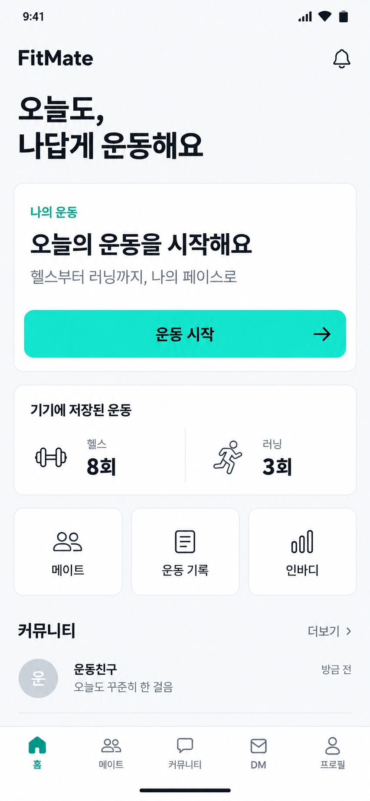
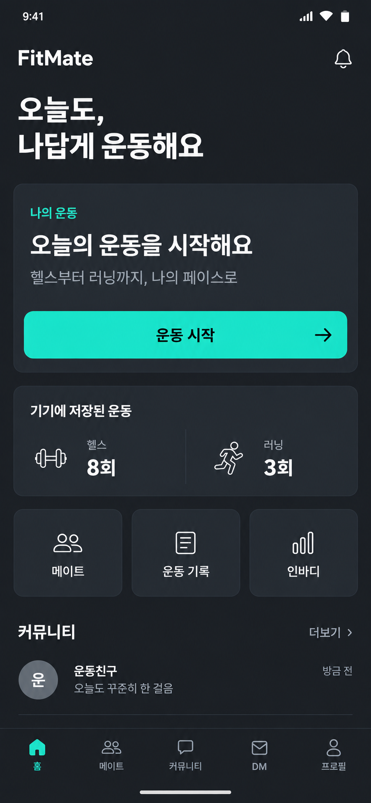
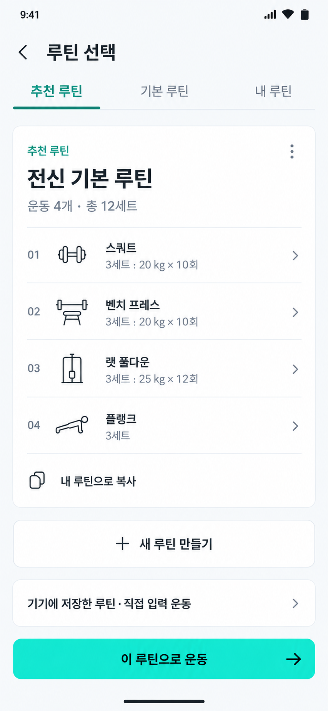
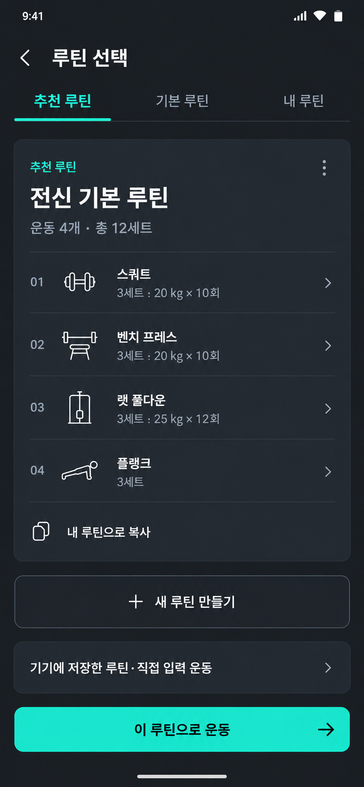
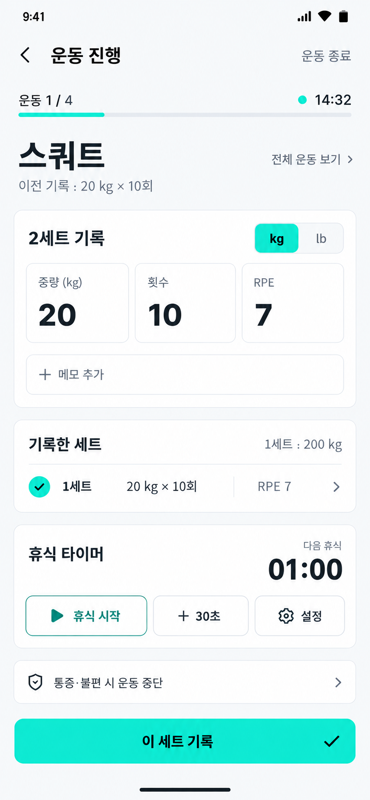
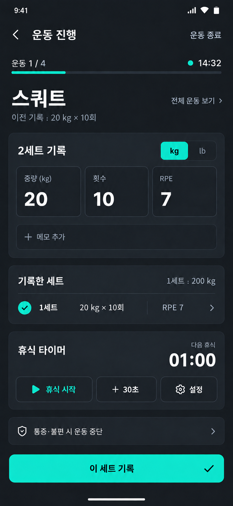

# 검토 중 — FitMate UI 1차 시안

- 작성일: 2026-09-10
- 최종 수정일: 2026-09-10
- 버전: v1.2
- 상태: 검토 중
- 목적: 홈·루틴 선택·운동 진행의 정보 배치와 라이트/다크 스타일 검토
- 기준: [UI 개편 계획](./검토중-ui-개편-계획.md)
- 제작: built-in `image_gen`, [전체 생성·수정 프롬프트](../assets/ui-redesign/prompts-v1.json)

실제 플랜핏 Android 앱에서 관찰한 운동 중심 배치, 민트 강조, 명확한 입력과 목록 구조를 FitMate의 기존 기능에 맞춘 이미지 시안이다. 아래 PNG는 생성 시안이며 실제 앱 캡처는 [1차 구현·검증 기록](../03-qa/ui-1차-구현-검증.md)에 별도로 정리했다. **프로필 → 설정 → Samsung Health 내부 UI는 다른 팀원 작업 영역으로 제외**했다. 기존 데이터·API·권한 정책을 유지한다.

각 이미지를 선택하면 개별 파일로 크게 볼 수 있다. 숫자·루틴·이름은 시안용 합성 데이터다. 라이트/다크는 같은 콘텐츠와 동작을 표현한다.

## 01 홈

운동 시작을 첫 번째 행동으로 배치했다. 기기 기록 요약과 메이트·운동 기록·인바디 바로가기를 그 아래에 두고, 커뮤니티 미리보기와 기존 5개 탭을 유지한다.

| 라이트 | 다크 |
|---|---|
|  |  |

- `운동 시작`은 기존 운동 선택으로 이동한다. 진행 중 세션이 있으면 별도 상태 컷에서 `운동 이어하기`를 표시한다.
- `기기에 저장된 운동`의 헬스 8회·러닝 3회는 예시다. 서버 통계나 주간 집계로 의미를 바꾸지 않는다.
- `운동 기록`은 기존 개인 기록 진입 제안이다. 커뮤니티는 미리보기·하단 탭으로 계속 접근한다.
- 검토 초점: 운동 영역과 커뮤니티 영역의 비중, 제목 크기, 바로가기 밀도.

## 02 루틴 선택

추천·기본·내 루틴 탭을 유지하고 운동 이름을 이어 붙인 문장을 운동별 행으로 정리했다. 현재 컷은 추천 루틴 1개를 보여 주는 상태다.

| 라이트 | 다크 |
|---|---|
|  |  |

- `이 루틴으로 운동`은 기존 운동 준비 단계로 이동한다. 즉시 세션을 시작하는 의미가 아니다.
- `내 루틴으로 복사`, `새 루틴 만들기`, `기기에 저장한 루틴·직접 입력 운동`을 보존한다.
- 내 루틴의 수정·삭제, 편집의 운동 순서·추가·제거·상세·대체는 후속 상태 컷에 포함한다. 행 끝 이동 표시는 기존 상세 기능으로 연결할 수 있도록 검토하며 새로운 콘텐츠를 전제하지 않는다.
- 루틴명·운동 4개·총 12세트·목표 중량은 합성 예시다. 실제 데이터에 없는 목표 값은 표시하지 않는다.
- 운동 아이콘은 시안용 표현이다. 구현 때 프로젝트 아이콘 체계로 통일하고 플랜핏의 이미지 자산을 사용하지 않는다.
- 검토 초점: 한 화면의 운동 목록 밀도, 루틴 선택과 관리 동작의 구분.

## 03 운동 진행

현재 운동·세트 입력을 중앙에 두고 하단 `이 세트 기록`을 주 행동으로 강조했다. 휴식 시작은 보조 스타일로 수정해 세트 기록과 구분했다.

| 라이트 | 다크 |
|---|---|
|  |  |

- 현재 컷은 첫 운동에서 1세트 기록 후 2세트를 입력하는 상태다. 기록 볼륨 200 kg은 20 kg × 10회이며 다음 입력값은 아직 합산하지 않는다.
- 중량·횟수·RPE, kg/lb 전환, 메모, 전체 운동 보기, 기록 수정 진입을 유지한다.
- 기록 행에서 기존 전체 운동 화면의 수정·삭제로 접근하도록 연결한다. 삭제 정책이나 저장 시점은 변경하지 않는다.
- 휴식은 대기 상태다. 기존 휴식 시작·일시정지·재개·30초 추가·30/60/90초 설정을 유지하며 동작 중 상태는 후속 컷으로 표현한다.
- 상단 `운동 종료`는 기존 종료·저장·리포트 동작이다. 뒤로가기는 기존 상태 보관 흐름을 유지한다. 안전 안내 진입도 남겨 둔다.
- 검토 초점: 입력 필드 크기, 휴식 영역의 비중, 세트 기록 버튼 위치, 종료 버튼의 구분.

## 검토 상태와 다음 범위

6개 이미지의 주요 한글 라벨·수치·화면 잘림·테마별 구성과 명시한 동작의 진입 표시를 육안 확인했다. 운동 진행의 휴식 시작 버튼은 보조 스타일로 한 차례 보정했다. 정확한 색상 토큰·명암비·터치 영역·글자 확대·키보드 대응은 이미지로 확정하지 않고 구현 단계에서 검증한다.

후속 작업으로 홈 이어하기, 내 루틴 빈 상태·편집, 세트 수정·휴식 중·종료 저장 실패를 [추가 상태 시안](./검토중-ui-시안-추가상태.md)에 12장으로 정리했다. 입력 오류·로딩·저장 중 등 남은 상태는 구현 전 점검 목록에 유지한다. 이후 계획의 개인 운동 흐름·메이트·커뮤니티/DM·프로필/인바디·가입/일반 설정 순서로 확장한다. Samsung Health 내부 UI는 계속 제외한다.

홈·루틴 선택·운동 진행의 Android 적용과 USB 설치를 완료했다. 화면별 변경, 단위 테스트 58개·실기기 UI 테스트 8개, 실제 서버 연결 미검증 범위는 [구현·검증 기록](../03-qa/ui-1차-구현-검증.md)을 기준으로 확인한다. 나머지 화면 전체의 구현 완료를 뜻하지 않는다.
