# 검토 중 — FitMate UI 2차 시안: 개인 운동

- 작성일: 2026-09-10
- 최종 수정일: 2026-09-10
- 버전: v1.2
- 상태: 검토 중
- 목적: 운동 선택부터 러닝·완료·이력까지 기존 기능을 유지하는 화면 구성 검토
- 기준: [UI 개편 계획](./검토중-ui-개편-계획.md), [1차 기본 화면](./검토중-ui-시안-1차.md), [추가 상태](./검토중-ui-시안-추가상태.md)
- 제작: built-in `image_gen`, [전체 생성·보정 프롬프트](../assets/ui-redesign/prompts-personal-v1.json)

**주요 화면 6개에서 완료 리포트를 헬스/러닝으로 나눈 7개 화면 × 라이트·다크 = PNG 14장**이다. 실제 플랜핏 Android 앱에서 참고한 정보 위계와 앞선 시안의 공통 스타일을 이어 간다. 기존 기능·데이터·API·권한 정책을 유지하며, 프로필 → 설정 → Samsung Health 내부 UI는 제외한다.

앱 구현 화면이 아닌 검토용 이미지다. 숫자·날짜·운동명·기록은 합성 예시이며 화면별로 독립적인 상태를 보여 준다. 이미지를 선택하면 원본을 크게 볼 수 있다. 생성 이미지 간 해상도·세부 간격 차이는 실제 기기 레이아웃 규격을 뜻하지 않는다.

## 04 운동 선택

헬스와 러닝을 두 개의 큰 선택 영역으로 정리하고 각 선택 다음에 어떤 단계가 나오는지 표시했다.

| 라이트 | 다크 |
|---|---|
| [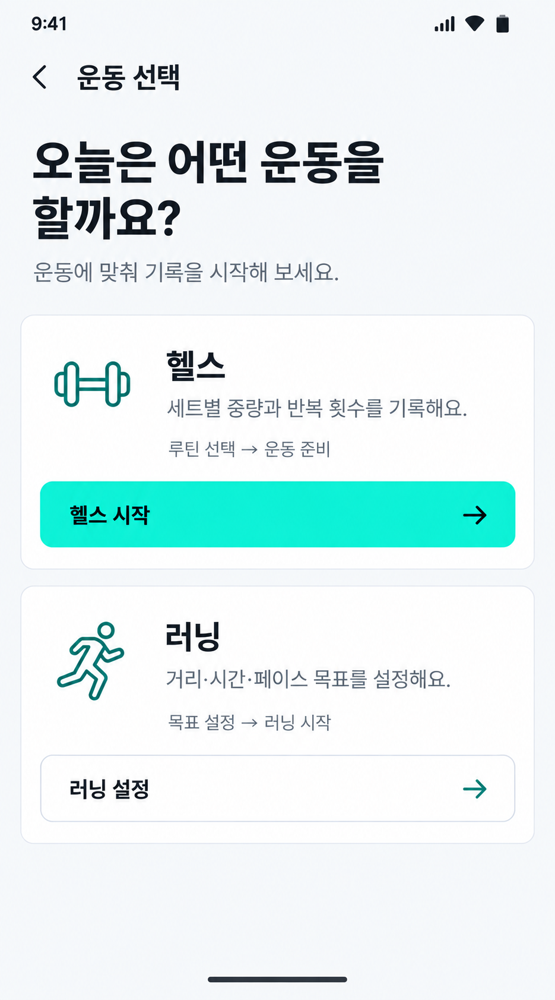](../assets/ui-redesign/04-workout-select-light-v1.png) | [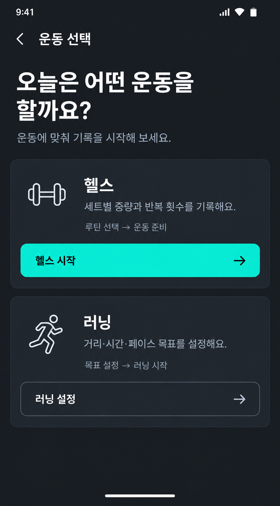](../assets/ui-redesign/04-workout-select-dark-v1.png) |

- `헬스 시작` → 기존 루틴 선택 → 운동 준비로 이동한다. 선택 버튼을 눌렀다고 즉시 운동 세션을 만들지 않는다.
- `러닝 설정` → 기존 러닝 설정으로 이동한다. 기존 종목 두 개를 유지한다.
- 하위 화면이므로 홈의 5개 탭을 붙이지 않는다.

## 05 운동 준비

선택한 루틴의 운동 순서를 먼저 확인하고 하단에서 시작하는 구조다. 예시는 운동 4개인 전신 기본 루틴이다.

| 라이트 | 다크 |
|---|---|
| [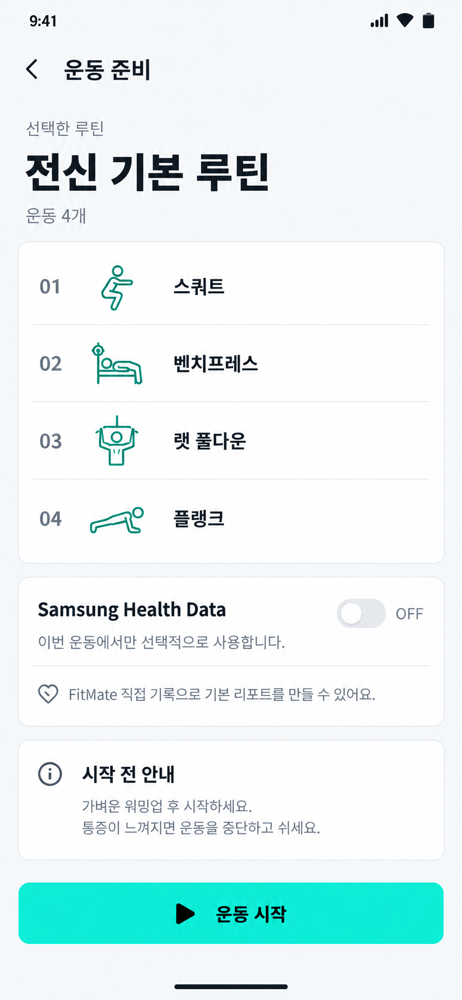](../assets/ui-redesign/05-workout-prep-light-v1.png) | [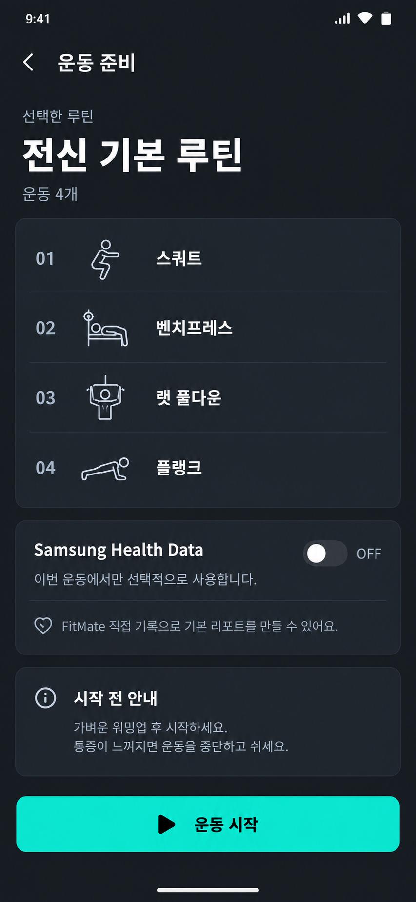](../assets/ui-redesign/05-workout-prep-dark-v1.png) |

- 루틴 설명과 운동 이름을 기존 선택 데이터에서 표시한다. 시작 전 응답에 없는 중량·세트 목표·소요 시간을 생성하지 않는다.
- `운동 시작`에서 기존 서버 세션 생성 또는 로컬 세션 생성 경로를 따른다. 요청 중 중복 실행 방지와 실패 시 준비 화면 유지도 보존한다.
- 화면에 남긴 `Samsung Health Data`는 기존 운동 준비의 선택 항목이다. 이번 운동 사용 여부만 전달하며 프로필 → 설정 → Samsung Health 내부 화면은 개편하지 않는다.
- 루틴 설명이 추가로 제공되면 목록과 함께 표시한다. 시안에 없는 설명을 구현에서 삭제하지 않는다.

## 06 러닝 설정

거리 목표가 선택된 기본 상태다. 목표 종류·입력·기록 설정·시작 순서로 묶었다.

| 라이트 | 다크 |
|---|---|
| [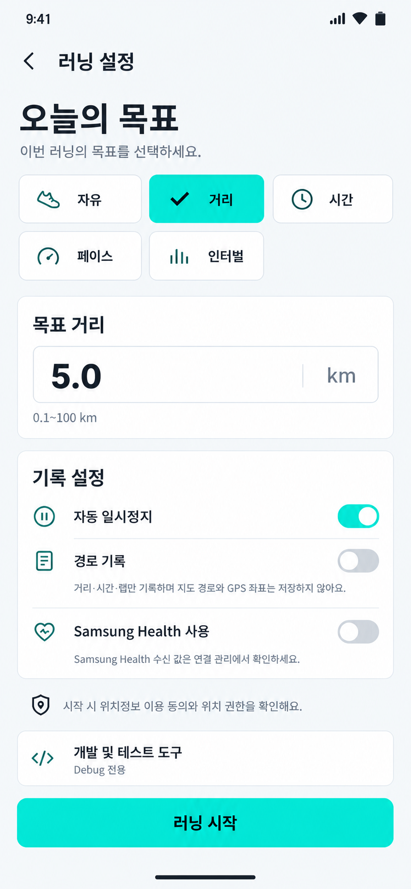](../assets/ui-redesign/06-running-setup-light-v1.png) | [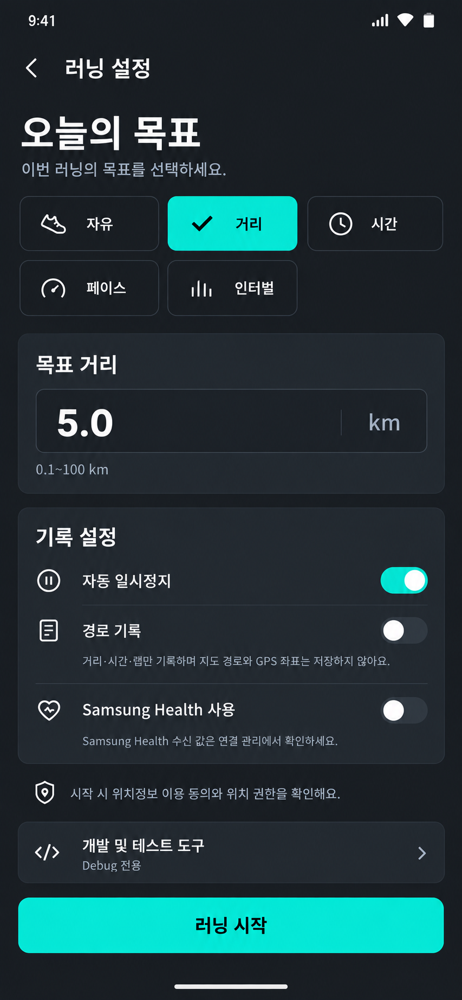](../assets/ui-redesign/06-running-setup-dark-v1.png) |

- 자유·거리·시간·페이스·인터벌 선택을 모두 유지한다. 거리 0.1~100 km, 시간·페이스·인터벌의 기존 선택값과 검증을 바꾸지 않는다.
- 자동 일시정지·경로 기록·Samsung Health 사용 설정과 경로 기록 선택 시 공개 범위 선택을 보존한다. 시안은 경로 기록 OFF 상태다.
- 기존 `경로 기록` 명칭을 유지하되 현재 지도 경로·GPS 좌표를 저장하지 않는다는 설명을 상시 표시하는 제안이다. 기능이 구현된 것으로 보이게 지도 이미지를 넣지 않았다.
- 위치정보 동의·위치 권한 요청과 Android 버전에 따른 알림 권한 처리를 기존 시작 흐름대로 유지한다.
- Debug 개발·테스트 도구는 접어 두는 표현 제안이다. 펼치면 기존 예시 GPS 조작에 접근할 수 있어야 하며 Release에는 표시하지 않는다. 자동 일시정지의 실제 GPS/예시 GPS 적용 조건도 기존 로직을 따른다.

## 07 러닝 진행

실제 GPS가 정상인 예시다. 시간·거리·현재/평균 페이스·목표 진행·랩 순서로 읽도록 구성했다.

| 라이트 | 다크 |
|---|---|
| [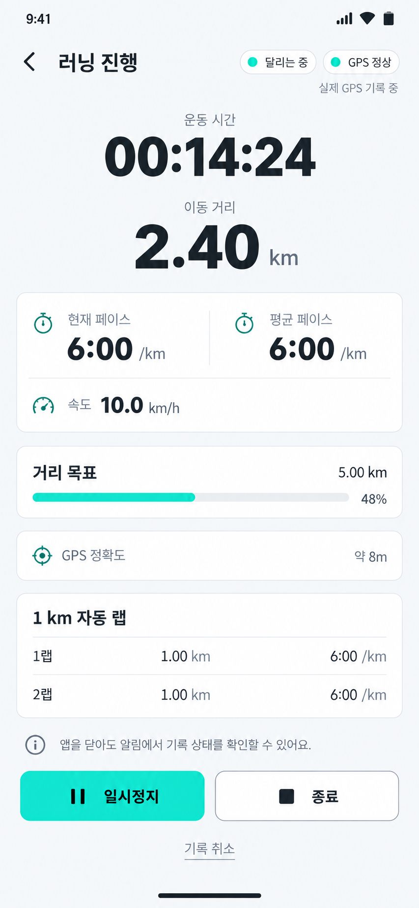](../assets/ui-redesign/07-running-active-light-v1.png) | [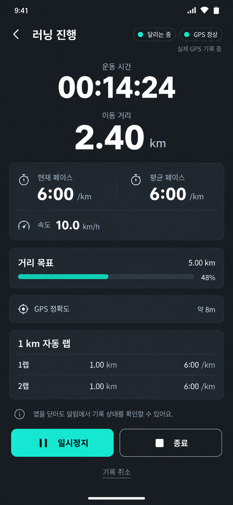](../assets/ui-redesign/07-running-active-dark-v1.png) |

- 14분 24초에 2.40 km를 달린 예시이므로 평균 페이스는 6:00/km, 5 km 목표의 진행률은 48%다. 현재 페이스·속도·정확도는 별도 합성 수신 예시다.
- `일시정지`는 기존 추적 서비스 또는 예시 상태의 pause를 호출하고 이후 `재개`로 바뀐다. `종료`는 기존 기록 측정을 중지하고 저장 전 러닝 리포트로 이동한다.
- `기록 취소`와 뒤로가기의 기존 이탈 확인·기록 폐기 동작을 유지한다. 헬스의 잠시 나가기/이어하기와 혼동하지 않는다.
- GPS 확인 중·끊김·권한 없음, 자동/수동 일시정지, 랩 없음, 인터벌 구간은 실제 상태에 맞게 표시한다. 수신값이 없으면 대시·안내를 유지하고 임의 수치를 채우지 않는다.
- Samsung Health 사용 시 기존 심박 수신 대기 표시와 Debug 예시 GPS 테스트 조작도 해당 조건에서 유지한다.

## 08a 헬스 완료 리포트

서버 세션의 완료 처리와 리포트 조회가 성공한 상태다. 요약 → 운동별 정보 → 세트 기록 순서로 정리했다.

| 라이트 | 다크 |
|---|---|
| [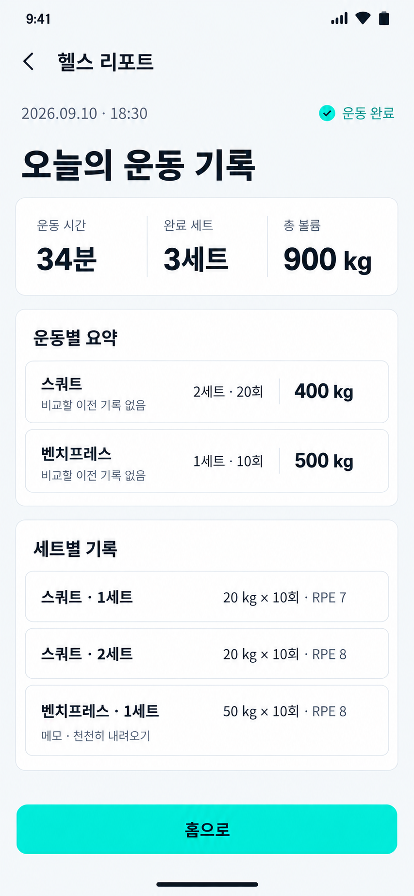](../assets/ui-redesign/08-health-report-light-v1.png) | [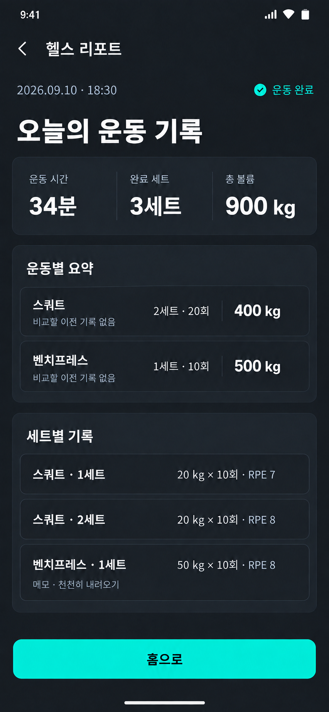](../assets/ui-redesign/08-health-report-dark-v1.png) |

- 실제 `ServerRecordDetail` 경로를 기준으로 시간·완료 세트·총 볼륨·운동별 반복·이전 동일 운동 비교·세트별 RPE·메모를 보존한다.
- 예시 볼륨은 스쿼트 20 kg × 10회 × 2세트 = 400 kg, 벤치프레스 50 kg × 10회 = 500 kg, 총 900 kg이다.
- 운동·세트 행은 읽기 전용이다. 초안에 생성된 이동 화살표 5개를 제거했으며 새로운 세트 편집·상세 이동 기능을 넣지 않는다.
- `홈으로`는 기존 완료 후 이동이다. 이력에서 상세를 열 때는 기존 상세 시트와 닫기 동작을 사용하고 완료 화면 전용 홈 버튼을 그대로 강제하지 않는다.
- 로컬 완료 리포트는 별도 기존 경로다. 목표 세트·이전 로컬 운동 비교·Samsung Health 선택에 따른 내용 등 해당 경로의 기존 정보는 보존하되 이번 서버 리포트에 합치지 않는다.

## 08b 러닝 종료·저장

측정은 끝났지만 서버 저장 전인 상태다. 종료 결과와 입력할 항목을 함께 표시한다.

| 라이트 | 다크 |
|---|---|
| [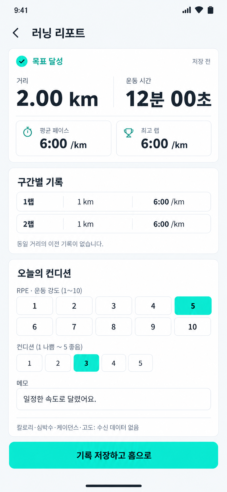](../assets/ui-redesign/08b-running-report-light-v1.png) | [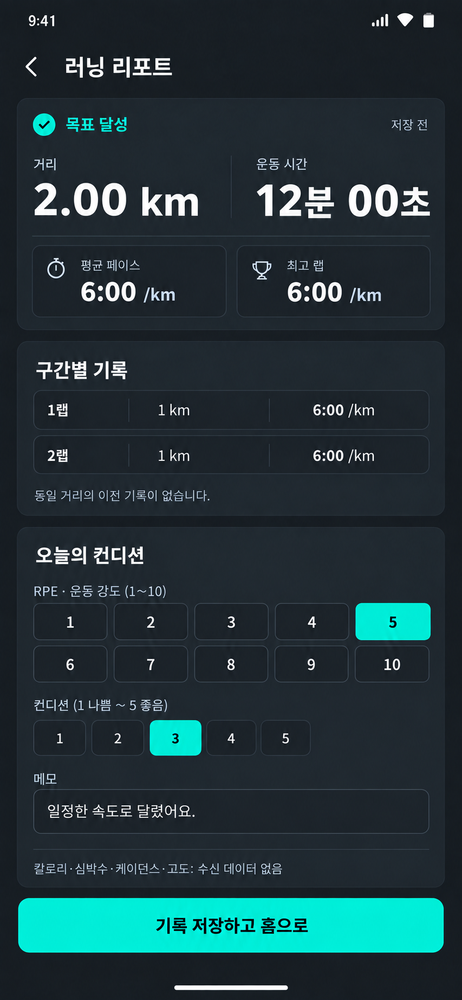](../assets/ui-redesign/08b-running-report-dark-v1.png) |

- 이 컷은 거리 목표 2 km를 12분에 완료한 독립 예시다. 앞의 5 km 설정·2.40 km 진행 컷과 한 번의 연속 운동 데이터로 해석하지 않는다.
- 평균·최고 랩 페이스, 랩 목록, 동일 거리 이전 기록 비교, RPE 1~10·컨디션 1~5·메모를 보존한다. RPE는 5개씩 두 줄로 보정했다.
- `기록 저장하고 홈으로`에서 기존 저장 요청을 수행하고 성공한 뒤 홈으로 이동한다. `목표 달성`은 목표 결과이며 저장 성공을 뜻하지 않도록 `저장 전`을 표시했다.
- 저장 중·오류·재시도와 기존 clientRecordId/pendingUpload 재사용 동작은 유지한다. 요청이 확인 중일 때 입력을 바꾸는 새 저장 정책을 도입하지 않는다.
- 마지막 미완성 랩·거리 0·목표 미달성·자유 달리기·동일 거리 비교가 있는 상태는 기존 조건을 따른다. 칼로리·심박수·케이던스·고도 수신값을 임의 생성하지 않는다.

## 09 운동 이력

헬스 탭에 완료 기록 세 개가 있고 다음 페이지가 있는 상태다. 날짜·루틴명·운동 수·세트 수를 비교하기 쉽게 배치했다.

| 라이트 | 다크 |
|---|---|
| [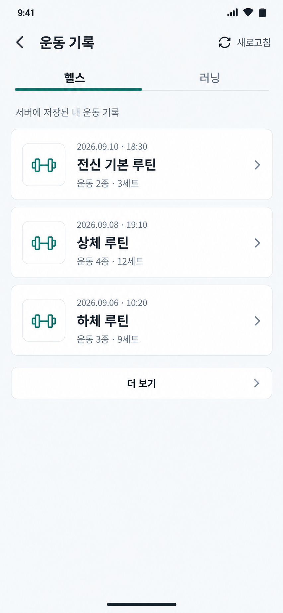](../assets/ui-redesign/09-workout-history-light-v1.png) | [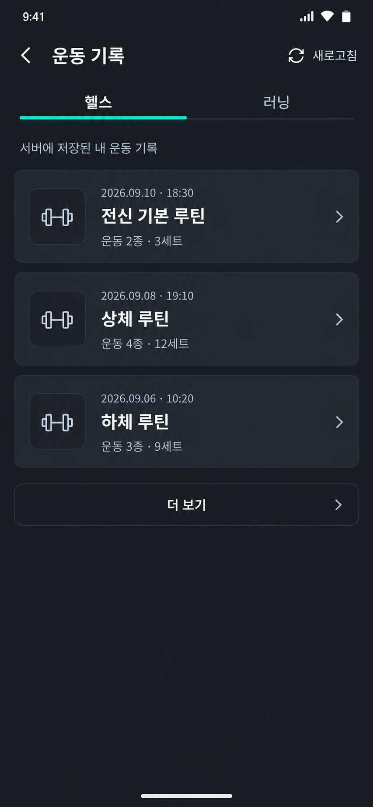](../assets/ui-redesign/09-workout-history-dark-v1.png) |

- 서버에 저장된 개인 운동 기록임을 명시하고 헬스·러닝 탭, 새로고침, 상세 조회, 다음 페이지 더 보기를 유지한다.
- 홈의 기기 기록 요약과 이 서버 목록은 다른 출처다. 두 목록을 합치거나 집계 기준을 통일하지 않는다.
- 헬스는 완료 세션과 HEALTH 종목 필터를 유지한다. 러닝 탭에서는 기존 거리·운동 시간·평균 페이스를 표시한다.
- `더 보기`는 다음 페이지가 있을 때만 표시하고 기존 로딩·오류·빈 목록·재시도 조건과 중복 제거를 따른다.
- 목록에서 항목을 선택하면 기존 상세 시트를 연다. 새 월별 캘린더·검색·통계 기능은 추가하지 않는다. 독립 헤더는 기존 기록 화면 접근을 정리하는 UX 제안이며 프로필의 기존 진입도 보존한다.

## 검토와 남은 상태

2차 기본 화면 7개를 Android 라이트/다크 UI에 적용했다. 운동 준비 순서 목록, 러닝 하단 고정 일시정지/종료, 저장 전 리포트, 서버 이력을 포함한다. [2차 구현·검증](../03-qa/ui-2차-개인운동-구현-검증.md)에 단위 테스트 58개·실기기 UI 회귀 12개·실제 서버 연동 4개 결과와 캡처를 정리했다. 아래 제작 시점 기록은 시안 검토 이력이며 현재 구현 상태를 뜻하지 않는다. 실외 GPS·권한 거부·TalkBack 등 남은 검증은 구현 검증 문서의 한계를 따른다.

코드에서 `SoloScreen`, `WorkoutPrepScreen`, 시작·완료 라우팅, `RunningFlow`, `ServerRecordList`, `ServerRecordDetail`의 현재 동작을 대조했다. PNG 14장의 선택 상태·주요 라벨·예시 계산·화면 잘림을 육안 검토했다. 헬스 리포트 이동 화살표 제거와 러닝 RPE 두 줄 배치를 보정했다. 새 PNG 14장 읽기·프롬프트 JSON의 화면 7개·관련 문서의 로컬 링크 82개 검증을 통과했다. 운동 선택은 935×1683, 나머지는 853×1844이며 각 화면의 라이트/다크 해상도는 같다. Android 코드·설정·설치 앱은 변경하지 않았으므로 이번 작업에서 Android 빌드·테스트를 재실행하지 않았다.

남은 파생 상태는 러닝 목표별 입력, 위치 동의·권한 거부, GPS 수신 불량, 일시정지·취소 확인, 저장 중·실패, 기록 목록 로딩·빈 상태·오류, 러닝 기록 상세, 로컬 헬스 완료 리포트다. 이번 기본 시안으로 이 상태들의 검토 완료를 대신하지 않는다. 실제 명암비·48dp 터치 영역·작은 화면·글자 확대·키보드·스크롤은 구현 단계에서 검증한다.

후속 메이트 묶음은 [3차 시안](./검토중-ui-시안-3차-메이트.md)에 목록·필터·상세·작성·신청 관리·문의 목록/대화 16장으로 정리했다. 시안 검토 후 구현한다는 진행 순서와 Samsung Health 내부 화면 제외 범위는 유지한다.
