# 검토 중 — FitMate UI 3차 시안: 메이트

- 작성일: 2026-09-10
- 최종 수정일: 2026-09-10
- 버전: v1.2
- 상태: 검토 중
- 목적: 모집 탐색·작성·신청 관리·문의의 기존 기능을 유지하는 UI/UX 검토
- 기준: [UI 개편 계획](./검토중-ui-개편-계획.md), [2차 개인 운동 시안](./검토중-ui-시안-2차-개인운동.md)
- 제작: built-in `image_gen`, [전체 생성·수정 프롬프트](../assets/ui-redesign/prompts-mate-v1.json)

**주요 화면 6개에 필터와 작성 폼 아래쪽을 포함한 8개 컷 × 라이트·다크 = PNG 16장**이다. 앞선 시안의 민트·중립 배경·명확한 주 행동 스타일을 유지한다. 메이트는 FitMate의 기존 기능이며 플랜핏에 없는 기능을 새로 복제한 것이 아니다.

아래 이미지는 기존 데이터·API·권한·상태 전이를 유지하는 검토용 시안이다. 생성 당시 실제 앱이나 서버에 작성한 결과가 아니며 닉네임·날짜·장소·대화·수치는 합성 예시다. 이후 Android 적용과 실기기 검증을 진행했으며 결과·실제 캡처는 [3차 구현·검증](../03-qa/ui-3차-메이트-구현-검증.md)에 구분했다. **프로필 → 설정 → Samsung Health 내부 UI는 계속 제외한다.** 이미지를 선택하면 원본을 크게 볼 수 있다.

## 10 메이트 모집 목록

종목·일정·지역·수준·비용·인원을 카드에서 비교하고 문의함과 모임 만들기에 바로 접근하도록 정리했다.

| 라이트 | 다크 |
|---|---|
| [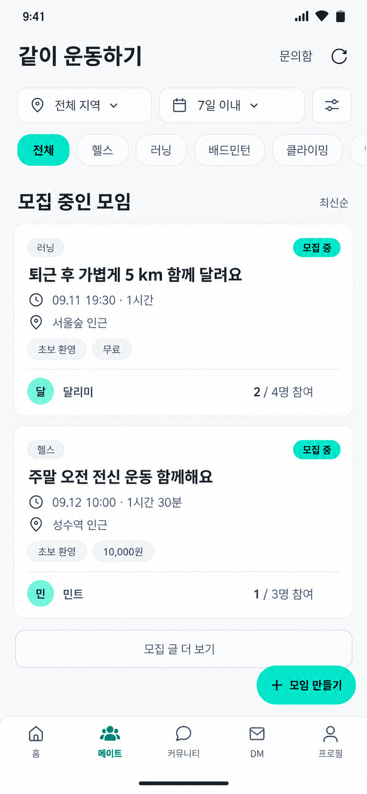](../assets/ui-redesign/10-mate-list-light-v1.png) | [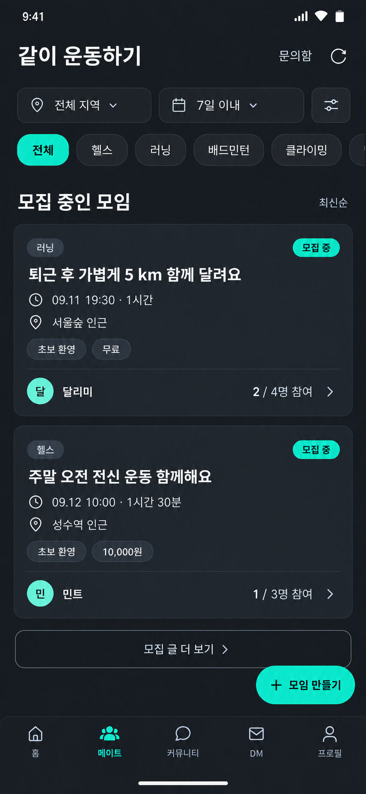](../assets/ui-redesign/10-mate-list-dark-v1.png) |

- 기존 지역·날짜 필터 진입, 전체/종목 탭, 새로고침, 최신순 표시, 다음 페이지를 유지한다. 종목 탭은 가로 스크롤로 헬스·러닝·배드민턴·클라이밍·등산·골프에 접근한다.
- `최신순`은 현재 표시이며 새 정렬 선택 기능을 뜻하지 않는다. `모집 글 더 보기`는 nextCursor가 있을 때만 표시한다.
- 모임 카드는 기존 상세로 이동한다. 프로필·별점·즐겨찾기·결제 기능을 추가하지 않는다.
- 홈/메이트/커뮤니티/DM/프로필 하단 탭은 이 목록에만 표시하며 메이트를 선택 상태로 둔다.

## 10a 모집 필터

현재 제공되는 조건을 섹션별로 묶은 파생 화면이다.

| 라이트 | 다크 |
|---|---|
| [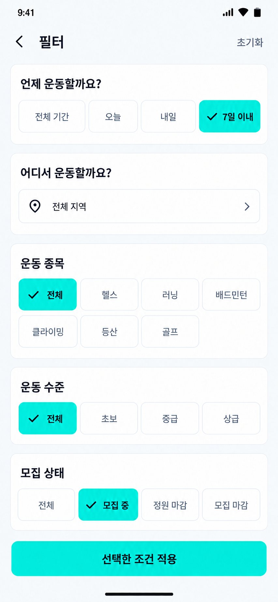](../assets/ui-redesign/10a-mate-filter-light-v1.png) | [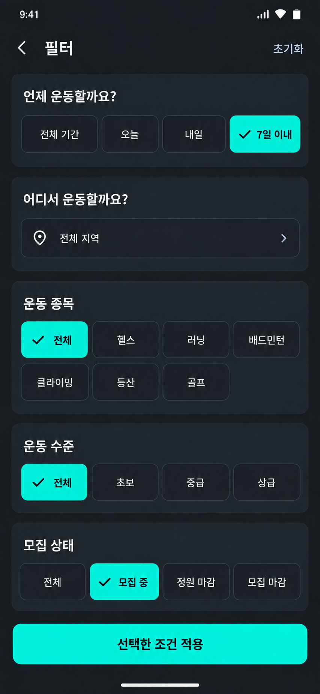](../assets/ui-redesign/10a-mate-filter-dark-v1.png) |

- 날짜는 전체 기간/오늘/내일/7일 이내, 종목은 전체와 기존 6종, 수준은 전체/초보/중급/상급, 모집 상태는 전체/모집 중/정원 마감/모집 마감을 유지한다.
- 지역 선택은 기존 서버 지역 선택기를 사용한다. 반경·지도·자동 위치 조회를 추가하지 않는다.
- `초기화`는 기존 MateFilters(status = 전체) 동작을 따른다. 앱 최초 목록의 모집 중 기본값과 구분한다.
- 편집한 필터는 `선택한 조건 적용`에서 목록에 적용하고 뒤로가기로 나가면 기존 선택을 유지한다.

## 11 모임 상세 — 미신청 사용자

참여 조건과 장소 공개 수준을 확인한 뒤 문의하거나 신청하는 화면이다.

| 라이트 | 다크 |
|---|---|
| [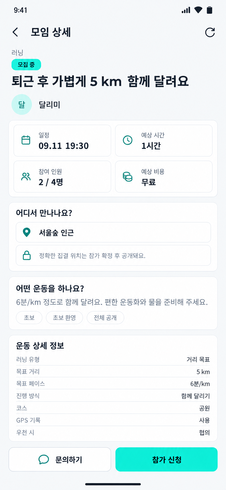](../assets/ui-redesign/11-mate-detail-light-v1.png) | [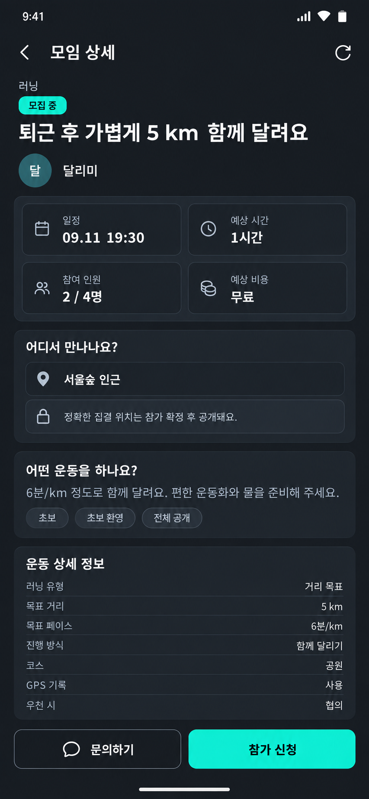](../assets/ui-redesign/11-mate-detail-dark-v1.png) |

- 일정·예상 시간·참여 인원·예상 비용·공개 장소·운동 내용·수준·초보 환영·공개 범위·종목별 조건을 유지한다.
- 정확한 집결 위치는 서버가 제공한 접근 가능 데이터에 따라 표시한다. 시안은 미신청 상태이므로 집결 위치를 숨겼다. 참가 확정 여부를 UI만으로 판단해 권한을 넓히지 않는다.
- 문의는 기존 myInquiryRoomId 또는 OPEN_INQUIRY_ROOM 조건을 따른다. 신청은 allowedActions에 APPLY가 있고 요청 중이 아닐 때만 활성화한다.
- 신청 대기/참가 확정이면 기존 내 상태와 참가 취소를 표시하고 취소 확인을 유지한다. 정원·모집 마감·거절·취소·접근 제한 상태를 신청 가능으로 꾸미지 않는다.

## 12a 모집 작성 — 기본 조건

하나의 긴 작성 폼을 위·아래 두 컷으로 나눠 보여 준다. 이 컷은 기본 정보와 모집 조건이 있는 위쪽이다.

| 라이트 | 다크 |
|---|---|
| [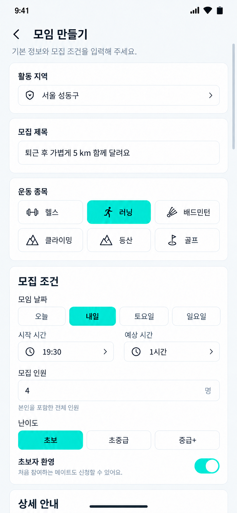](../assets/ui-redesign/12-mate-write-light-v1.png) | [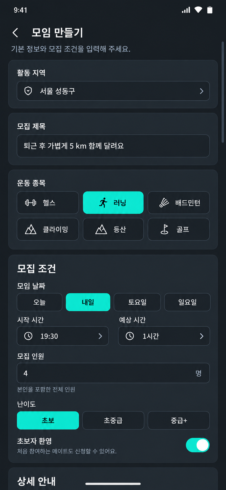](../assets/ui-redesign/12-mate-write-dark-v1.png) |

- 기존 서버 지역·활성 종목, 제목, 날짜, 시작 시간, 예상 시간, 본인 포함 인원, 난이도와 초보 환영 설정을 유지한다.
- 날짜 선택과 시간 선택기는 기존 오늘/내일/토요일/일요일 및 편집 시 원래 날짜, 기존 시간 선택 동작을 따른다. 새 달력 기능을 추가하지 않는다.
- 아래로 스크롤하면 다음 컷의 안내·장소·상세 조건과 모집 게시 버튼이 나온다. 새 단계/다음 버튼/임시 저장을 도입하지 않는다.
- 인원 2~100명, 예상 시간 1분 이상, 필수값과 활성 종목 검증은 기존 코드대로 적용한다.

## 12b 모집 작성 — 장소·공개 범위·상세 조건

동일한 작성 폼의 아래쪽이다. 러닝을 선택한 예시이며 별도 페이지나 작성 단계가 아니다.

| 라이트 | 다크 |
|---|---|
| [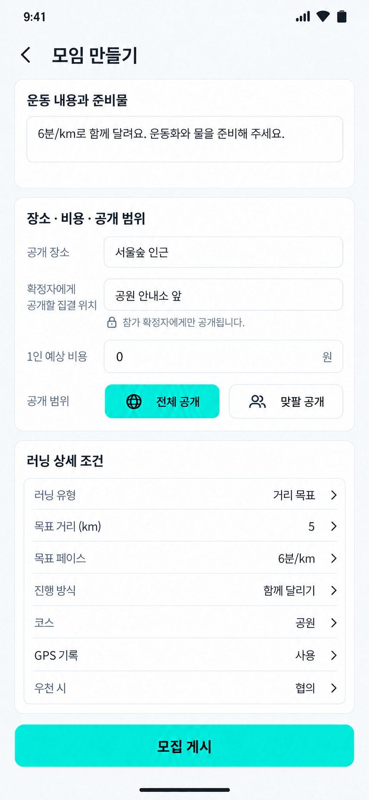](../assets/ui-redesign/12b-mate-write-details-light-v1.png) | [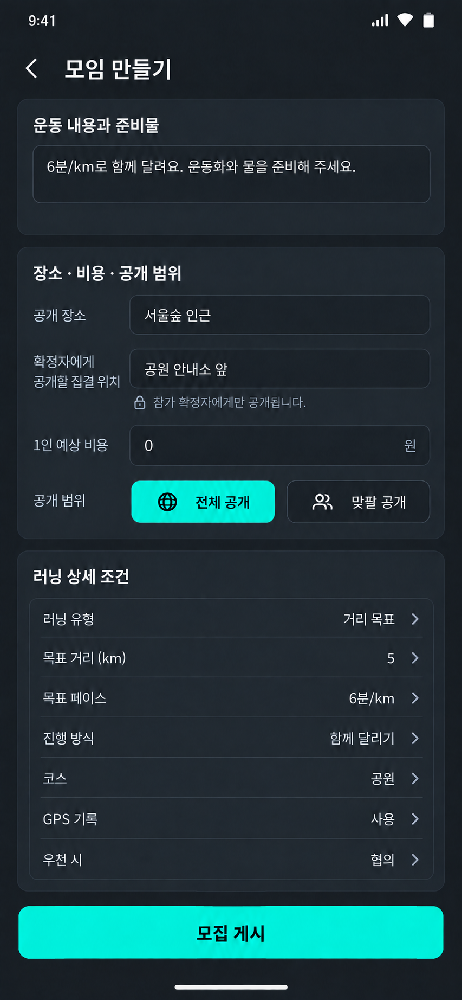](../assets/ui-redesign/12b-mate-write-details-dark-v1.png) |

- 안내문, 공개 장소, 확정자 집결 위치, 1인 예상 비용, 전체/맞팔 공개, 러닝의 7개 상세 조건을 모두 보존한다. 집결 위치는 작성자 입력값이므로 이 폼에는 보인다.
- 반복되는 선택값은 간결한 선택 행으로 표현하는 UX 제안이다. 펼치면 기존 선택지 전체에 접근해야 하며 값·기본값·필수 여부를 바꾸지 않는다.
- 비용은 기존 0~10,000,000원 검증을 따른다. 참가비 결제나 정산 처리를 추가하지 않는다.
- `모집 게시`는 기존 create와 중복 요청 키 처리를 사용하고 성공 시 상세로 이동한다. 실패 시 입력과 기존 재시도 정책을 유지한다.
- 수정은 같은 폼에 원래 값을 채우고 `수정 저장`을 사용한다. 신청 이력이 있으면 현재 제한대로 제목·안내·인원만 수정 가능하며 다른 조건은 유지한다. 별도 수정 상태 이미지는 아직 제작하지 않았다.

## 13 모집자 — 참가 신청 관리

기존 모임 상세 안의 작성자 전용 관리 영역을 보여 주는 컷이다. 상세 정보 영역은 위쪽 스크롤에 유지한다.

| 라이트 | 다크 |
|---|---|
| [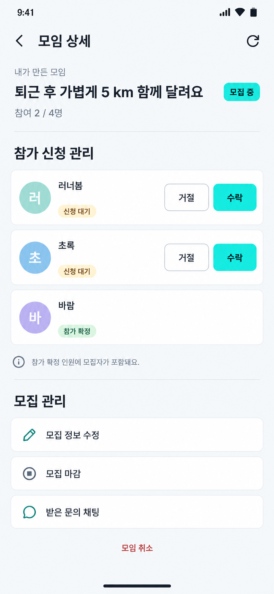](../assets/ui-redesign/13-mate-manage-light-v1.png) | [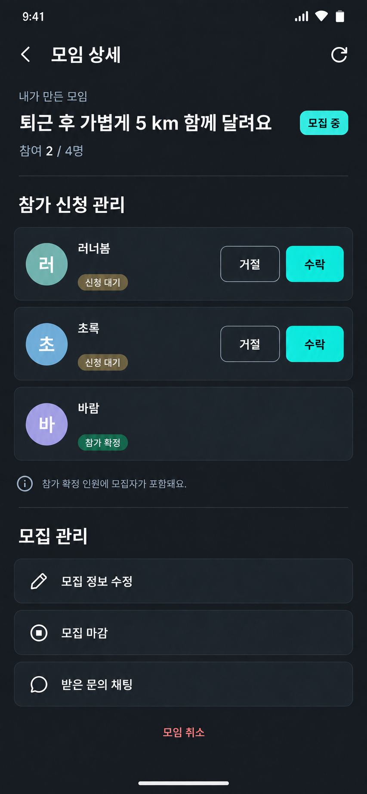](../assets/ui-redesign/13-mate-manage-dark-v1.png) |

- 신청 대기인 두 명과 참가 확정 한 명은 합성 예시다. 모집자를 포함한 참여 인원은 2/4명으로 표현했다.
- 수락·거절은 신청 상태 PENDING이며 모임 상태 RECRUITING일 때만 표시하고 요청 중 비활성화한다. 참가 확정 행에는 두 버튼을 표시하지 않는다.
- 기존 신청 버전과 서버 상태 검증을 유지하고 요청 후 상세/신청 목록을 다시 조회한다. 일괄 수락·강퇴·평가를 추가하지 않는다.
- 모집 정보 수정·모집 마감은 RECRUITING/FULL에서, 모임 취소는 CANCELED가 아닐 때 표시하는 기존 조건을 유지한다. 마감·취소 확인도 보존한다.
- `받은 문의 채팅`은 기존 문의 목록으로 이동한다. 이 모임의 문의만 자동 필터링하는 새 기능으로 해석하지 않는다. 모집자는 참가 신청 버튼을 갖지 않는다.

## 14 메이트 문의 목록

상대 닉네임·최근 메시지·읽지 않은 개수를 우선하는 기존 문의함이다.

| 라이트 | 다크 |
|---|---|
| [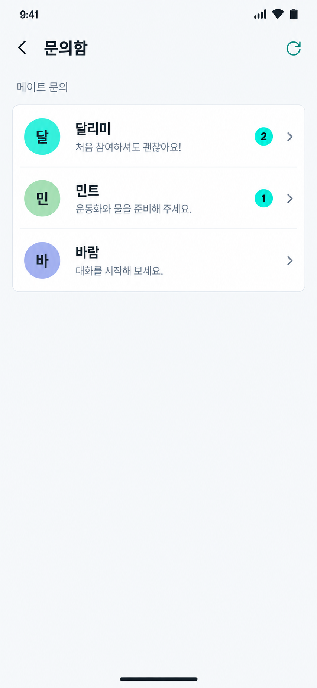](../assets/ui-redesign/14-mate-inbox-light-v1.png) | [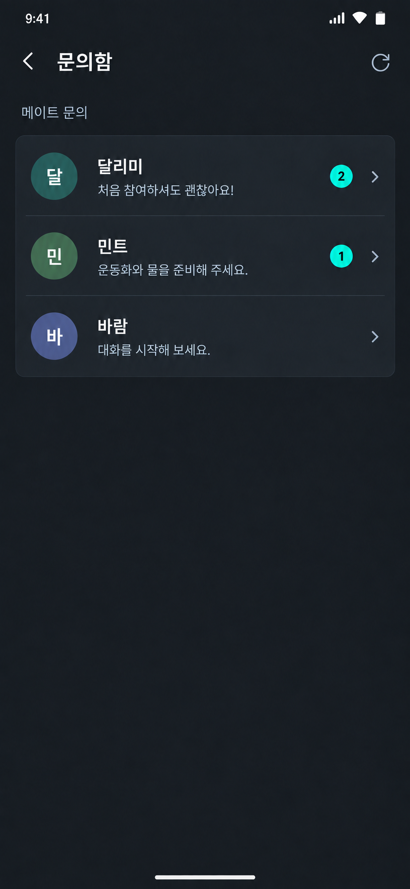](../assets/ui-redesign/14-mate-inbox-dark-v1.png) |

- 문의방의 author/inquirer 중 현재 사용자 반대쪽 닉네임을 표시한다. 실사용자 사진·활동 상태를 만들어 넣지 않는다.
- 읽지 않은 개수는 기존 unreadCount에서 가져오고 0이면 배지를 생략하는 표현 제안이다. 최근 메시지가 없으면 기존 대화 시작 안내를 표시한다.
- 행 선택은 기존 문의방으로 이동한다. 새로운 대화 생성·검색·읽지 않음 필터·삭제·DM 통합을 추가하지 않는다.
- 빈 목록·로딩·오류·새로고침은 기존 조건을 유지한다.

## 15 메이트 문의 대화

기존 텍스트 메시지·읽음 상태와 입력/전송을 정리한 화면이다. 시안은 writable인 문의방이다.

| 라이트 | 다크 |
|---|---|
| [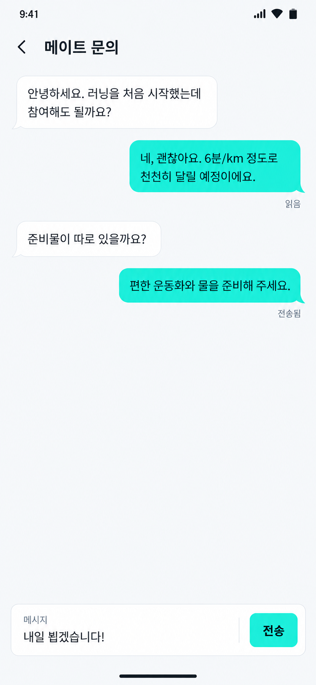](../assets/ui-redesign/15-mate-chat-light-v1.png) | [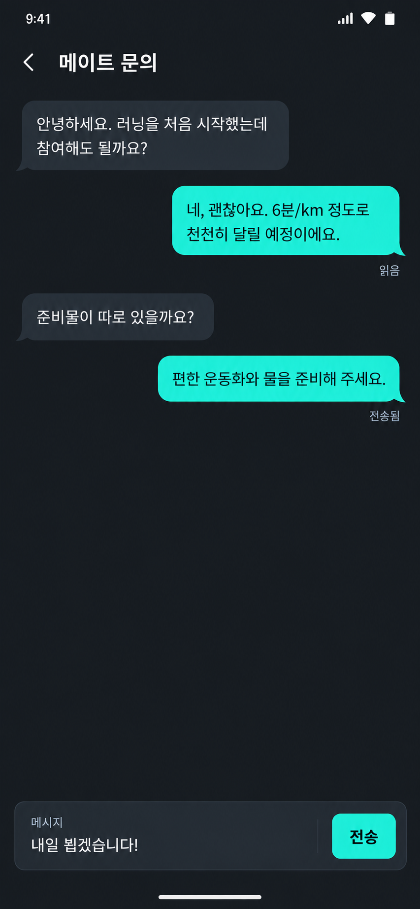](../assets/ui-redesign/15-mate-chat-dark-v1.png) |

- 내 메시지와 상대 메시지를 좌우로 구분하고 기존 sequence와 상대 읽음 상태에 따라 읽음/전송됨을 표시한다. 상대 접속·입력 중·시간 정보를 임의 추가하지 않는다.
- 기존 메시지 최대 2,000자, 공백·전송 중 비활성, 전송 실패 시 같은 요청 키로 재전송, 성공 후 입력 초기화 동작을 유지한다.
- 입력부를 아래에 두는 배치 제안이며 작은 화면·키보드·대화 스크롤 가림을 구현에서 확인한다.
- writable=false이면 종료된 모임·신청·접근 제한 안내와 읽기 전용 상태를 표시하고 입력/전송을 막는다. 서버 오류의 다시 연결도 유지한다.
- 기존 문의방의 텍스트 대화에 사진·첨부·전화·음성·위치 공유를 추가하지 않는다. 이번 작업에서 실제 메시지를 전송하지 않았다.

## 시안 제작 당시 확인 범위와 후속 상태

실제 라우팅의 `ServerMateFlow`, 목록·상세·필터를 구성하는 `MateDesign.kt`, `MateWriteScreen`, `MateDetailsEditor`, `mateFields`, 서버 모델 변환·요청 필드를 대조했다. `MateFeatures.kt`에 남은 별도 로컬 데모의 모집 재개·평가·테스트 신청 같은 동작을 현재 서버 화면 기능으로 가져오지 않았다.

16장의 주요 한국어 라벨·선택 상태·기능 접근·공개 범위를 육안 검토했다. 날짜 선택, 추가로 생성된 글자 수·신청일·문의함 하단 탭을 보정하고 라이트 선택 행의 화살표를 복원했다. 새 PNG 16장은 모두 853×1844로 읽기 검증을 통과했고, 프롬프트 JSON 8개 화면과 관련 문서의 로컬 링크 119개를 확인했다. 전체 시안 PNG는 48장이다. 실제 대비·터치 영역·긴 제목·글자 확대·키보드·스크롤·서버 권한별 동작은 구현 시 검증한다. 이미지·문서만 변경했으며 Android 빌드·테스트·USB 재설치는 수행하지 않았다.

별도 이미지가 남은 상태는 빈 목록·로딩·네트워크 오류, 신청 대기/참가 확정/거절, 정원·모집 마감·취소, 신청 이후 수정 제한, 헬스 및 다른 종목 작성 조건, 입력 오류·저장 중, 문의 읽기 전용·전송 실패·재연결이다. 이 상태들을 기본 컷으로 검증 완료 처리하지 않는다.

[4차 커뮤니티·DM 시안](./검토중-ui-시안-4차-커뮤니티-dm.md)에 피드·댓글 시트·작성/수정·DM 목록·대화/받은 요청 7개 컷, 라이트·다크 PNG 14장을 추가했다. 시안 검토 후 구현하는 순서를 유지한다.

## Android 적용 상태

메이트 목록·필터·상세·작성/수정·신청 관리·문의함·대화에 두 테마를 적용하고 일반 USB 기기 앱을 업데이트했다. 단위 테스트 58개, 메이트 UI 검사 8개, 실제 서버 작성·수정 검사 2개가 최종 통과했다. 실제 캡처 19장과 미검증 범위는 [3차 구현·검증](../03-qa/ui-3차-메이트-구현-검증.md)을 기준으로 한다. 위 시안 제작 당시의 미구현 기록과 구분한다.
