# 검토 중 — FitMate UI 4차 시안: 커뮤니티·DM

- 작성일: 2026-09-10
- 최종 수정일: 2026-09-11
- 버전: v1.2
- 상태: 검토 중
- 목적: 커뮤니티·댓글·게시물 작성/수정·DM 대화/요청의 UI 검토
- 기준: [UI 개편 계획](./검토중-ui-개편-계획.md), [3차 메이트 시안](./검토중-ui-시안-3차-메이트.md)
- 제작: built-in `image_gen`, [전체 생성·보정 프롬프트](../assets/ui-redesign/prompts-social-v1.json)

**주요 화면 5개에서 작성/수정과 DM 대화/받은 요청을 구분한 7개 컷 × 라이트·다크 = PNG 14장**이다. 플랜핏 Android 앱에서 참고한 정보 위계와 앞선 FitMate 시안의 공통 스타일을 이어 간다. 기존 기능·데이터·API·권한 정책을 유지하며 프로필 → 설정 → Samsung Health 내부 UI는 제외한다.

검토용 이미지이며 실제 앱·게시물·메시지를 변경한 결과가 아니다. 이름·글·대화·사진·수치는 모두 시안용 합성 자료다. 이미지를 선택하면 원본을 크게 볼 수 있다.

## 16 커뮤니티 피드

2026-09-11 이 묶음의 Android UI 적용과 USB 검증을 진행했다. [4차 구현·검증 기록](../03-qa/ui-4차-커뮤니티-dm-구현-검증.md)에 실제 캡처 14장, 단위 테스트 58개·UI 검사 8개·실제 서버 저장 검사 2개의 통과 범위와 남은 검증을 정리했다. 아래 이미지는 계속 생성 시안이며 실제 구현 캡처와 구분한다.

본문과 사진, 좋아요·댓글을 순서대로 읽는 피드다. 사진은 신발과 물병을 그린 시안용 생성 이미지이며 실제 계정 자료가 아니다.

| 라이트 | 다크 |
|---|---|
| [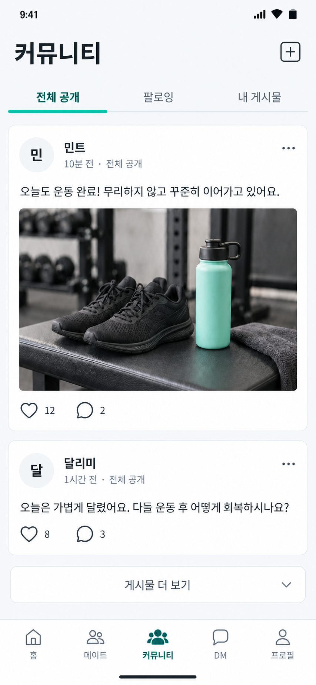](../assets/ui-redesign/16-community-feed-light-v1.png) | [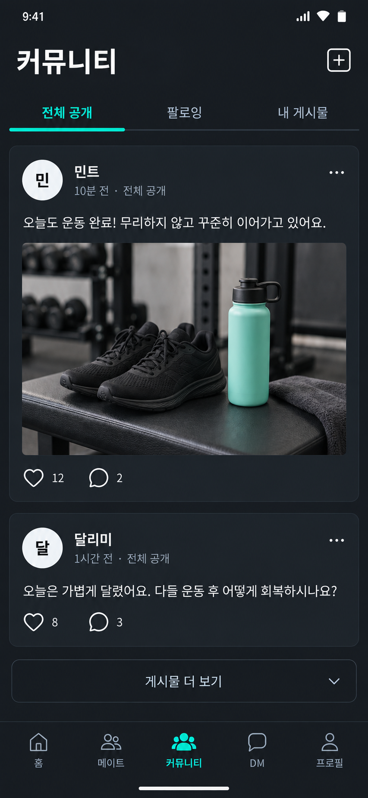](../assets/ui-redesign/16-community-feed-dark-v1.png) |

- 전체 공개/팔로잉/내 게시물 탭과 작성 진입, 작성자 프로필, 좋아요·취소, 댓글 열기, 더 보기와 기존 차단/공개 범위 필터를 유지한다.
- 팔로잉 탭과 맞팔 공개 권한은 같은 의미가 아니다. 팔로우만 했다는 이유로 맞팔 공개 글을 보여 주지 않는다.
- 내 게시물 메뉴는 수정·삭제, 타인 메뉴는 프로필·신고·팔로우/해제·차단을 보존한다. 각 동작의 서버/로컬 처리 차이를 그대로 따른다.
- 하단 탭은 기존 홈/메이트/커뮤니티/DM/프로필이며 커뮤니티가 선택 상태다. 새로운 스토리·검색·공유·저장 기능을 추가하지 않는다.

## 17 게시물과 댓글 시트

게시물 내용이 배경에 남는 기존 댓글 시트를 정돈했다. 별도 게시물 상세 API나 화면 경로를 새로 만들지 않는다.

| 라이트 | 다크 |
|---|---|
| [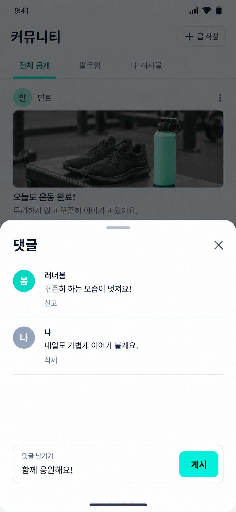](../assets/ui-redesign/17-post-comments-light-v1.png) | [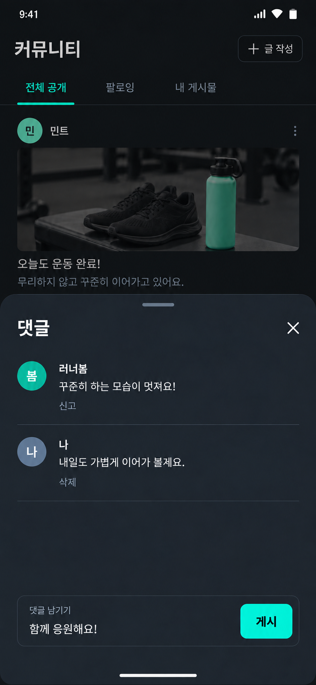](../assets/ui-redesign/17-post-comments-dark-v1.png) |

- 기존 댓글 조회·본문 표시·500자 입력·게시와 빈 댓글 안내를 유지한다. 대댓글·댓글 좋아요·정렬 기능을 추가하지 않는다.
- 내 댓글은 삭제, 다른 사람 댓글은 신고 진입을 제공한다. 내 댓글 삭제는 기존 서버 식별자가 있으면 서버 경로를 따르고 없는 경우 기존 로컬 처리를 유지한다.
- 타인 댓글 신고는 현재 로컬 임시 접수 안내다. 시안에서 서버 신고 완료로 표현하지 않는다.
- 시트를 닫으면 기존 게시물 목록으로 돌아간다. 조회 실패·게시 실패와 키보드가 열린 상태는 별도 후속 검토 항목이다.

## 18a 새 게시물 작성

기존 작성 시트의 본문·공개 범위·사진·운동 기록 선택·저장 동작을 한 흐름으로 배치했다.

| 라이트 | 다크 |
|---|---|
| [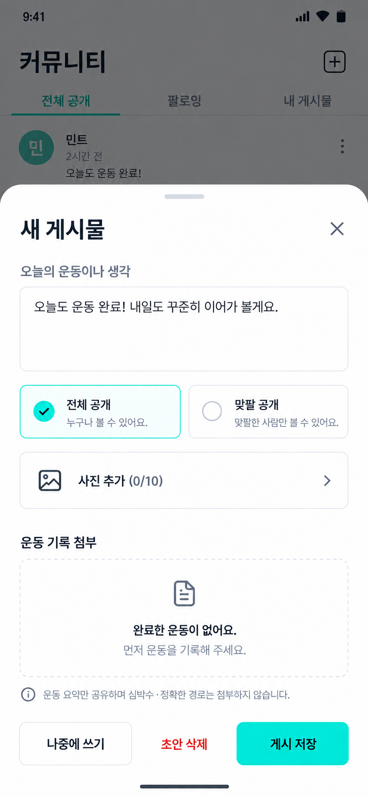](../assets/ui-redesign/18-post-compose-light-v1.png) | [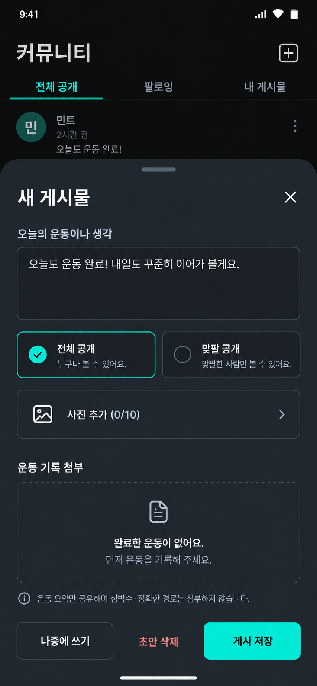](../assets/ui-redesign/18-post-compose-dark-v1.png) |

- 본문 최대 2,000자, 전체/맞팔 공개, 사진 최대 10장과 사진 제거를 유지한다. 본문 또는 사진이 있어야 저장하는 기존 검증을 따른다.
- 예시는 사진 0장·완료 운동 없음 상태다. 사진이 없는 입력에 미리보기 이미지를 넣지 않았다.
- 나중에 쓰기와 시트 닫기는 기존 초안을 보존하고 초안 삭제는 기존 확인 후 내용을 비운다. 게시 저장 성공 뒤 내 게시물 탭으로 이동하는 흐름을 유지한다.
- 운동 기록 선택 UI는 기존 최근 헬스/러닝 요약을 따른다. 아래 서버 연동 범위 항목처럼 운동 요약이 서버에 첨부된다고 새로 보장하지 않는다.

## 18b 게시물 수정

기존 내 게시물 편집 시트에 본문·사진 1장·맞팔 공개가 선택된 상태다.

| 라이트 | 다크 |
|---|---|
| [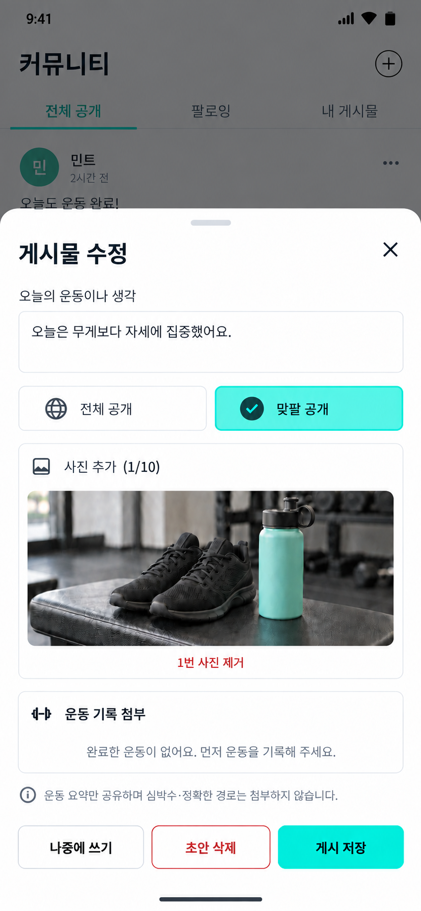](../assets/ui-redesign/18b-post-edit-light-v1.png) | [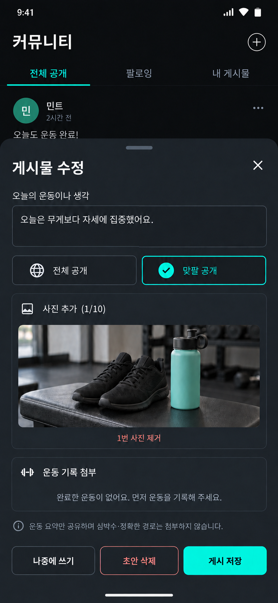](../assets/ui-redesign/18b-post-edit-dark-v1.png) |

- 기존 본문·사진 목록·공개 범위를 채운 후 수정한다. 사진 추가/번호별 제거와 10장 제한을 유지한다.
- 게시 저장은 기존 게시물 ID·version을 사용하는 수정 요청을 따른다. 실패 시 최신 내용을 확인하라는 기존 오류를 유지하고 성공으로 꾸미지 않는다.
- 다른 게시물을 수정하려고 할 때 작성 중 초안이 있으면 기존 초안 교체 확인을 유지한다. 초안 삭제는 게시물 자체를 삭제하는 동작과 구분한다.
- 새 자르기·필터·사진 재정렬·예약 발행 기능은 추가하지 않는다.

## 19 DM 목록

메시지 요청과 대화 가능한 방을 분리하고 기존 받은/보낸 요청을 표시했다.

| 라이트 | 다크 |
|---|---|
| [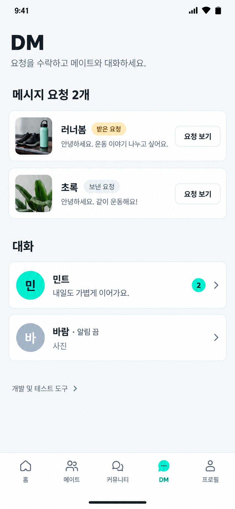](../assets/ui-redesign/19-dm-list-light-v1.png) | [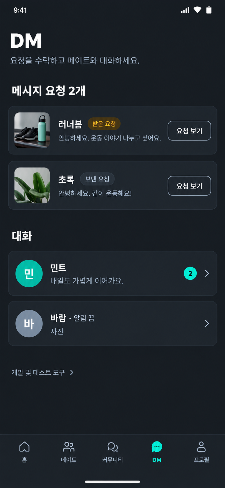](../assets/ui-redesign/19-dm-list-dark-v1.png) |

- 요청 2개와 대화 2개는 합성 예시다. 나간 방·차단한 상대는 기존 목록 조건대로 제외한다.
- 요청 보기와 대화 행 선택은 기존 방으로 이동하고 기존 로컬 unread를 초기화한다. 이를 서버 읽음 반영 완료로 해석하지 않는다.
- 미리보기는 사진이면 사진, 텍스트면 마지막 본문을 표시한다. 알림 끔과 읽지 않은 수 표기를 보존한다.
- 개발 및 테스트 도구는 기존 Debug 진입으로 남긴다. 하단 5탭에서 DM을 선택한다. 메이트 문의함과 합치거나 검색·새 대화 버튼을 추가하지 않는다.

## 20a DM — 대화 가능

기존 ACTIVE 대화에서 텍스트·사진과 전송/읽음 상태를 보여 준다.

| 라이트 | 다크 |
|---|---|
| [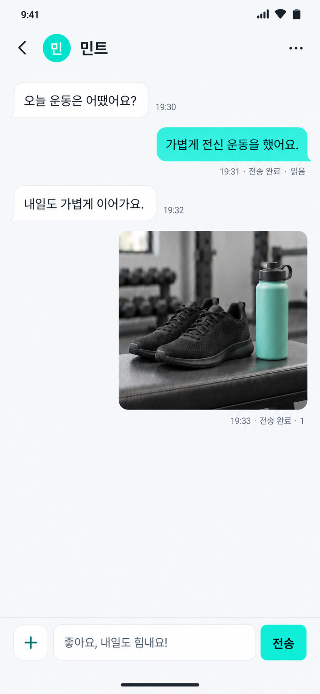](../assets/ui-redesign/20-dm-chat-light-v1.png) | [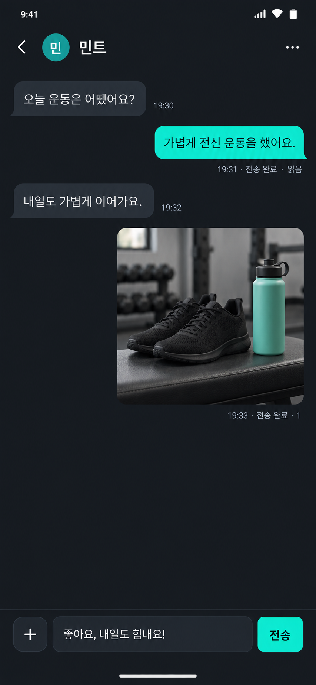](../assets/ui-redesign/20-dm-chat-dark-v1.png) |

- 본문 최대 2,000자, 사진 첨부·취소, 텍스트 또는 사진 전송, 기존 메시지 더 보기와 입력부의 키보드 대응을 유지한다.
- 메시지의 시간·전송 상태·읽음/미확인 표기를 보존한다. 실제 서버에서 받은 표시값을 사용하며 시안 숫자는 합성 예시다.
- 대화 옵션의 알림 켜기/끄기·차단/해제·나가기, 메시지 옵션의 내 메시지 삭제/타인 신고 접근을 유지한다. 아래에서 명시한 현재 로컬 처리 범위를 서버 기능으로 확대하지 않는다.
- 통화·음성·동영상·위치 공유·반응·접속 상태·입력 중 표시는 추가하지 않는다. 시안에서 전송을 실행하지 않았다.

## 20b DM — 받은 요청

수락 전 받은 요청 상태다. 요청 메시지와 수락/거절을 보여 주고 입력창은 표시하지 않는다.

| 라이트 | 다크 |
|---|---|
| [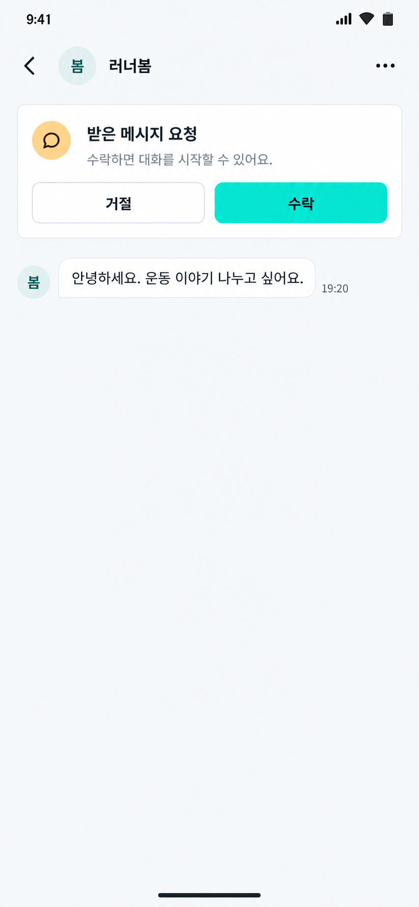](../assets/ui-redesign/20b-dm-request-light-v1.png) | [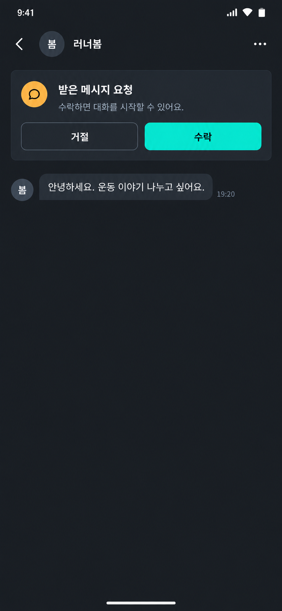](../assets/ui-redesign/20b-dm-request-dark-v1.png) |

- 요청 수락/거절은 서버 대화 ID가 있는 경우 기존 respondToMessageRequest를 따른다. 성공한 응답에 맞춰 기존 상태를 전환한다.
- 수락 전에는 메시지 입력·사진 첨부·전송을 제공하지 않는다. 수락 후 대화 가능 화면으로 이어지는 기존 조건을 유지한다.
- 보낸 요청은 최초 텍스트 1개와 이후 대기 조건을 별도로 유지한다. 받은 요청의 두 버튼을 보낸 요청에 노출하지 않는다.
- 요청 거절·차단·응답 실패는 기존 안내와 송신 제한을 유지한다. 수락이 자동으로 서버 맞팔을 생성한다고 설명하지 않는다.

## 현재 서버 연동 범위와 기능 보존

이번 대조에서 다음 차이를 확인했다. UI 개편 중 기능을 추가하는 대신 기존 처리 범위를 보존한다.

- 게시물 작성에 운동 기록 선택 UI가 있지만 현재 서버 create/update 호출에는 content·visibility·mediaIds 등이 전달되고 선택한 workout 요약은 전달하지 않는다. 로컬 분기에서는 요약을 FeedEntry에 보관한다. 시안은 완료 운동 없음으로 표현하며 서버 운동 첨부 완성을 주장하지 않는다.
- DM의 알림 설정·차단/해제·방 나가기·내 메시지 삭제는 해당 대화 UI에서 로컬 상태를 바꾸는 코드다. 서버 전체 삭제·상대방 메시지 회수·서버 알림 정책 변경으로 의미를 넓히지 않는다.
- 댓글 및 타인 DM 메시지 신고의 일부 진입은 로컬 임시 접수 안내다. 게시물 신고의 서버 경로와 혼동하지 않는다. 서버 활성 DM 전송 실패와 로컬 예시 재전송도 동일한 처리로 단정하지 않는다.

## 검토와 남은 상태

`CommunityFlow`, `EditorialPost`, 사진 선택·표시 컴포넌트, `DmListFlow`, `DmChatFlow`, 실제 라우팅과 서버 호출 인자를 대조했다. 14장의 주요 한국어 라벨·선택 상태·기능 접근을 육안 검토하고, 시트 배경의 잘못 생성된 탭과 라이트 배경 명암을 보정했다. 새 PNG 14장은 모두 853×1844로 읽기 검증을 통과했다. 프롬프트 JSON 7개 화면과 관련 문서 로컬 링크 152개를 확인했으며 누락은 없다. 전체 시안 PNG는 62장이다. Android 코드·설정·설치 앱과 실제 게시물·좋아요·팔로우·메시지는 변경하지 않았다. 이미지·문서 작업으로 Android 빌드·테스트·USB 재설치는 수행하지 않았다.

별도 이미지가 남은 상태는 빈 피드·목록 로딩/오류·더 보기, 내/타인 게시물 메뉴, 초안 교체·삭제 확인, 사진 로딩/실패·최대 첨부, 댓글 없음/실패, DM 보낸 요청/거절/차단, 사진 첨부 시트, 전송 실패와 대화/메시지 옵션이다. 이 상태들의 기능 보존·접근성·작은 화면·글자 확대·키보드·스크롤을 구현 전에 대조한다. 생성 컷 사이에 남은 하단 탭 아이콘·작성 버튼 외형 차이는 구현 전에 공통 컴포넌트로 통일하며, 시안만으로 실제 색상 대비나 터치 영역 검증을 대신하지 않는다.

[5차 프로필·인바디 시안](./검토중-ui-시안-5차-프로필-인바디.md)에 프로필·편집·인바디 목록/상세/직접 입력/사진 확인/검수의 10개 컷, 라이트·다크 PNG 20장을 추가했다. Samsung Health 내부 화면은 계속 제외하며, 시안을 검토한 화면 묶음부터 구현한다.
