# 검토 중 — FitMate UI 5차 시안: 프로필·인바디

- 작성일: 2026-09-10
- 최종 수정일: 2026-09-11
- 버전: v1.3
- 상태: 검토 중
- 목적: 프로필·편집·인바디 목록/상세/입력/사진/검수 UI 검토
- 기준: [UI 개편 계획](./검토중-ui-개편-계획.md), [4차 커뮤니티·DM 시안](./검토중-ui-시안-4차-커뮤니티-dm.md)
- 제작: built-in `image_gen`, [전체 프롬프트](../assets/ui-redesign/prompts-profile-inbody-v1.json)

**10개 컷 × 라이트·다크 = PNG 20장**이다. 프로필 편집·인바디 목록·상세는 긴 화면의 위/아래를 나눈 컷이며 새로운 단계나 경로가 아니다. 실제 플랜핏 Android 앱을 참고한 앞선 FitMate 시안의 스타일을 이어 간다. 기존 기능·데이터·API·권한 정책을 유지하며 Samsung Health 내부 UI는 제외한다.

모든 시안의 이름·측정값·날짜별 기록·사진은 합성 예시다. 시안 제작에서는 실제 계정이나 건강정보를 재사용하거나 데이터 변경을 실행하지 않았다. 이미지를 선택하면 원본을 크게 볼 수 있다.

2026-09-11 Android에 이 묶음의 UI를 적용했다. [5차 구현·실기기 검증](../03-qa/ui-5차-프로필-인바디-구현-검증.md)에 실제 화면 캡처 20장, 단위 테스트 58개·실기기 검사 11개 통과, 합성 계정의 서버 저장 검증 및 남은 범위를 정리했다. 아래 이미지는 생성 시안이며 실제 구현 캡처와 구분한다.

## 프로필

운동 기록·관계 수치와 프로필 정보를 위에 모으고, 게시물/운동 기록 탭을 유지했다. 예시는 내 게시물 없음 상태다.

| 라이트 | 다크 |
|---|---|
| [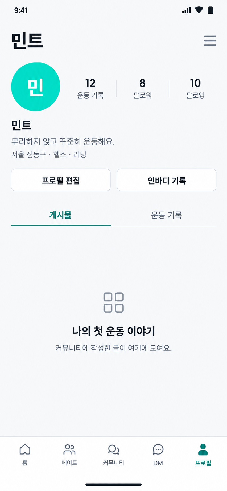](../assets/ui-redesign/21-profile-light-v1.png) | [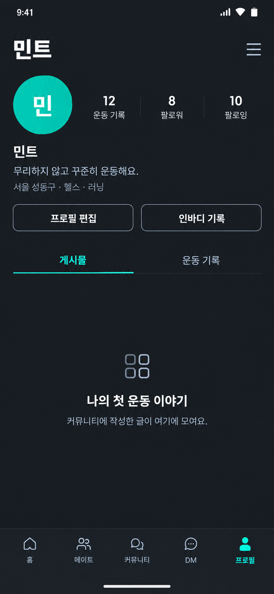](../assets/ui-redesign/21-profile-dark-v1.png) |

- 운동 기록 수는 완료 헬스·러닝 서버 집계이며 팔로워·팔로잉은 서버 프로필 값이다. 현재 조회 실패 시 로컬 대체값을 쓰는 처리도 변경하지 않는다.
- 운동 기록 수 선택은 운동 기록 탭으로, 팔로워/팔로잉은 기존 목록으로 이동한다. 게시물 그리드와 기존 게시물 보기 시트는 보존한다.
- 프로필 편집·인바디 기록·설정 메뉴와 하단 5탭을 유지한다. 새 게시물 작성 버튼이나 새 통계를 추가하지 않는다.

## 프로필 수정 — 기본 정보

한 편집 화면의 상단이다. 이름·닉네임·활동 지역·시설·소개와 프로필 사진을 정돈했다.

| 라이트 | 다크 |
|---|---|
| [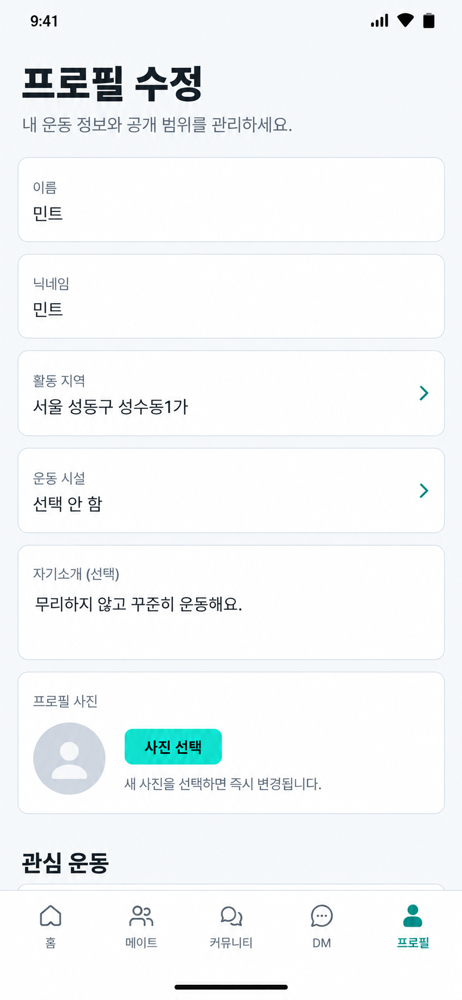](../assets/ui-redesign/22a-profile-edit-basic-light-v1.png) | [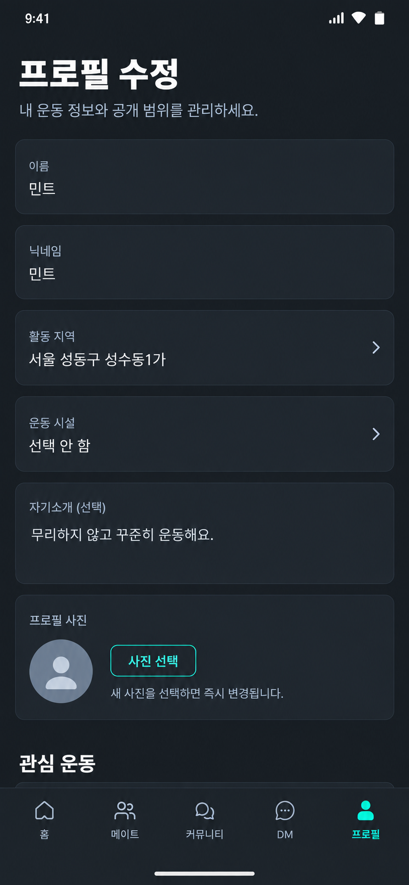](../assets/ui-redesign/22a-profile-edit-basic-dark-v1.png) |

- 활동 지역은 기존 서버 지역 선택기를 사용하며 필요한 지역 ID를 보존한다. 시설 조회와 선택 조건도 유지한다.
- 사진은 기존 사진 선택으로 즉시 업로드·저장된다. 하단 저장을 누르기 전에도 반영되며, 취소가 사진까지 복원한다는 안내를 넣지 않는다.
- 상단 컷에는 저장 버튼을 중복 배치하지 않았다. 관심 운동부터 다음 컷으로 스크롤되며, 별도 다음 단계나 새 경로를 만들지 않는다.

## 프로필 수정 — 운동·공개 범위

같은 편집 화면의 하단이다. 기존 관심 운동·직접 추가·운동 경력·목표·시간과 비공개 계정을 표시했다.

| 라이트 | 다크 |
|---|---|
| [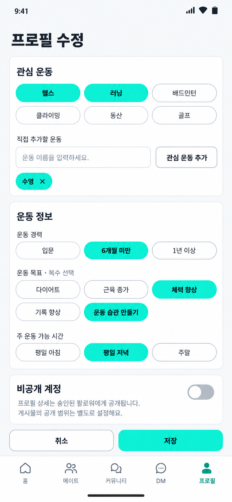](../assets/ui-redesign/22b-profile-edit-sports-light-v1.png) | [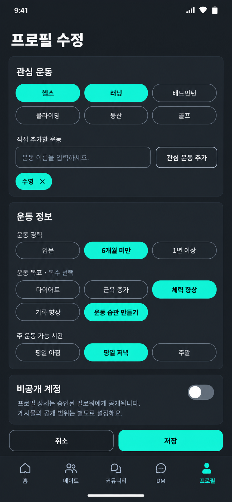](../assets/ui-redesign/22b-profile-edit-sports-dark-v1.png) |

- 헬스·러닝·배드민턴·클라이밍·등산·골프와 커스텀 운동 추가/제거를 유지한다. 활성 서버 종목 코드 및 customSports 변환을 바꾸지 않는다.
- 운동 경력과 가능 시간은 단일 선택, 목표는 복수 선택이다. 현재 목표 순서의 primary 변환을 보존한다.
- 닉네임·관심 운동·목표 검증, version 기반 PATCH, 저장 중 차단, 실패 시 최신 서버 정보 다시 불러오기를 유지한다.
- 비공개 계정과 게시물 공개 범위를 구분한다. 취소는 기존 편집 종료이며 별도 임시 저장이나 전체 되돌리기 기능을 추가하지 않는다.

## 인바디 목록 — 등록·변화

목록 상단에서 결과표 등록·최근 기록·변화 차트를 확인한다. 세 날짜의 예시 수치는 모두 합성 자료다.

| 라이트 | 다크 |
|---|---|
| [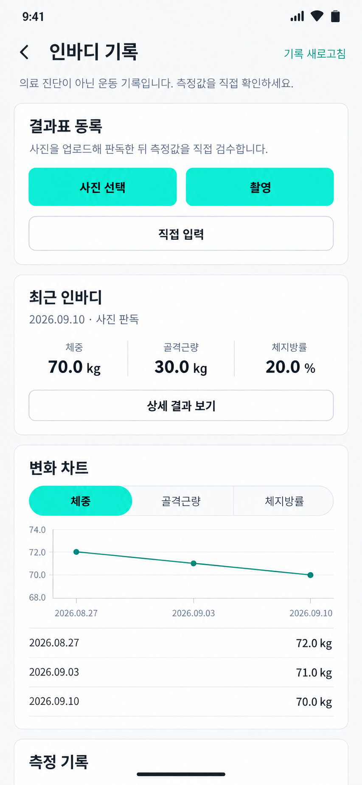](../assets/ui-redesign/23a-inbody-list-light-v1.png) | [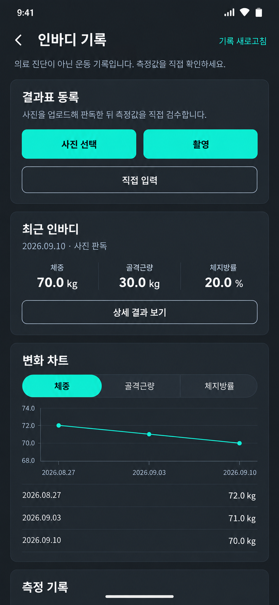](../assets/ui-redesign/23a-inbody-list-dark-v1.png) |

- 사진 선택·촬영·직접 입력과 기록 새로고침, 진행 중 판독 확인을 유지한다. 건강정보 동의가 없는 경우 기존 동의 화면을 먼저 거친다.
- 최근 인바디는 날짜순 최신 기록과 실제 sourceType을 표시한다. 체중/골격근량/체지방률 차트는 기존 기록값만 연결하며 예측·권장 범위를 추가하지 않는다.
- 3개 예시 체중은 72.0→71.0→70.0 kg이다. 단일 기록 안내, 빈 목록, 조회 오류를 정상 차트와 구분한다.

## 인바디 목록 — 측정 기록

같은 목록의 아래쪽이다. 각 기록의 출처·수치·직전 기록 대비 체중과 상세/삭제를 제공한다.

| 라이트 | 다크 |
|---|---|
| [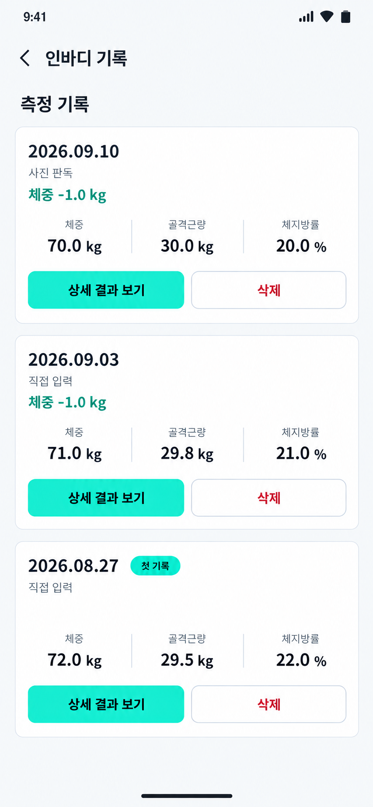](../assets/ui-redesign/23b-inbody-records-light-v1.png) | [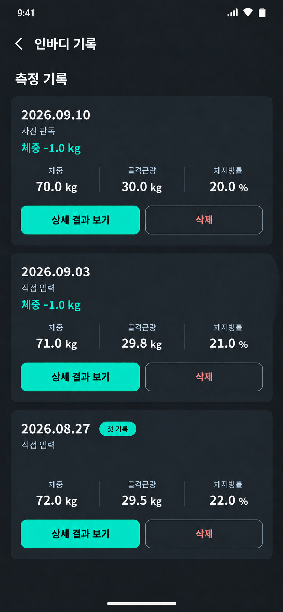](../assets/ui-redesign/23b-inbody-records-dark-v1.png) |

- 날짜 내림차순, 최근 3개와 그보다 오래된 기록 접기/펼치기를 유지한다. 이번 예시는 총 3개라 이전 기록 버튼을 표시하지 않는다.
- 체중 증감은 직전 기록과의 단순 차이이며 건강 상태 평가로 해석하지 않는다. 첫 기록은 증감을 만들지 않는다.
- 삭제는 기존 확인 후 서버 삭제, 성공 시 목록과 차트 갱신이다. 즉시 삭제하거나 삭제 실패를 성공으로 표시하지 않는다.

## 신체 구성 상세 — 요약·근육

상세의 상단이다. 핵심 요약·체지방 관련 값·부위별 근육량을 기존 분류대로 표시했다.

| 라이트 | 다크 |
|---|---|
| [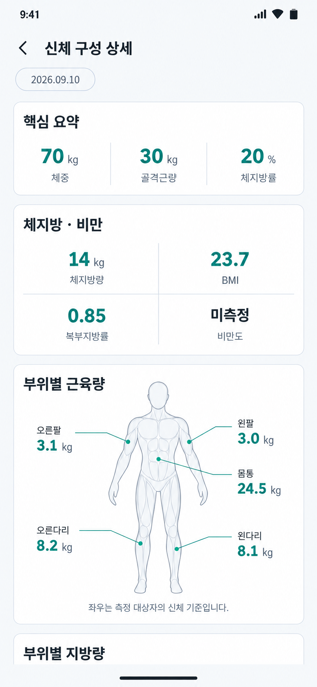](../assets/ui-redesign/24a-inbody-detail-light-v1.png) | [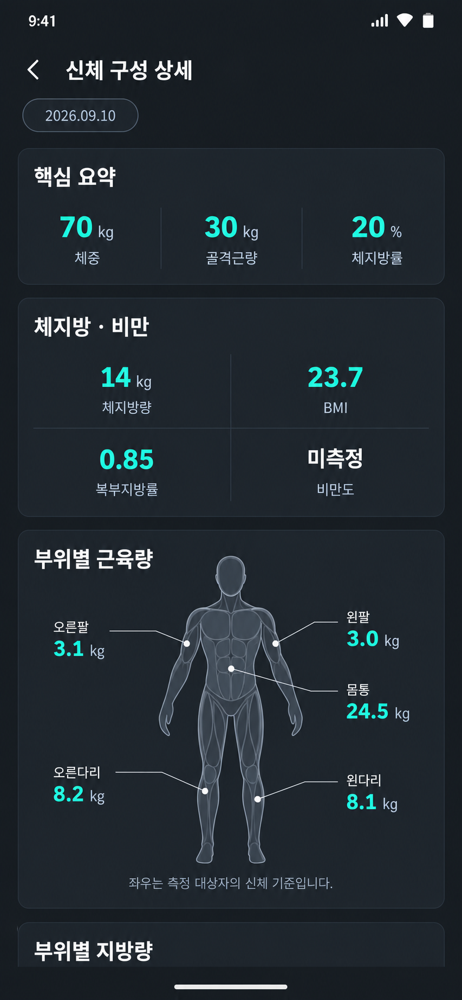](../assets/ui-redesign/24a-inbody-detail-dark-v1.png) |

- 저장 기록과 검수 초안이 공유하는 기존 상세 컴포넌트다. 기록 상세에서 돌아가면 목록, 초안 상세에서 돌아가면 검수 화면으로 복귀한다.
- 비만도는 예시에서 미측정이다. 신체 그림은 항목 구분용이며 체형 추정·진단·새 분석을 뜻하지 않는다.
- 좌우는 측정 대상자 기준이다. 화면 왼쪽에 오른팔/오른다리, 오른쪽에 왼팔/몸통/왼다리를 배치한다.

## 신체 구성 상세 — 지방·참고 수치

동일 상세 화면의 아래쪽이다. 부위별 지방량, 결과표의 체중 목표와 접을 수 있는 기타 측정 정보를 보존한다.

v2에서는 지방량을 직관적으로 구분하도록 인체 그림을 복부·팔·허벅지에 살집이 많은 체형으로 변경했다. 근육량 그림은 유지한다. 이 그림은 항목 구분용이며 표시된 수치로 사용자의 실제 체형을 추정한 결과가 아니다.

| 라이트 | 다크 |
|---|---|
| [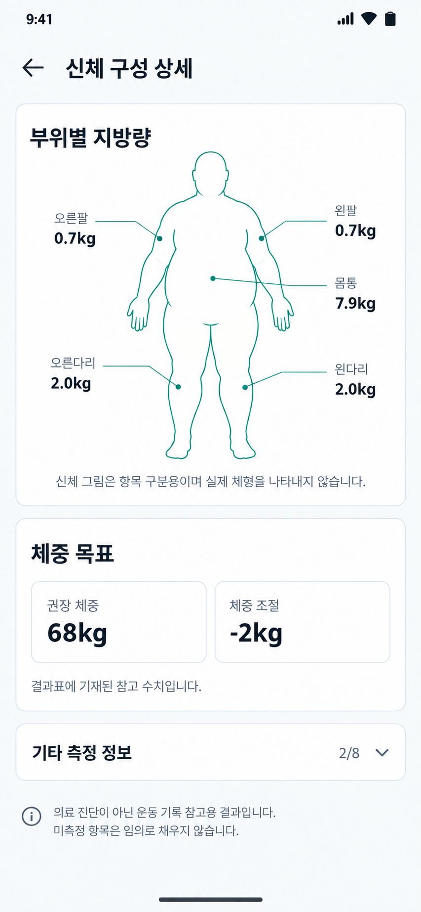](../assets/ui-redesign/24b-inbody-detail-more-light-v2.png) | [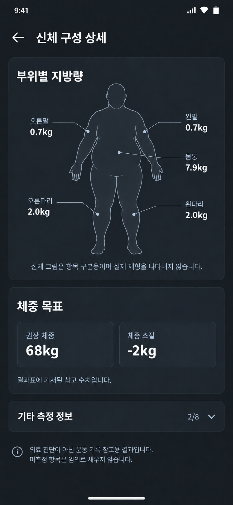](../assets/ui-redesign/24b-inbody-detail-more-dark-v2.png) |

- 권장 체중·체중 조절은 결과표에 기재된 읽기 전용 값이다. 사용자가 설정하는 운동 목표나 새 추천으로 바꾸지 않는다.
- 기타 측정 정보는 기존 8개 중 값이 있는 항목 수를 표시한다. 예시는 신장 172 cm와 기초대사량 1,500 kcal 두 값이 있어 2/8이다.
- 상세 항목에서 빠진 값은 미측정으로 남긴다. 새 저장·수정·공유·내보내기 버튼을 추가하지 않는다.

## 인바디 직접 입력

직접 입력도 기존 검수 화면을 사용한다. 핵심 수치를 선택하면 기존 수정 대화상자를 연다.

| 라이트 | 다크 |
|---|---|
| [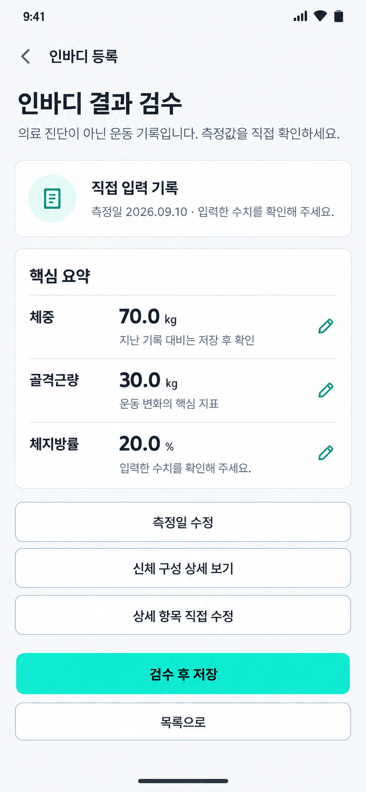](../assets/ui-redesign/25-inbody-manual-light-v1.png) | [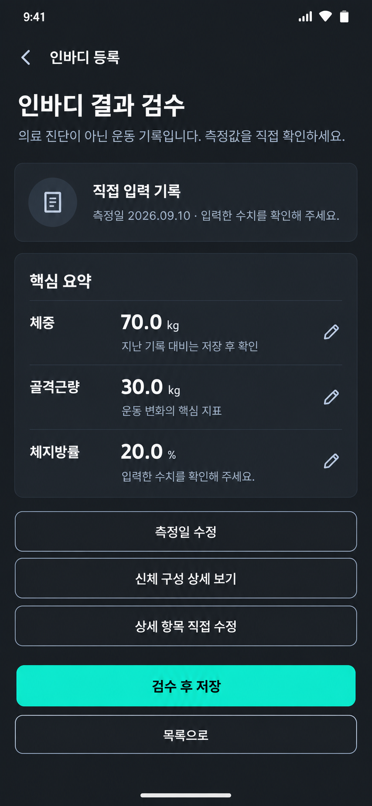](../assets/ui-redesign/25-inbody-manual-dark-v1.png) |

- 측정일·체중·골격근량·체지방률과 선택 상세값의 기존 범위 검증을 유지한다. 미래 측정일은 저장하지 않는다.
- 직접 입력에는 사진과 AI 검수 확인 토글이 없다. 기존 ‘검수 후 저장’ 동작과 버튼 문구를 유지한다.
- 직접 입력인데 사진 확인을 요구하던 설명은 ‘입력한 수치’로 표현하는 문구 개선안이다. 데이터·검증 조건 변경은 없다.
- 상세 항목 직접 수정의 모든 입력값을 보존한다. 이번 컷은 접힌 상태이며 펼침과 입력 대화상자는 후속 상태다.

## 인바디 사진 확인

사진을 확인한 후 사용자가 판독을 시작하는 화면이다. 결과표 이미지는 시안용 생성 자료이며 실제 건강정보가 아니다.

| 라이트 | 다크 |
|---|---|
| [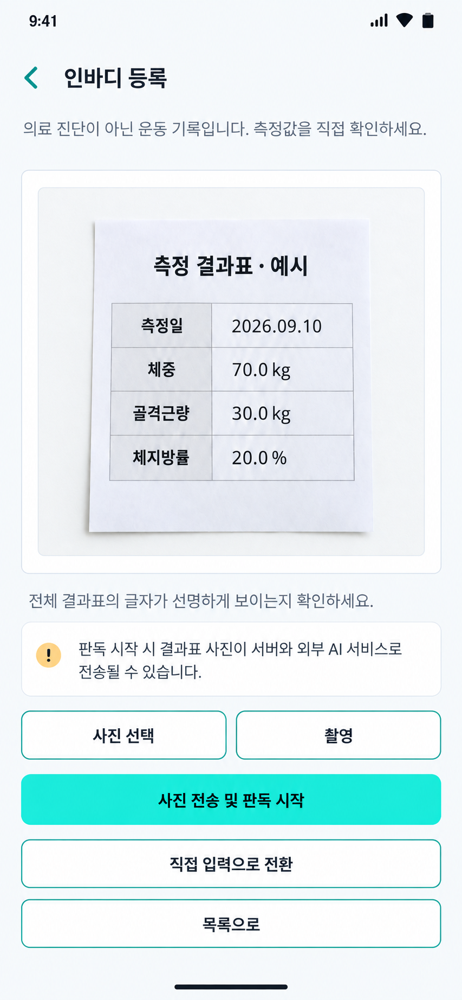](../assets/ui-redesign/25b-inbody-photo-light-v1.png) | [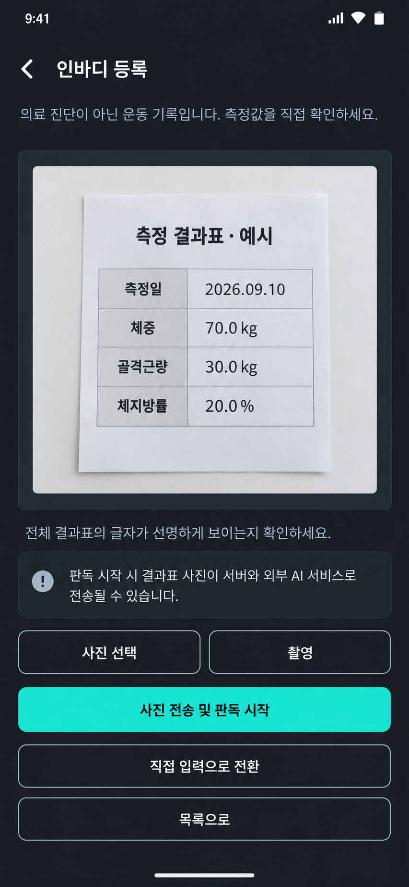](../assets/ui-redesign/25b-inbody-photo-dark-v1.png) |

- 사진 선택만으로 판독 완료나 기록 저장을 표시하지 않는다. 기존 사진 전송 및 판독 시작 버튼으로 업로드·분석 요청을 수행한다.
- 서버 및 외부 AI 서비스 전송 안내, 사진 재선택·촬영·직접 입력 전환·목록 복귀를 유지한다.
- 요청 접수 여부가 불명확하면 기존 중복 방지 조건을 지킨다. 실패 재시도도 기존 analysisId를 조회한 뒤 허용된 경로만 따른다.

## 인바디 판독 검수

판독 결과를 확인하는 예시다. 체지방률 재확인 안내와 아직 선택하지 않은 검수 확인을 표시했다.

| 라이트 | 다크 |
|---|---|
| [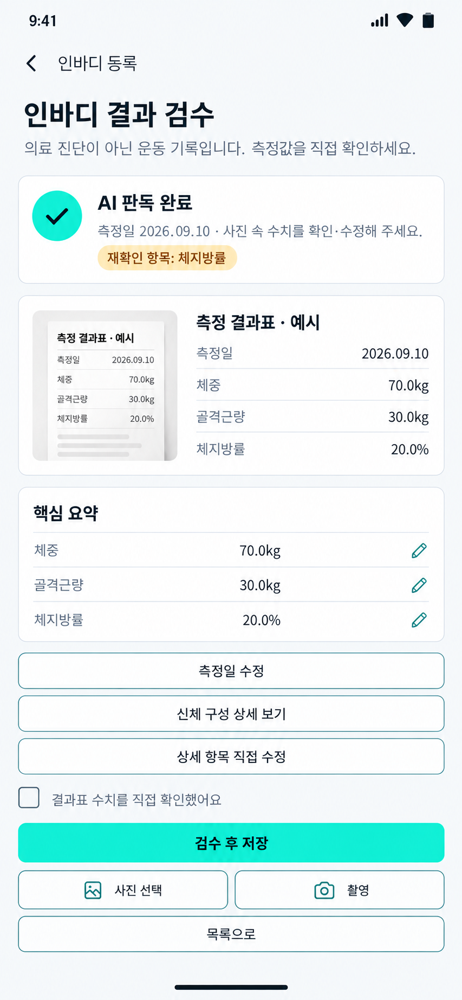](../assets/ui-redesign/26-inbody-review-light-v1.png) | [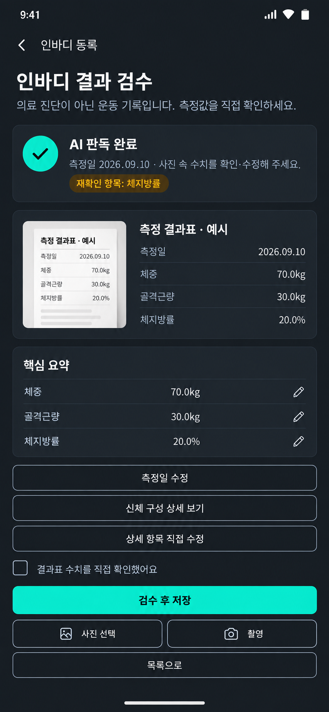](../assets/ui-redesign/26-inbody-review-dark-v1.png) |

- COMPLETED/REVIEW_REQUIRED 결과를 검수 화면에 적용한다. 실제 provider가 MOCK이면 기존 ‘서버 예시 판독’ 안내를 반드시 표시하며 실제 분석으로 꾸미지 않는다.
- 필수·선택 수치 수정, 날짜 수정, 상세 보기, 사진 교체와 확인 토글을 유지한다. 예시 수치는 가짜 자료다.
- 현재 버튼은 누른 뒤 확인 여부를 검증하므로 미확인 상태도 민트 버튼으로 보인다. 저장 시 확인되지 않았다면 기존 오류를 표시하고 저장하지 않는다.
- 저장 응답이 불명확하면 목록에서 저장 여부 확인을 제공하고 중복 저장을 막는다. 판독 완료와 서버 기록 저장 완료를 구분한다.

## 기능 보존 및 남은 상태

`ProfileOverview`, `ProfileScreen`, `profilePatch`, `InbodyFlow`, `InbodyReviewContent`, `InbodyDetailsDesign` 및 실제 라우팅을 대조했다. 프로필 편집에서는 기존처럼 하단 프로필 탭을 유지하고 인바디에서는 하단 탭을 표시하지 않는다. 건강정보 동의와 사진 전송 고지를 UI 변경으로 생략하지 않는다.

별도 컷이 남은 상태는 프로필 게시물 있음/운동 기록 탭·팔로우 목록, 지역/시설 선택, 저장 중/충돌/오류, 건강정보 동의, 인바디 빈 목록·조회 실패·판독 진행/실패, 상세 항목 펼침·수정 대화상자, 미확인 검수 오류·저장 불명확·삭제 확인이다. 기존 경로와 접근 조건을 유지하고 구현 전 작은 화면·큰 글자·키보드·뒤로가기·스크롤과 함께 대조한다. 공통 아이콘·색상·간격은 최종 컴포넌트 기준으로 통일하며 생성 이미지로 실제 대비·터치 영역 검증을 대신하지 않는다.

## 시안 제작 당시 검증 및 후속 계획

v1.1 수정 검증: 부위별 지방량 인체 그림 v2 두 테마의 살집 표현·수치·좌우·문구를 육안 확인했다. 두 PNG 모두 853×1844이며 로컬 링크 197개가 정상이다. 현재 검토본은 계속 82장이고 변경 전 원본 2장을 포함한 저장소 PNG는 84장이다. 앱 코드 변경은 없다.

20장의 주요 한국어 라벨·선택 상태·수치·단위·신체 좌우·미측정 표기를 육안 검토했다. 첫 기록에 잘못 생성된 증감 표시와 기록 제목 간격을 보정했다. 새 PNG 20장은 모두 853×1844로 읽기 검증을 통과했고, 프롬프트 JSON 10개 컷과 관련 문서 로컬 링크 197개를 확인했으며 누락은 없다. 전체 시안은 PNG 82장이다. 실제 색상 대비·터치 영역·글자 확대·키보드와 서버 동작은 구현 시 검증한다. 이번 작업은 이미지·문서만 변경했으며 Android 빌드·테스트·USB 재설치는 수행하지 않았다. 실제 프로필·사진·건강 기록과 Samsung Health 영역은 변경하지 않았다.

인증·일반 설정은 [6차 인증·설정 시안](./검토중-ui-시안-6차-인증-설정.md)에 12개 컷·두 테마·PNG 24장으로 정리했다. 건강정보 동의 기본 화면도 이 묶음에서 확인할 수 있다. 다음은 남은 빈 상태·오류·확인 시트와 공통 컴포넌트의 일관성 검토다. 프로필 → 설정 → Samsung Health 내부 UI는 계속 제외한다. 시안을 검토한 화면 묶음부터 구현하고 USB 실기기 회귀 검증을 진행한다.
