# 검토 중 — FitMate UI 6차 시안: 인증·설정

- 작성일: 2026-09-10
- 최종 수정일: 2026-09-11
- 버전: v1.2
- 상태: 검토 중
- 목적: 로그인·회원가입·동의·알림·일반 설정·계정 관리 UI 검토
- 기준: [UI 개편 계획](./검토중-ui-개편-계획.md), [5차 프로필·인바디 시안](./검토중-ui-시안-5차-프로필-인바디.md)
- 제작: built-in `image_gen`, [전체 생성·보정 프롬프트](../assets/ui-redesign/prompts-auth-settings-v1.json)

**12개 컷 × 라이트·다크 = PNG 24장**이다. 실제 플랜핏 Android 앱을 참고한 앞선 FitMate 스타일을 이어 가며, 기존 기능·데이터·API·동의·권한 정책을 유지한다. 설정 상단/하단은 하나의 스크롤 화면을 나눈 컷이다. Samsung Health는 기존 진입 항목만 보존하고 내부 UI는 제외한다.

시안의 이름·이메일·생년월일·알림·요청·약관 버전은 모두 합성 예시다. 시안 제작에서는 실제 로그인·가입·동의 변경·알림 처리·계정 삭제를 실행하지 않았다. 이미지를 선택하면 원본을 크게 볼 수 있다.

2026-09-11 Android 적용 및 USB 검증을 진행했다. [6차 구현·검증 기록](../03-qa/ui-6차-인증-설정-구현-검증.md)에 적용 범위, 단위 테스트 58개·실기기 검사 17개, 실제 구현 캡처 24장과 미검증 항목을 정리했다. 아래 이미지는 생성 시안이며 실제 구현 캡처와 구분한다.

## 로그인

이메일과 비밀번호 입력, 로그인·회원가입 진입만 정리했다. 예시는 비밀번호가 비어 있어 로그인 버튼이 비활성이다.

| 라이트 | 다크 |
|---|---|
| [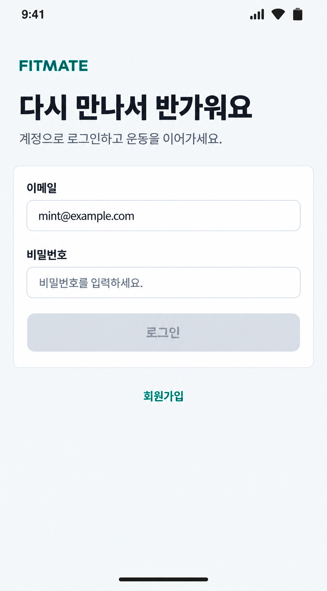](../assets/ui-redesign/27-login-light-v1.png) | [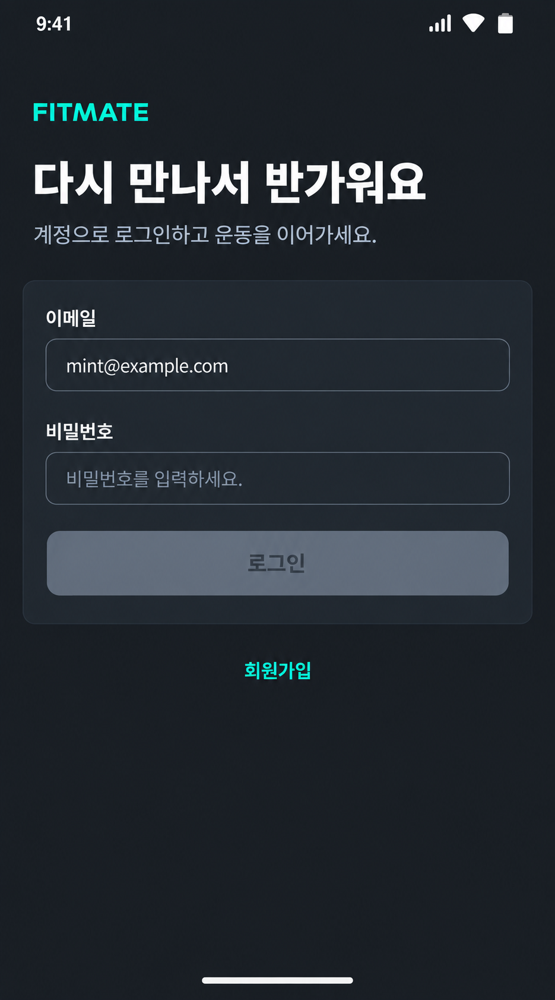](../assets/ui-redesign/27-login-dark-v1.png) |

- 실제 ServerLogin을 기준으로 이메일 형식·빈 비밀번호·처리 중 조건을 유지한다. 로그인 요청, 오류 표시, 세션 재조회와 재로그인 흐름을 보존한다.
- 현재 비밀번호 가시성 전환·비밀번호 찾기·소셜 로그인은 제공하지 않는다. 가입 버튼은 기존 회원가입 화면으로 이동한다.

## 회원가입 1 — 계정 정보

기존 가입 1단계다. 이메일 중복 확인과 기본 정보를 한 화면에서 입력한다.

| 라이트 | 다크 |
|---|---|
| [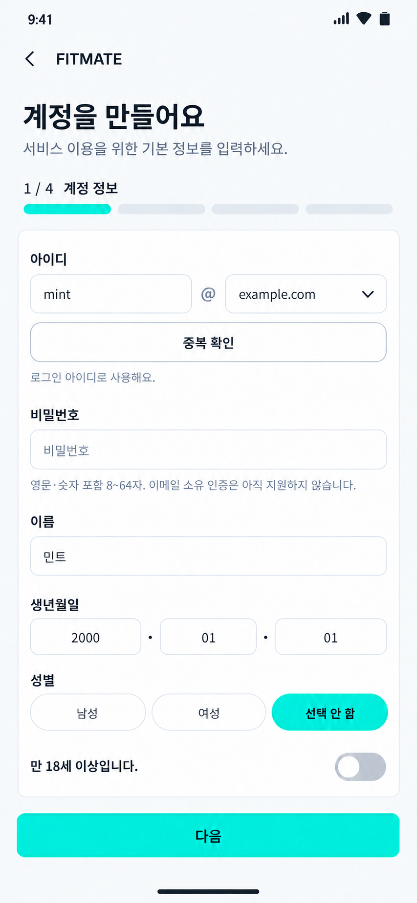](../assets/ui-redesign/28a-signup-account-light-v1.png) | [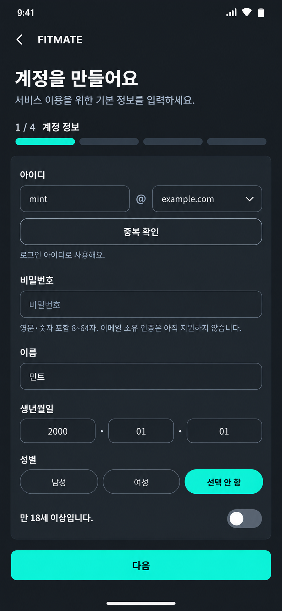](../assets/ui-redesign/28a-signup-account-dark-v1.png) |

- 이메일 아이디/도메인 선택·직접 입력·중복 확인을 보존한다. 중복 확인은 이메일 소유 인증이 아니며 값 변경 시 확인 상태를 해제한다.
- 비밀번호 영문·숫자 포함 8~64자와 기존 바이트 길이 조건, 이름, 생년월일 실제 날짜·만 18세 기준, 성별, 성인 확인 검증을 유지한다.
- 생년월일의 숫자 제한과 다음 입력 자동 포커스를 보존한다. 다음 버튼은 현재처럼 누른 뒤 검증하며 시안의 비밀번호는 비어 있다. 합성 생년월일은 실제 사용자 정보가 아니다.

## 회원가입 2 — 프로필

기존 가입 2단계다. 닉네임 확인·지역·시설·선택 소개를 묶었다.

| 라이트 | 다크 |
|---|---|
| [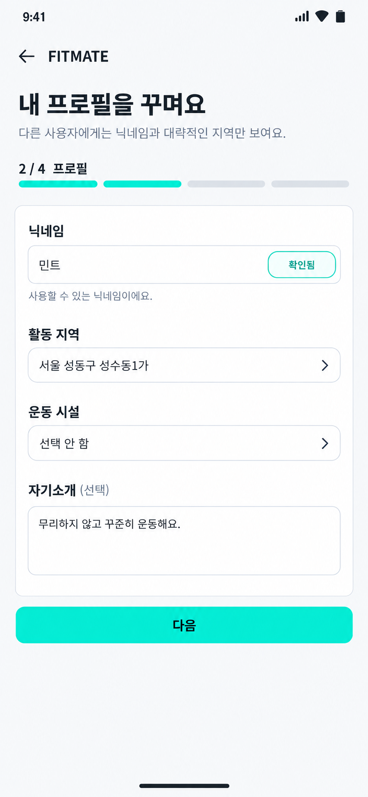](../assets/ui-redesign/28b-signup-profile-light-v1.png) | [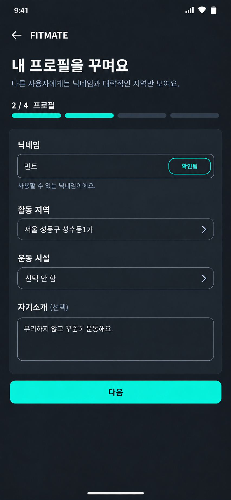](../assets/ui-redesign/28b-signup-profile-dark-v1.png) |

- 확인됨은 합성 예시의 닉네임 중복 확인 상태다. 입력값과 확인값 비교, 지역 ID, 서버 지역·시설 선택기를 유지한다.
- 사진 등록이나 공개 범위 설정을 이 가입 단계에 새로 추가하지 않는다. 뒤로가기는 이전 단계로 이동한다.

## 회원가입 3 — 운동 프로필

기존 가입 3단계다. 관심 운동·운동 경험·목표·선호 시간의 선택 상태를 보여 준다.

| 라이트 | 다크 |
|---|---|
| [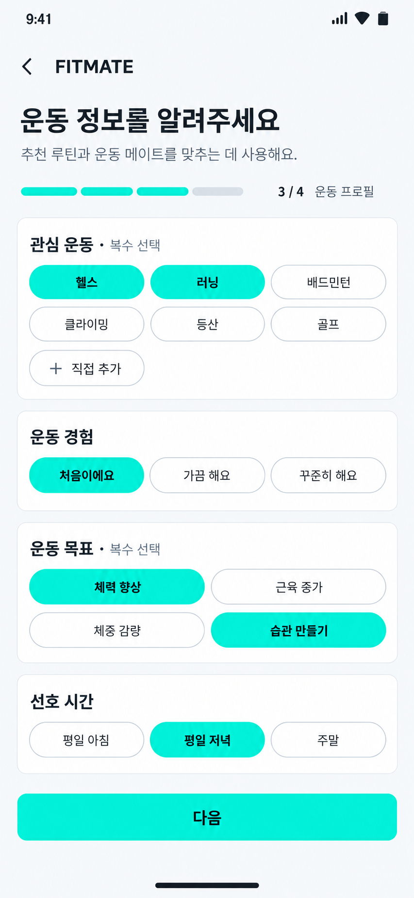](../assets/ui-redesign/28c-signup-sports-light-v1.png) | [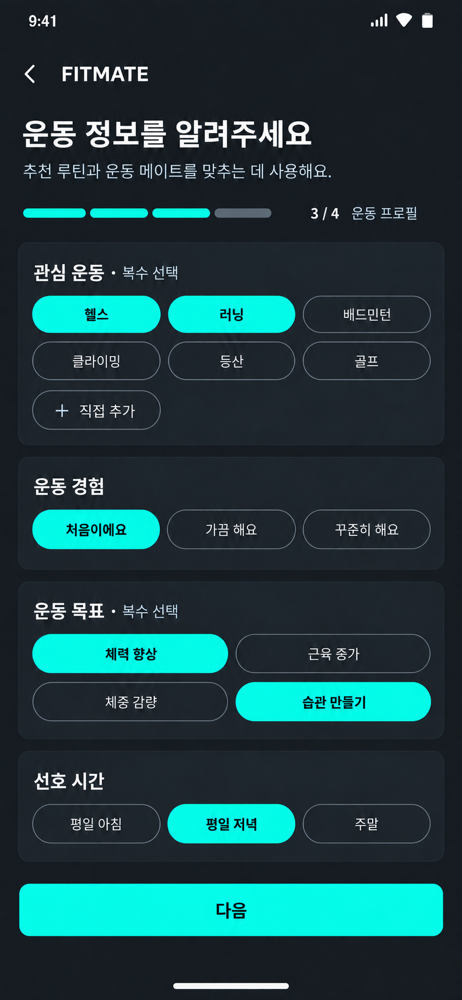](../assets/ui-redesign/28c-signup-sports-dark-v1.png) |

- 기존 여섯 종목, 커스텀 운동 펼침/추가/제거와 최소 관심 운동·목표 검증을 유지한다.
- 가입의 운동 경험·목표 라벨은 프로필 편집과 현재 다르므로 임의로 합치지 않는다. 서버 코드 매핑과 목표 primary 순서, 요일·시간 변환은 보존한다.

## 회원가입 4 — 약관·동의

가입 요청 전 요약과 동의를 확인하는 4단계다. 필수 두 항목은 켜고 건강정보는 끈 예시다.

| 라이트 | 다크 |
|---|---|
| [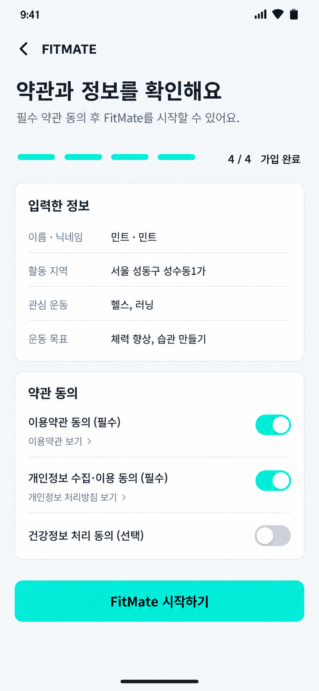](../assets/ui-redesign/29a-signup-consent-light-v1.png) | [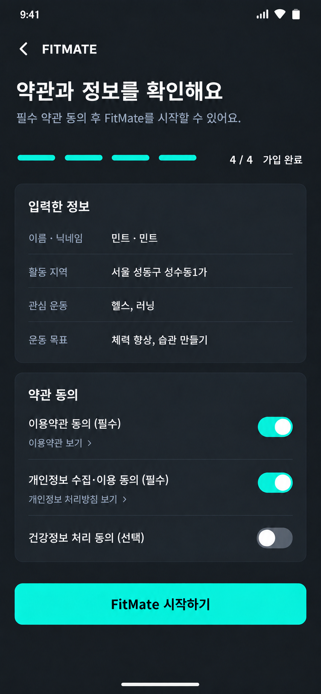](../assets/ui-redesign/29a-signup-consent-dark-v1.png) |

- 가입 완료라는 기존 단계 라벨은 서버 가입 성공을 의미하지 않는다. FitMate 시작하기로 실제 요청하고 서버 성공 뒤 이동한다.
- 필수 약관·개인정보 동의와 선택 건강정보 동의를 구분한다. 약관/종목 참조 자료·지역 ID 로딩, 제출 중 차단과 실패 안내를 유지한다.
- 현재 signupPayload에는 서버 필수 약관 ID를 전달하고 선택 건강정보는 onHealthConsent로 기기 상태에 반영한다. 선택 건강정보까지 서버 동의 저장 완료라고 표현하지 않는다.
- 약관·처리방침 보기의 PolicyDetail은 개발 중 안내다. 정식 정책으로 새로 작성하지 않았으며, 현재 코드의 저장 위치 설명과 실제 인바디 서버 저장의 차이는 별도 본문 검토가 필요하다.

## 건강정보 동의

인바디 진입 때 건강정보 동의가 없는 경우 표시하는 기존 화면이다.

| 라이트 | 다크 |
|---|---|
| [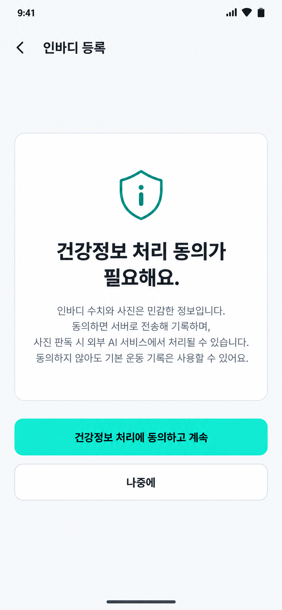](../assets/ui-redesign/29b-health-consent-light-v1.png) | [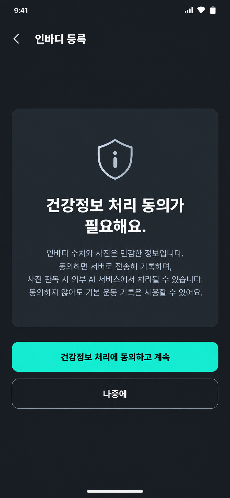](../assets/ui-redesign/29b-health-consent-dark-v1.png) |

- 기기 내 healthConsent를 확인하고 동의 시 기존 인바디 흐름으로 이동한다. 이 화면의 확인을 서버 약관 동의 완료나 Android 권한 허용으로 바꾸지 않는다.
- 서버 기록·외부 AI 사진 처리 가능성과 동의하지 않아도 기본 운동을 쓸 수 있다는 안내, 나중에로 원래 화면 복귀를 유지한다. 실제 동의는 실행하지 않았다.

## 알림 목록

읽지 않은 알림과 읽은 알림을 구분하고 기존 설정·관리 메뉴를 유지했다.

| 라이트 | 다크 |
|---|---|
| [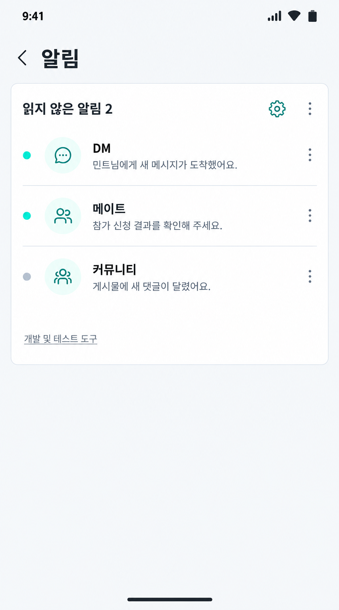](../assets/ui-redesign/30a-notifications-light-v1.png) | [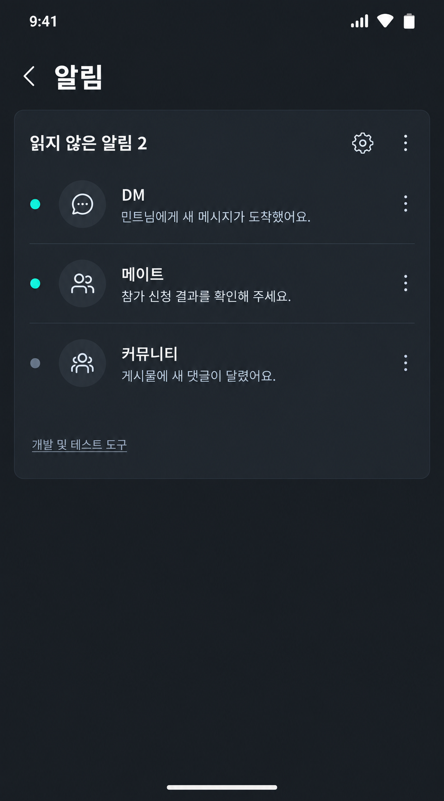](../assets/ui-redesign/30a-notifications-dark-v1.png) |

- 서버 알림 조회, 개별 알림 열기 및 기존 목적지 분기, 전체 읽음·전체 삭제 확인을 보존한다. 임의의 날짜나 개별 미확인 개수를 추가하지 않았다.
- 알림 열기/전체 작업은 로컬 상태를 먼저 바꾸고 서버 호출하는 현재 구조다. 행 메뉴의 읽음 전환/개별 삭제는 현재 로컬 처리이므로 서버 동기화 성공으로 표현하지 않는다.
- 톱니 설정 시트는 현재 앱 실행 중 Push 선호 UI이며 실제 Push 전송·권한 요청은 미연결이다. 계정·개인정보의 서버 알림 설정과 합치지 않는다.
- 개발 및 테스트 도구는 Debug 전용이다. 시안 알림은 합성 자료이며 실제 읽음·삭제·발송을 실행하지 않았다.

## 팔로우 요청

기존 팔로우 요청 목록의 수락·거절을 보여 준다.

| 라이트 | 다크 |
|---|---|
| [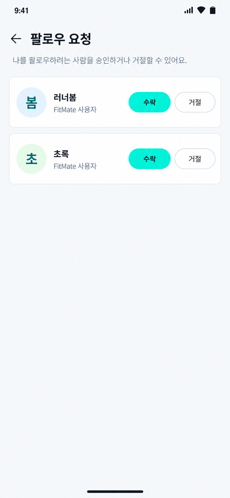](../assets/ui-redesign/30b-follow-requests-light-v1.png) | [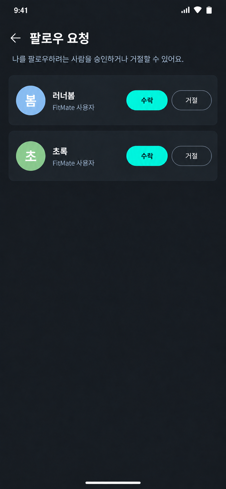](../assets/ui-redesign/30b-follow-requests-dark-v1.png) |

- PENDING이며 차단되지 않은 사용자 조건을 유지한다. 서버 ID가 있는 요청은 기존 수락/거절 API 성공 후 목록에서 제외하고, 로컬 경로는 기존 동작을 따른다.
- 시안은 합성 서버 대기 상태 예시다. 실제 Debug 빈 목록에서 보이는 미리보기는 개발용 표시를 유지해야 하며 실제 요청으로 꾸미지 않는다.
- 새 맞팔·프로필 이동·일괄 승인·요청 일시를 추가하지 않는다. 실제 수락·거절은 실행하지 않았다.

## 설정 — 계정·기기

일반 설정의 위쪽이다. 계정·프로필과 운동·기기의 기존 항목을 유지했다.

| 라이트 | 다크 |
|---|---|
| [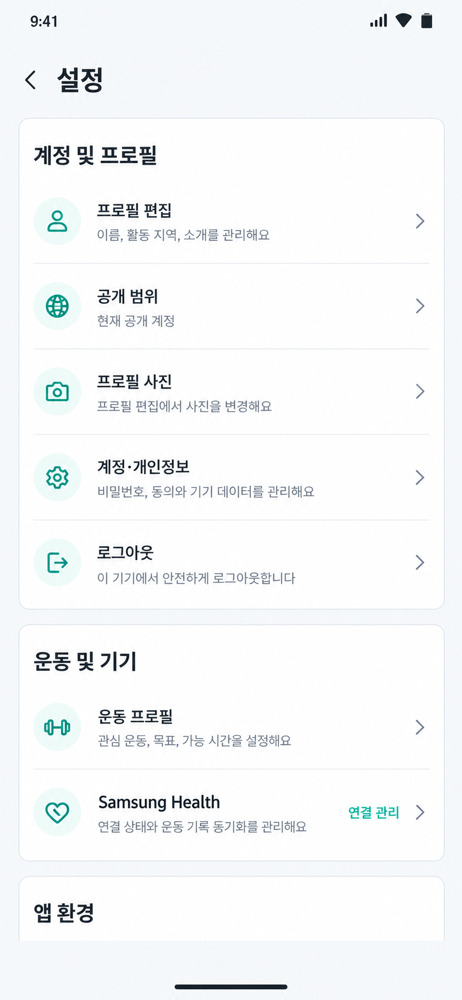](../assets/ui-redesign/31a-settings-light-v1.png) | [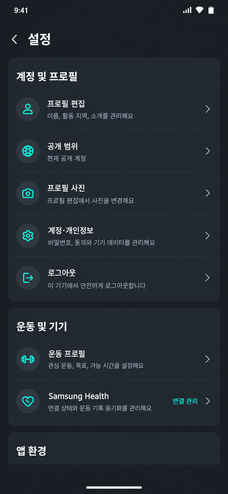](../assets/ui-redesign/31a-settings-dark-v1.png) |

- 프로필 편집·공개 범위·사진·운동 프로필은 현재 프로필 편집으로 이어진다. 별도 기능 경로를 만들지 않는다.
- 로그아웃은 기존 확인 후 현재 기기 세션 정리·운동 측정 중지/일시정지·로그인 화면 이동을 유지한다. 기기 기록 삭제와 구분한다.
- Samsung Health 행은 기존 진입 링크만 표현한다. 연결 완료 상태를 새로 표시하거나 내부 UI·로직·권한 화면을 변경하지 않는다.

## 설정 — 앱 환경·지원

같은 설정 화면의 아래쪽이다. 앱 환경·지원·개발 항목을 정돈했다.

| 라이트 | 다크 |
|---|---|
| [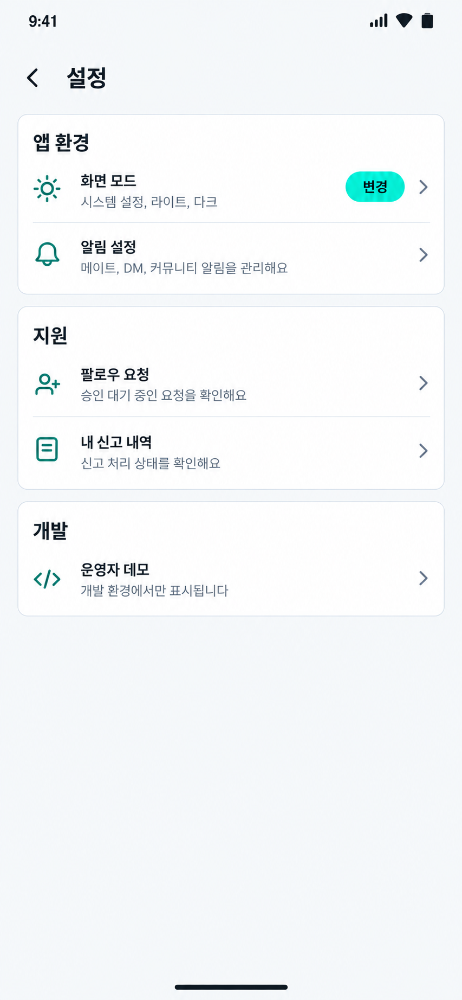](../assets/ui-redesign/31b-settings-more-light-v1.png) | [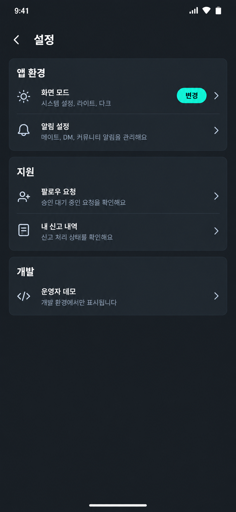](../assets/ui-redesign/31b-settings-more-dark-v1.png) |

- 화면 모드·알림 화면·팔로우 요청·내 신고 내역의 현재 목적지를 보존한다. 알림 설정 행은 현재 알림 목록으로 연결된다.
- 운영자 데모는 Debug에서만 표시한다. 운영자 기능 자체는 이번 디자인 개편에 포함하지 않는다.
- 내 신고 내역은 현재 로컬 목록과 개발용 상태 예시가 있으므로 실제 운영자 처리 결과라고 새로 보장하지 않는다.

## 화면 모드

시스템 설정 따르기·라이트·다크의 기존 단일 선택 화면이다.

| 라이트 | 다크 |
|---|---|
| [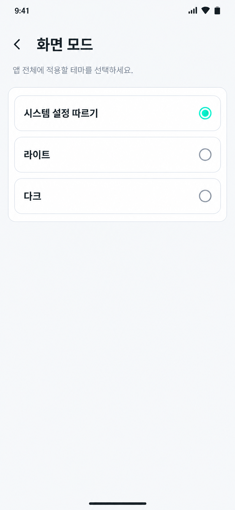](../assets/ui-redesign/31c-appearance-light-v1.png) | [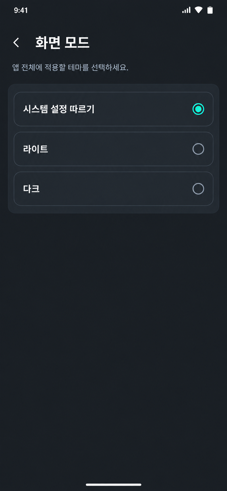](../assets/ui-redesign/31c-appearance-dark-v1.png) |

- 두 시안 모두 시스템 설정 따르기를 선택했다. OS 테마만 다른 예시이며 라이트 시안에서 라이트 항목을 자동 선택한 것이 아니다.
- 기존 선택 즉시 적용·저장 흐름을 유지하며 별도 저장 버튼을 추가하지 않는다. Samsung Health에 공통 스타일이 간접 적용되는지는 구현 시 별도 점검한다.

## 계정·개인정보

기존 서버 알림 설정·동의·기기 정보와 계정 관리 진입을 한 화면으로 정리했다.

| 라이트 | 다크 |
|---|---|
| [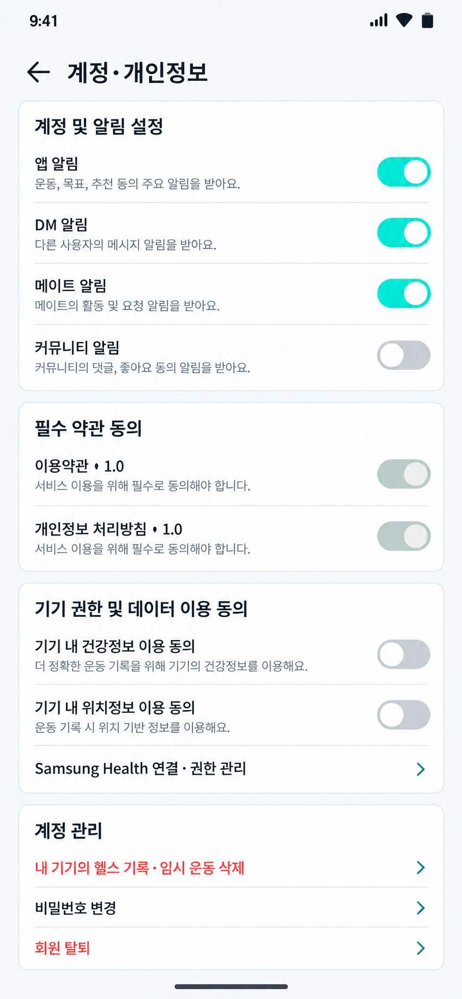](../assets/ui-redesign/31d-account-light-v1.png) | [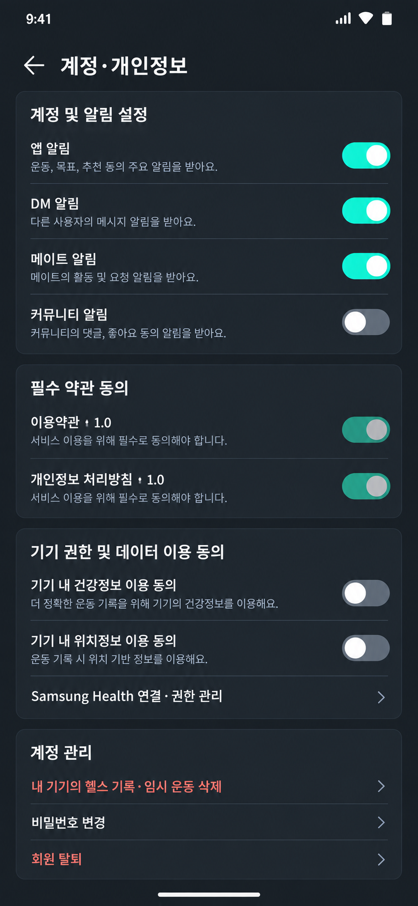](../assets/ui-redesign/31d-account-dark-v1.png) |

- 앱/DM/메이트/커뮤니티 알림은 서버 notification-settings를 읽고 변경 시 PATCH 후 재조회한다. 실패·다시 불러오기와 busy 차단을 유지한다.
- 약관 제목·1.0 버전은 합성 예시다. 실제 서버 약관 ID·버전·required·withdrawnAt에 따라 표시하며 필수 동의 스위치는 선택된 비활성 상태다. 선택 약관은 기존 PUT/DELETE를 따른다.
- 기기 내 건강/위치 동의는 로컬 상태다. 서버 동의나 Android 권한 자체와 동일하게 취급하지 않는다.
- 로컬 헬스 기록·임시 운동 삭제는 기존 확인과 진행 중 서버 운동 차단 조건을 유지한다. 서버 기록이나 러닝 이력까지 삭제하는 것으로 확대하지 않는다.
- 비밀번호 변경/탈퇴는 현재 비밀번호 입력 시트와 검증, 서버 처리·세션 정리를 유지한다. 이 시안에서는 실행하지 않는다. Samsung Health는 기존 연결·권한 관리 진입만 유지한다.

## 시안 제작 당시 검증과 남은 상태

`ServerLogin`, `ServerSessionGate`, `OnboardingScreen`, `signupPayload`, `PolicyDetail`, `NotificationFlow`, `FollowRequestsScreen`, `SettingsScreen`, `AppearanceSettings`, `ServerAccountSettings`와 실제 라우팅을 대조했다. 24장의 주요 한국어 라벨·입력값·선택 상태·버튼·진입 항목을 육안 검토했다. 가입 단계 표시, 불필요한 글자 수 표기, 요청 아바타, 라이트 성인 확인과 필수 동의 비활성 표현을 보정했다.

PNG 24장 모두 파일 읽기 검증을 통과했다. 19장은 853×1844이고, 계정 라이트는 853×1843, 로그인 라이트는 934×1683, 로그인 다크와 알림 두 테마는 935×1683이다. 생성 결과의 비율·1px 차이가 있으므로 픽셀 단위 구현 기준으로 사용하지 않는다. 실제 레이아웃은 공통 컴포넌트와 dp/sp 기준으로 통일한다. 프롬프트 JSON의 12개 컷·생성/보정 기록, 관련 문서 로컬 링크 250개를 확인했으며 누락은 없다. 현재 문서에서 연결하는 PNG는 총 106장이고, 이전 지방량 그림 원본 2장을 포함한 저장소 PNG는 108장이다.

시안 제작 당시에는 이미지·검토 문서만 변경했다. Android 코드·설치 파일·실제 계정·건강 기록·Samsung Health 내부 영역은 변경하지 않았고 Android 빌드·테스트·USB 재설치는 수행하지 않았다. 이후 구현과 검증 결과는 위 구현·검증 기록을 따른다.

별도 컷이 남은 상태는 로그인/세션 오류·가입 입력 오류·중복 확인 중/실패·참조 자료 실패, 약관 본문 시트, 알림 빈 목록/설정 시트/관리 메뉴, 팔로우 요청 빈 목록·실패, 신고 내역, 비밀번호 변경/탈퇴 입력 시트, 로그아웃·로컬 기록 삭제 확인이다. 기능 보존·서버/로컬 처리 구분·스크롤·키보드·글자 확대·읽기 순서·실제 대비를 구현 전에 검토한다.

이번 묶음으로 계획의 주요 화면 01~31에 대응하는 기본 시안 묶음을 작성했다. 이후 [7차 상태·공통 규칙](./검토중-ui-시안-7차-상태-공통규칙.md)에서 세션 조회 실패·알림 빈 목록·로그아웃 확인을 포함한 주요 상태와 공통 UI 기준을 정리한다. 위 6차 검증 수량은 당시 기준이다. 전체 파생 상태 검토가 끝났거나 구현이 완료됐다는 의미는 아니다. 검토한 화면 묶음부터 구현하며 Samsung Health 내부 UI는 계속 제외한다.
