# 검토 중 — FitMate UI 7차 시안: 상태·공통 규칙

- 작성일: 2026-09-10
- 최종 수정일: 2026-09-11
- 버전: v1.1
- 상태: 검토 중
- 목적: 복구·대기·확인 상태의 UI와 공통 컴포넌트 기준 검토
- 기준: [UI 개편 계획](./검토중-ui-개편-계획.md), [6차 인증·설정](./검토중-ui-시안-6차-인증-설정.md)
- 제작: built-in image_gen, [생성 프롬프트](../assets/ui-redesign/prompts-states-v2.json)

**8개 상태 × 라이트·다크 = PNG 16장**의 생성 시안이다. 기존 상태 전이와 API·입력 검증·동의 조건을 보존한다. 전체 파생 상태가 끝났다는 의미는 아니며, 중복 저장·삭제 범위·대기 중 이동을 오해하기 쉬운 상태를 먼저 정리했다. 시안 제작 당시에는 실제 계정·건강 기록·기기 설치를 변경하지 않았다. Samsung Health 내부 UI는 계속 제외한다.

2026-09-11 위 8개 상태를 Android에 적용했다. [7차 구현·검증 기록](../03-qa/ui-7차-상태-공통규칙-구현-검증.md)에 실제 화면 16장, 상태 전이·회귀 검사와 미검증 항목을 정리한다. 아래 생성 이미지와 실제 구현 캡처는 구분한다.

## 계정 조회 실패

| 라이트 | 다크 |
|---|---|
| [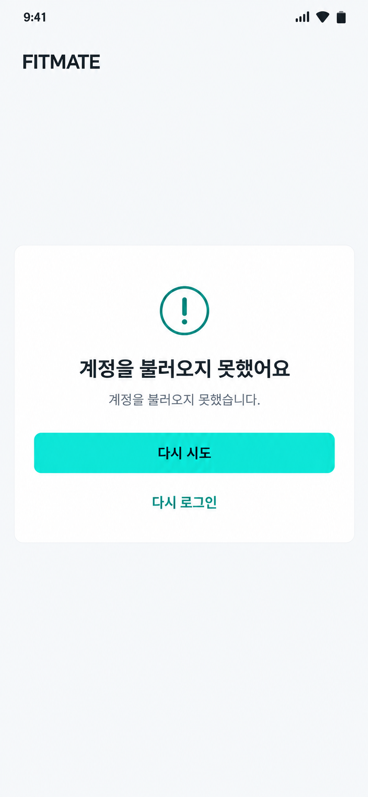](../assets/ui-redesign/27b-session-error-light-v1.png) | [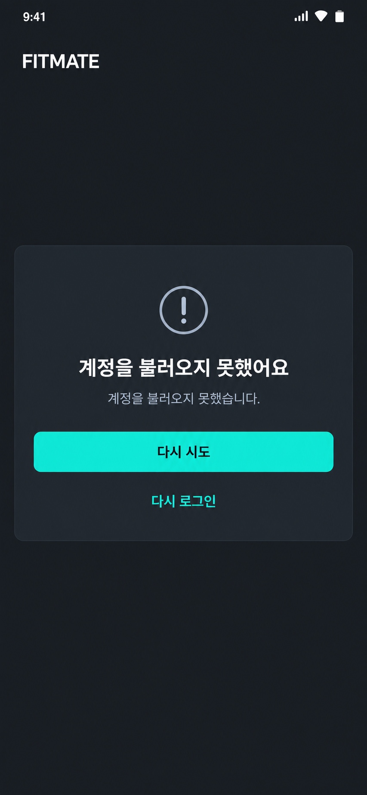](../assets/ui-redesign/27b-session-error-dark-v1.png) |

세션이 있는 상태에서 users/me 조회에 실패한 예시다. ServerSessionGate의 다시 시도는 attempt 증가로 재조회하고, 다시 로그인은 기존 로그인 화면으로 전환한다. 서버 오류 문구를 임의의 만료·비밀번호 오류로 확정하지 않는다. 로그인 실패와 별개 상태다.

## 알림 빈 목록

| 라이트 | 다크 |
|---|---|
| [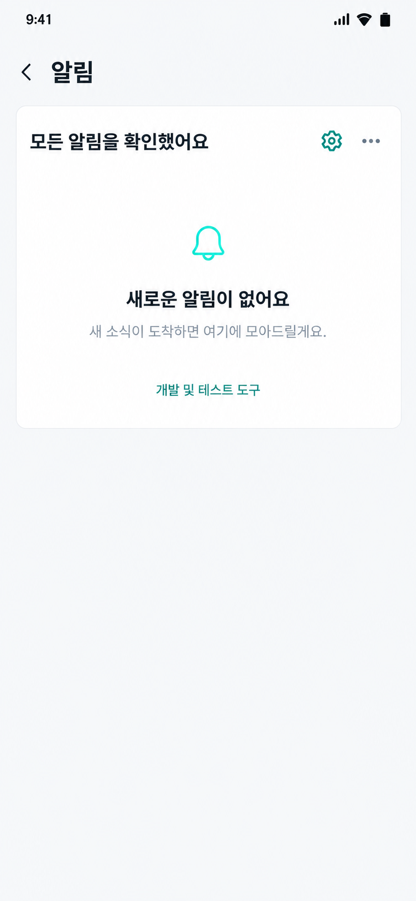](../assets/ui-redesign/30c-notifications-empty-light-v1.png) | [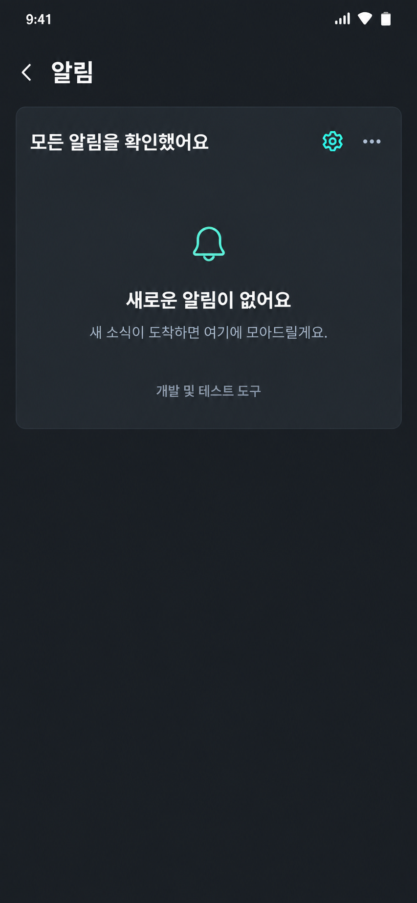](../assets/ui-redesign/30c-notifications-empty-dark-v1.png) |

NotificationFlow의 notices 빈 배열 상태다. 설정·관리 메뉴는 남기고 모두 읽음/전체 삭제는 기존 조건대로 비활성이다. 이 코드는 초기 서버 조회 실패를 별도 오류로 표시하지 않으므로 빈 화면만으로 조회 성공을 보장하지 않는다. 시안은 정상 조회 후 빈 결과 예시이며, 오류 처리 기능 추가는 별도 범위다. 개발 도구는 Debug 전용이다.

## 인바디 빈 목록

| 라이트 | 다크 |
|---|---|
| [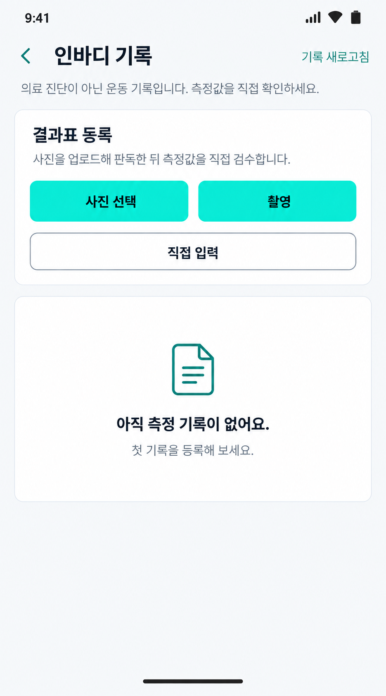](../assets/ui-redesign/23c-inbody-empty-light-v1.png) | [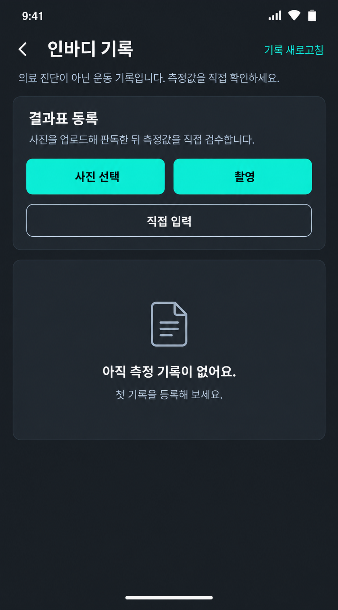](../assets/ui-redesign/23c-inbody-empty-dark-v1.png) |

InbodyFlow에서 loaded=true, refreshing=false, listError=null이고 기록이 비어 있을 때만 표시한다. 사진 선택·촬영·직접 입력과 새로고침을 보존하며, 조회 실패나 로딩 중을 빈 기록으로 바꾸지 않는다. 0 kg·가짜 변화 차트는 표시하지 않는다.

## 인바디 판독 대기

| 라이트 | 다크 |
|---|---|
| [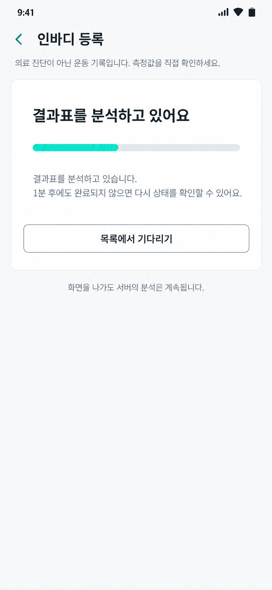](../assets/ui-redesign/25c-inbody-processing-light-v1.png) | [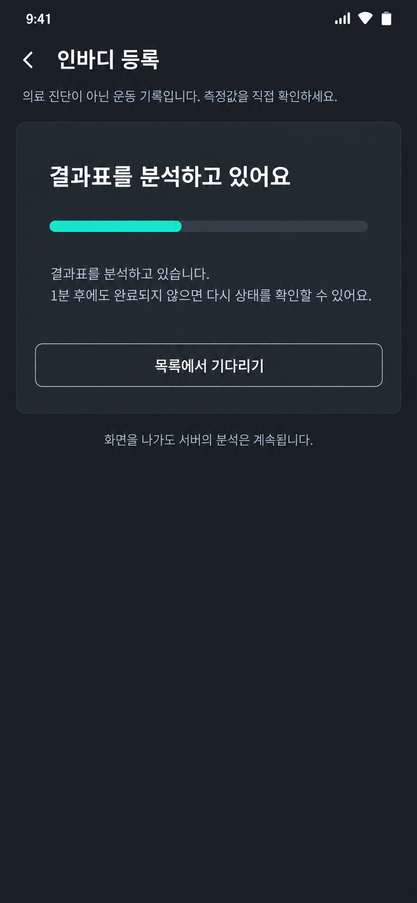](../assets/ui-redesign/25c-inbody-processing-dark-v1.png) |

기존 판독 중 상태다. 서버의 같은 analysisId를 최대 30회, 약 2초 간격으로 확인한다. 목록에서 기다리기는 화면 이동이며 서버 분석 취소가 아니다. 1분 문구는 완료 보장이 아니다. 타임아웃·FAILED·조회 실패는 기존 판독 실패 경로와 동일 판독 조회/재시도 조건을 따른다.

## 인바디 검수 누락

| 라이트 | 다크 |
|---|---|
| [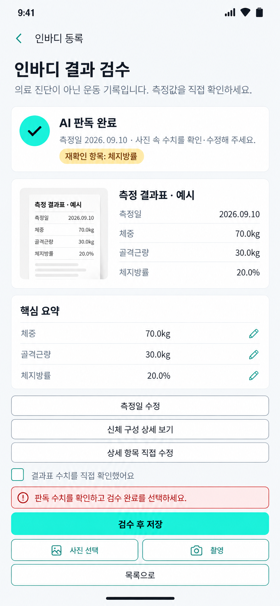](../assets/ui-redesign/26b-inbody-review-error-light-v1.png) | [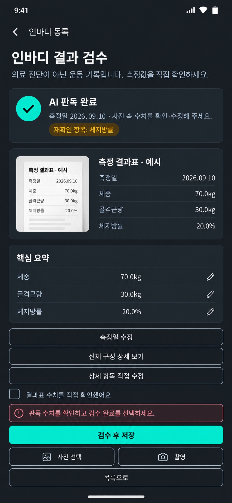](../assets/ui-redesign/26b-inbody-review-error-dark-v1.png) |

사진 판독 결과에서 acknowledged=false인 채 검수 후 저장을 누른 상태다. 오류를 확인 항목 가까이에 배치하지만 버튼은 기존처럼 누른 뒤 검증한다. 검수 확인 전 서버 저장을 호출하지 않는다. 숫자·사진·측정일은 합성 예시이며 provider가 MOCK인 실제 경로에서는 개발용 판독 안내를 유지한다.

## 인바디 저장 응답 불명확

| 라이트 | 다크 |
|---|---|
| [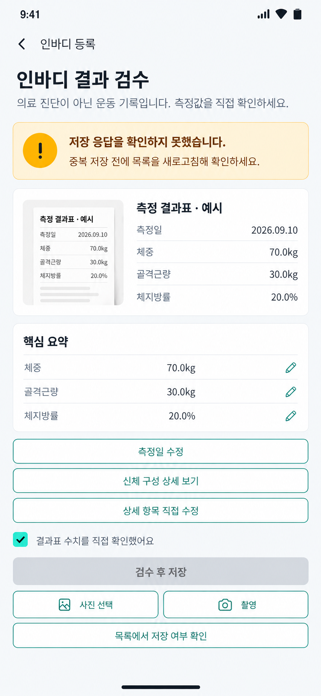](../assets/ui-redesign/26c-inbody-save-uncertain-light-v1.png) | [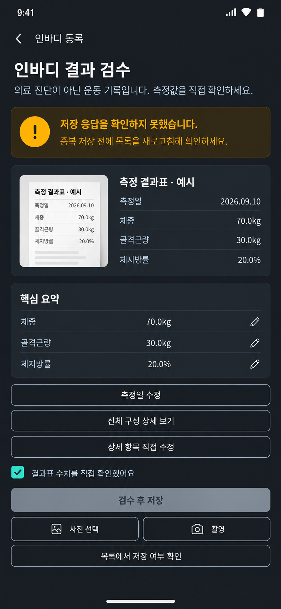](../assets/ui-redesign/26c-inbody-save-uncertain-dark-v1.png) |

검수 후 저장 요청의 응답을 확인할 수 없는 saveUncertain=true, busy=false 상태다. 검수 후 저장은 비활성이고 목록에서 저장 여부 확인은 기존 목록 전환·새로고침을 수행한다. 저장 실패나 성공으로 단정하지 않고 재저장 버튼을 새로 추가하지 않는다. 사진 교체와 입력 편집 등 현재 경로도 보존한다.

## 측정 기록 삭제 확인

| 라이트 | 다크 |
|---|---|
| [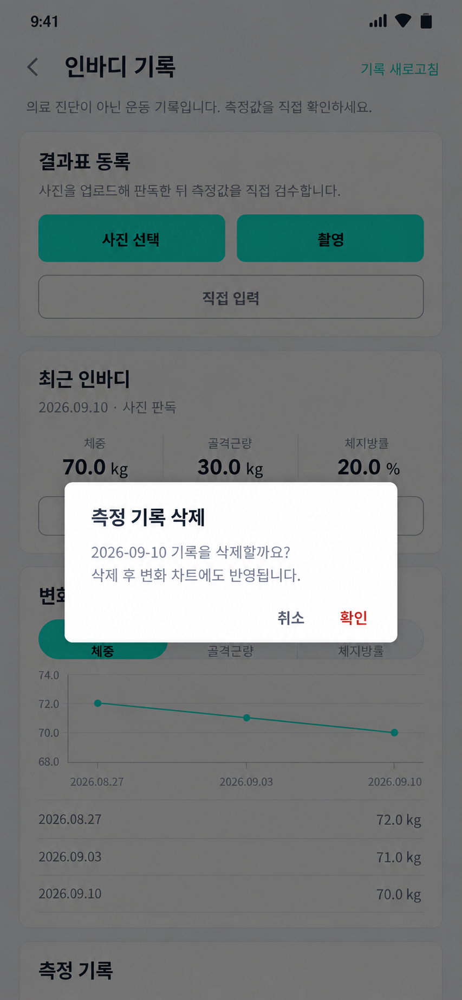](../assets/ui-redesign/23d-inbody-delete-confirm-light-v1.png) | [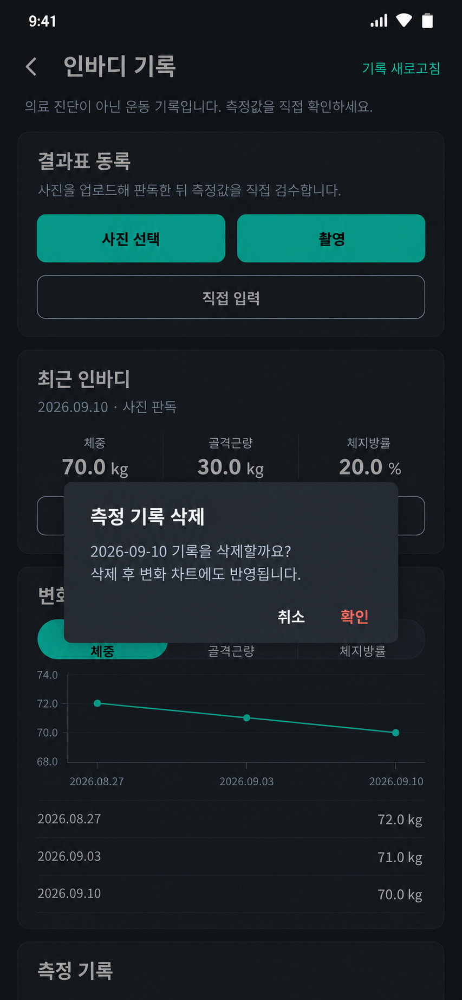](../assets/ui-redesign/23d-inbody-delete-confirm-dark-v1.png) |

목록의 측정 기록 삭제 동작으로 연 기존 ConfirmAction이다. 합성 날짜 2026-09-10을 표시한다. 취소/확인은 기존 레이블과 동작이며, 확인 뒤 서버 delete 성공 때 목록에서 제거한다. busy 중 중복 실행·닫기 방지, 실패 시 listError 처리를 유지한다. 실제 삭제는 실행하지 않았다.

## 로그아웃 확인

| 라이트 | 다크 |
|---|---|
| [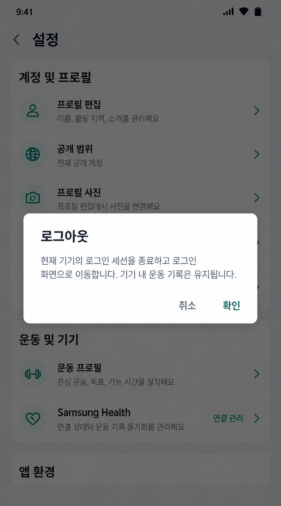](../assets/ui-redesign/31e-logout-confirm-light-v1.png) | [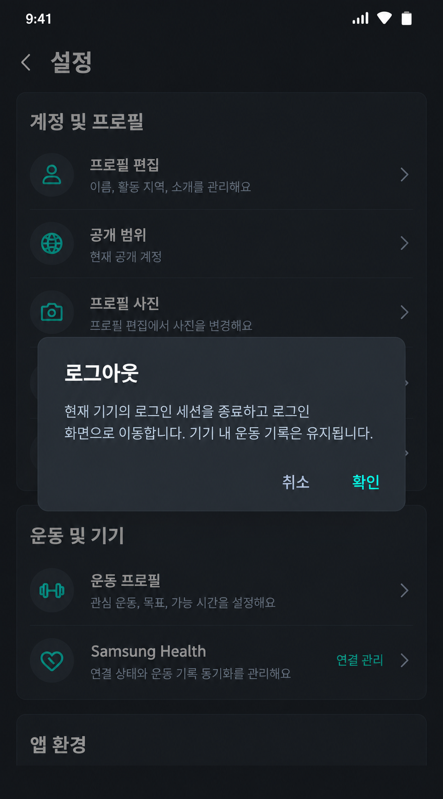](../assets/ui-redesign/31e-logout-confirm-dark-v1.png) |

일반 설정의 기존 ConfirmAction이다. 확인은 현재 기기 로그아웃 흐름이고 전체 기기 로그아웃이나 기록 삭제로 확대하지 않는다. 서버 로그아웃·세션 정리·운동 일시정지/측정 중지의 기존 경로를 보존한다. 실제 로그아웃은 실행하지 않았다.

## 공통 컴포넌트 기준 제안

이미지마다 생긴 외형 차이를 통일하기 위해 제안했던 기준이다. 실제 적용값과 검증 범위는 위 구현·검증 기록을 따른다.

| 요소 | 통일 기준 | 기능 보존·검증 |
|---|---|---|
| 여백·표면 | 화면 좌우 20dp, 섹션 20dp, 항목 12dp, 카드 내부 16dp. 일반 카드 16dp·주요 카드 18dp·버튼 12dp | 기존 FitMateSpacing 값을 우선 활용. 생성 이미지 픽셀값을 dp로 복사하지 않음 |
| 제목·본문 | 화면 제목 26sp, 섹션 20sp, 본문 16sp, 보조 14sp를 시작점으로 검토 | 긴 한국어는 줄바꿈. 200% 글자·작은 화면에서 잘림 확인 |
| 주 행동 | 민트 채움·진한 글자. 화면의 핵심 동작에 집중 | enabled와 busy 조건을 화면 코드대로 유지. 미확인 검수 버튼을 임의 비활성화하지 않음 |
| 보조·위험 행동 | 보조는 외곽선/텍스트, 삭제 확인은 오류 색. 확인 창 취소 왼쪽·확인 오른쪽 | 삭제/로그아웃의 기존 확인 단계·영향 범위 보존 |
| 입력 오류 | 경고 아이콘과 원인 문구를 관련 입력 또는 제출 영역 가까이 배치 | 색만으로 오류를 구분하지 않음. 서버 원문·검증 우선순위·입력값 유지 |
| 로딩 | 처리 중이라는 문구와 불확정 진행 표시 | 서버에 없는 백분율·남은 시간 생성 금지. 중복 실행 차단은 현재 조건 유지 |
| 빈 상태 | 단순 아이콘·빈 이유·기존 가능한 행동 | 로딩/오류를 빈 상태·0 수치로 대체하지 않음 |
| 선택·스위치 | 단일 선택은 라디오, 복수 선택은 체크 표식+색. ON 손잡이 오른쪽, OFF 왼쪽 | 비활성 ON과 OFF 구분. 필수 동의·기기 동의·서버 알림 상태를 합치지 않음 |
| 아이콘·탭 | 기존 Compose 아이콘 계열과 공통 크기 사용. 생성 컷의 탭 아이콘 차이 제거 | 기존 5개 탭과 화면별 표시 여부 유지. 터치 영역 최소 48dp |
| 시트·확인 창 | 제목→영향 설명→행동 순서, 배경과 분리 | 뒤로가기·바깥 터치·busy 닫기 조건은 화면별 기존 동작. 포커스 이동·복귀 검증 |

### 색상과 대비

제안 토큰의 불투명 단색 조합을 sRGB 상대 휘도 공식으로 계산했다. 이미지 픽셀이나 실제 앱의 대비 측정 결과는 아니다. 반투명·비활성·눌림 상태와 테두리/아이콘의 대비는 구현 시 따로 확인한다. 일반 본문 목표는 계획서의 4.5:1이다.

| 용도 | 글자 | 배경 | 계산 대비 |
|---|---|---|---|
| 라이트 본문 | #182129 | #FFFFFF | 16.30:1 |
| 라이트 보조 | #5D6874 | #FFFFFF | 5.68:1 |
| 라이트 민트 글자 | #007D70 | #FFFFFF | 5.04:1 |
| 민트 버튼 글자 | #182129 | #16DFC1 | 9.59:1 |
| 다크 본문 | #F5F7FA | #282E35 | 12.77:1 |
| 다크 보조 | #AFBAC6 | #282E35 | 6.96:1 |
| 라이트 오류 | #B3261E | #FFFFFF | 6.54:1 |
| 다크 오류 | #FFB4AB | #282E35 | 8.07:1 |

라이트 배경 #F6F8FA/표면 #FFFFFF, 다크 배경 #1C2025/표면 #282E35를 제안한다. 밝은 민트 #16DFC1은 채움에 쓰고 라이트의 링크·작은 글자는 #007D70으로 구분한다. 현재 Theme.kt의 전역 색상을 바로 바꾸면 Samsung Health에도 영향을 줄 수 있으므로, 구현 첫 단계에서 개편 화면의 테마 범위를 분리하고 제외 화면의 기존 테마와 진입 동작을 확인한다.

## 시안 제작 당시 상태 점검표

| 영역 | 이미지로 검토한 대표 상태 | 화면별 구현 시 남은 검증 |
|---|---|---|
| 운동 | 기존 추가 시안의 이어하기·루틴 없음·세트 수정·휴식·종료 저장 실패 | 초기 로딩, 입력 검증, 저장 중 중복 방지, 루틴 삭제, 러닝 GPS/권한·재진입 |
| 메이트 | 목록·상세·작성·신청 관리·문의 기본 컷 | allowedActions, 마감/정원/거절, 조회·전송 오류, 수정 제한·읽기 전용 |
| 커뮤니티·DM | 피드·댓글·작성/수정·목록·대화·받은 요청 | 빈 목록·로딩·전송 실패, 메뉴·차단·초안 삭제, 사진 제한 |
| 프로필·인바디 | 기본 컷과 이번 빈 기록·판독 대기·검수 오류·저장 불명확·삭제 확인 | 목록 조회 오류·편집 충돌·판독 실패/타임아웃, 수치 입력 오류·상세 수정, MOCK 안내 |
| 인증·설정 | 기본 컷과 이번 세션 오류·알림 없음·로그아웃 확인 | 로그인/가입 검증·중복 확인 실패, 약관 본문, 알림 설정/메뉴, 요청 실패, 비밀번호·탈퇴·로컬 삭제 시트 |

미제작 상태를 무조건 별도 이미지로 늘리기보다 같은 공통 표현으로 구현 가능한지 먼저 판단한다. 화면 구조나 위험 행동이 달라지는 경우 추가 시안을 검토한다. 시안 제작 당시 다음 작업 단위는 공통 UI 기반과 홈·루틴 선택·운동 진행 적용 준비였다. 이후 진행 상태는 [UI 개편 계획](./검토중-ui-개편-계획.md)을 따른다. 적용 시 기존 경로·데이터·오류 조건을 대조하고 해당 묶음의 테스트·빌드·USB 실기기 회귀를 수행한다. 다른 영역의 기능 수정은 함께 넣지 않는다.

## 시안 제작 당시 검증

16장의 주요 한국어 문구·수치·체크 상태·저장 버튼 활성 조건·확인 창 행동을 육안 대조했다. 라이트 확인 창 2장의 배경 오버레이와 로그아웃 확인 버튼 형태를 보정했다. 판독 진행 막대는 불확정 애니메이션의 정지 컷이며 진행률 수치가 아니다. 시안의 작은 장식·시스템 바·아이콘 색상 차이는 위 공통 기준과 실제 Android 시스템 UI에 맞춰 구현한다.

PNG 읽기 검증 결과 12장은 853×1844, 인바디 빈 목록과 로그아웃 확인의 두 테마 4장은 935×1683이다. 해상도·비율은 검토용이며 구현 치수 기준이 아니다. 프롬프트 JSON 8개 상태·16개 출력과 보정 기록을 확인했고, 관련 문서 로컬 링크 287개에 누락이 없다. 현재 검토본은 122장, 이전 지방량 그림 원본 2장을 포함한 저장소 PNG는 124장이다.

시안 제작 당시 변경은 검토 문서·프롬프트·PNG에 한정됐다. Android 코드·계정·건강 기록과 Samsung Health 내부 UI는 변경하지 않았고 Android 빌드·테스트·USB 설치도 수행하지 않았다. 이후 실제 구현·검증과 남은 항목은 위 7차 구현·검증 기록을 따른다.
