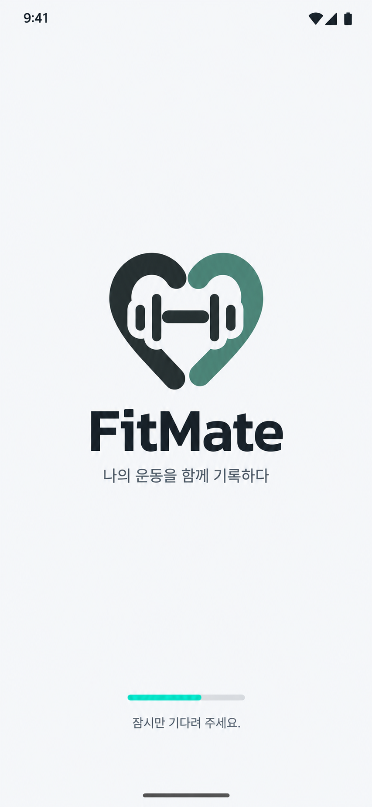
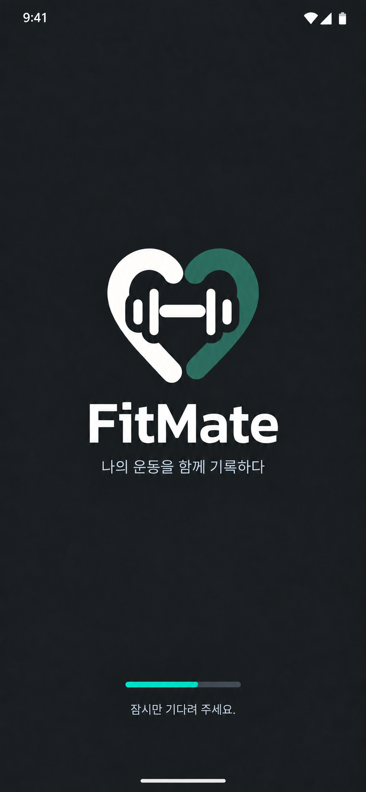
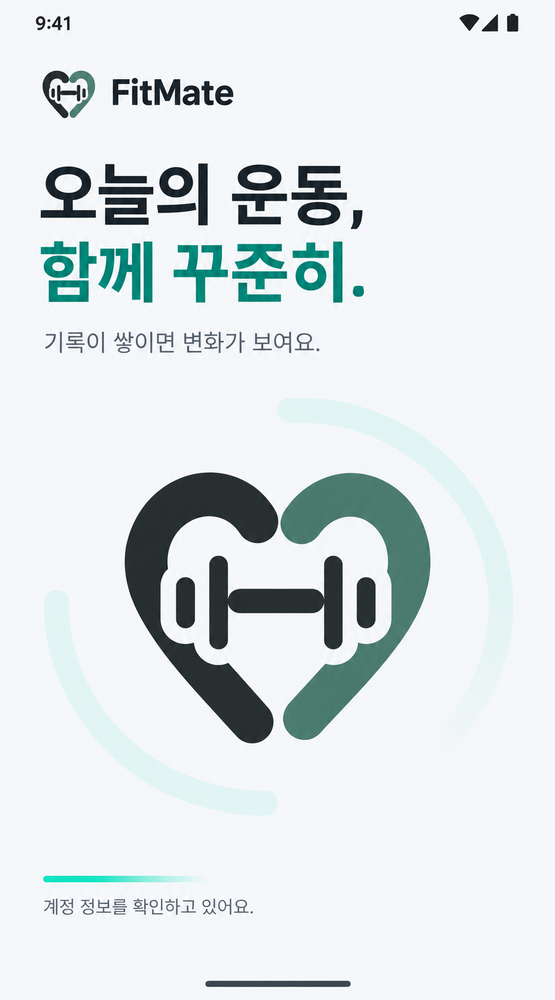
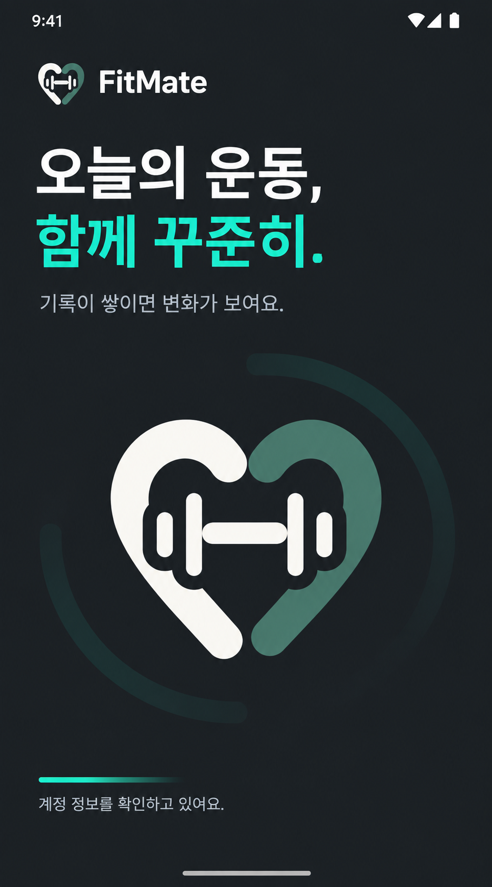

# 검토 중 — FitMate 시작 화면 시안

- 작성일: 2026-09-10
- 최종 수정일: 2026-09-10
- 버전: v2
- 상태: 검토 중
- 목적: 앱 실행 직후 브랜드 화면의 A안 구현 및 검증 기록
- 기준: [UI 개편 계획](./검토중-ui-개편-계획.md), [상태·공통 UI 기준](./검토중-ui-시안-7차-상태-공통규칙.md)
- 제작: built-in image_gen, [생성 프롬프트](../assets/ui-redesign/prompts-launch-v1.json)

**2개 방향 × 라이트·다크 = PNG 4장**이다. 기존 01~31 기능 화면에 앞서는 공통 시작 화면 00의 대안이며 두 안을 연속으로 표시하는 구성이 아니다. 사용자 선택에 따라 A안을 구현했고 B안은 비교 자료로 보관한다.

## 제안 — 자동으로 이어지는 브랜드 시작 화면

구현 전에는 MainActivity에서 앱을 시작하고 ServerSessionGate가 계정을 확인하는 동안 문구와 LinearProgressIndicator만 표시했다. 이번 구현은 기존 대기 화면에 브랜드 표현을 입히며 새 로그인 단계·시작 버튼·회원가입 설문은 추가하지 않는다.

심볼은 현재 앱 내 fitmate_symbol과 adaptive launcher foreground에 쓰는 **하트 안의 덤벨** 형태를 기준으로 한다. 기존 XML 벡터를 읽고 미리보기로 렌더링해 이미지 생성 참조로 사용했다. 저장소의 일부 webp 런처 아이콘은 기본 Android 그림이므로 브랜드 참조에서 제외했다. 시안은 로고의 사용·배치 제안이며 구현에는 기존 벡터를 사용하고 AI가 그린 로고를 그대로 대체하지 않는다.

## A안 — 로고 중심 · 적용

중앙의 심볼과 FitMate 이름, 짧은 한 줄 메시지로 구성한다. 매일 반복해서 켜는 앱의 첫 화면으로 간결하고 앞서 만든 운동 화면과 자연스럽게 연결된다.

| 라이트 | 다크 |
|---|---|
|  |  |

- 중심: 하트·덤벨 심볼 → FitMate → 나의 운동을 함께 기록하다.
- 하단: 실제 계정 확인 중에만 진행 표시와 짧은 안내 ‘잠시만 기다려 주세요.’
- 장식·버튼을 최소화하고 충분한 여백을 둔다.

## B안 — 메시지 중심

‘오늘의 운동, 함께 꾸준히.’를 먼저 보여주고 심볼을 크게 배치한다. 운동과 함께한다는 브랜드 인상을 강조하는 방향이다.

| 라이트 | 다크 |
|---|---|
|  |  |

- 상단: 작은 심볼과 FitMate.
- 주요 문구: 오늘의 운동, / 함께 꾸준히.
- 보조 문구: 기록이 쌓이면 변화가 보여요.
- 하단: A안과 같은 실제 계정 확인 상태이며 ‘계정 정보를 확인하고 있어요.’로 처리 내용을 표시한다. 메시지는 브랜드 문구이며 새로운 코칭·예측 기능을 뜻하지 않는다.

## 화면 전환과 구현 기준

| 상황 | 기존 흐름 유지 |
|---|---|
| 계정 확인 중 | 선택한 시작 화면과 불확정 진행 표시 |
| 세션 없음 | 기존 로그인 화면으로 이동 |
| 계정 조회 성공 | 기존 앱 진입·홈 초기화 흐름 유지 |
| 계정 조회 실패 | 7차 계정 조회 실패 화면의 다시 시도/다시 로그인 |
| 다시 시도 | 기존 계정 재조회 조건 유지. 시안을 보여주기 위한 추가 요청 금지 |
| 라이트·다크·시스템 | 기존 저장된 AppearanceMode 기준을 유지 |

로고를 보기 위해 의도적으로 2~3초씩 기다리게 하지 않는다. 준비가 끝나면 즉시 기존 목적지로 이동하며 진행률·완료 시간을 가정하지 않는다. 기존 busy·세션 조건을 유지한다. 시작 화면에 권한·건강정보 동의·광고를 끼워 넣지 않는다.

OS가 표시하는 앱 실행 화면과 앱 내부의 계정 확인 화면을 구분해 구현했다. OS 시작 화면에는 심볼·배경을 연결하고 앱 내부 계정 확인 화면에 브랜드명·문구·진행 표시를 배치했다. OS 화면은 시스템 테마를 따르고 앱 내부는 저장된 AppearanceMode를 따르므로 두 설정이 다르면 전환 때 배경이 바뀔 수 있다. 이번 네 장은 앱 내부 브랜드 대기 화면의 시안이며 OS 시작 화면의 픽셀 재현을 보장하지 않는다.

등장 모션을 사용한다면 짧은 불투명도 전환만 제안한다. 새 강제 대기·반복 확대·심박 효과는 필요하지 않다. 모션 축소 설정·빠른 실행·프로세스 재생성·테마 전환과 화면 깜빡임은 실제 적용 때 검증한다.

Samsung Health 내부 UI·연동·권한과 기존 기능·데이터·API는 변경하지 않는다. 시작 화면은 공통 진입 표현만 다룬다.

## 검증과 다음 단계

4장의 로고 형태·브랜드 문구·로딩 안내·두 테마 가독성을 육안 검토했다. A안 하단의 잘못 생성된 글자를 보정하면서 안내를 ‘잠시만 기다려 주세요.’로 정리했다. 진행 막대는 불확정 애니메이션의 정지 컷이며 표시 길이가 실제 진행률을 의미하지 않는다. 구현에는 기존 벡터의 정확한 경로와 실제 시스템 아이콘을 사용한다.

PNG 4장 읽기 검증을 통과했다. A안 두 장은 853×1844, B안은 935×1682/935×1683이며 1px 차이를 포함한 생성 이미지 치수는 구현 기준으로 사용하지 않는다. 프롬프트 JSON 2개 방향·4개 출력·보정 기록과 관련 문서 로컬 링크 299개를 확인했으며 누락은 없다. 저장소 현재 검토본은 126장이고 이전 원본 2장을 포함한 PNG는 128장이다.

### A안 Android 적용 결과 — 2026-09-10

- `LaunchScreen.kt`에 로고·FitMate·한 줄 문구와 실제 대기 중 진행 표시를 구현했다. 라이트용 심볼은 기존 벡터 경로를 그대로 사용하고 색상만 조정했다.
- `ServerSessionGate`의 loading 분기만 교체했다. 계정 조회·오류·재시도·로그인·가입·홈 분기, API와 저장 데이터는 그대로다. 의도적인 대기와 추가 요청은 없다.
- MainActivity에 시작 전용 테마를 지정하고 onCreate에서 기존 테마로 복귀한다. Android 12 이상은 시스템 splash 속성, 이전 버전은 windowBackground 리소스를 제공한다. 공통 Compose 테마와 Samsung Health UI·로직은 수정하지 않았다.
- `:app:testDebugUnitTest :app:assembleDebug` 성공. 기존 단위 테스트 56개, 실패·오류·건너뜀 0개. UI 전환 전체를 자동 검증하는 테스트는 아니다.
- USB Samsung SM-S947N에 debug APK를 데이터 유지 설치했다. 기기의 Compose PreviewActivity에서 두 테마를 각각 렌더링해 로고·문구·진행 표시·여백을 확인했다. 이는 실제 UI 코드 미리보기이며 로그인 성공 검증과 구분한다.
- MainActivity 실행은 성공했고 기존 계정 조회 실패 화면으로 전환했다. 당시 로컬 8080 서버의 수신 포트와 adb reverse 설정이 없어 서버에 연결되지 않았다. 로그인 성공 후 홈 진입은 검증하지 못했다.
- 작은 화면·글자 확대·TalkBack, Android 10/11 기기, OS splash의 프레임별 전환과 앱/시스템 테마 불일치 조합은 미검증이다. 실제 시작 시간에 대한 성능 개선은 주장하지 않는다.

공통 UI와 홈·루틴 선택·운동 진행 등 나머지 화면은 후속 적용 범위다. 시작 화면 구현이 전체 UI 개편 완료를 의미하지 않는다.
