# 검토 중 — FitMate UI 추가 상태 시안

- 작성일: 2026-09-10
- 최종 수정일: 2026-09-10
- 버전: v1.2
- 상태: 검토 중
- 목적: 홈·루틴·운동 진행의 주요 추가 상태 6개를 라이트/다크로 검토
- 기준: [UI 개편 계획](./검토중-ui-개편-계획.md), [1차 기본 화면 시안](./검토중-ui-시안-1차.md)
- 제작: built-in `image_gen`, [생성·보정 프롬프트](../assets/ui-redesign/prompts-states-v1.json)

기본 화면의 스타일에 이어 **6개 상태 × 2테마 = PNG 12장**을 제작했다. 플랜핏 Android 앱에서 참고한 정보 위계를 FitMate의 기존 기능에 적용한 이미지 시안이며 실제 앱 구현 화면은 아니다. 숫자·루틴·기록은 합성 예시다.

**기능·데이터·API·권한 정책은 유지하며 프로필 → 설정 → Samsung Health 내부 UI는 제외한다.** 공통 스타일을 구현할 때도 해당 팀원 영역에 간접 변경이 생기지 않도록 확인한다. 이미지를 선택하면 원본을 크게 볼 수 있다.

## 01a 홈 — 운동 이어하기

운동 진행에서 기존 일시정지·나가기 흐름을 거쳐 홈으로 돌아온 상태다. 일반 홈의 운동 시작 영역을 진행 중 운동 카드로 바꿔 다음 행동을 찾기 쉽게 했다.

| 라이트 | 다크 |
|---|---|
| [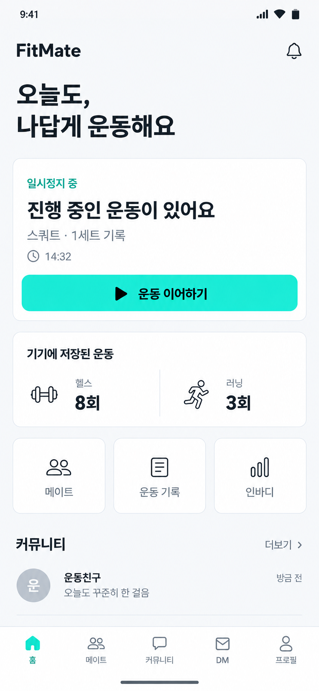](../assets/ui-redesign/01a-home-resume-light-v1.png) | [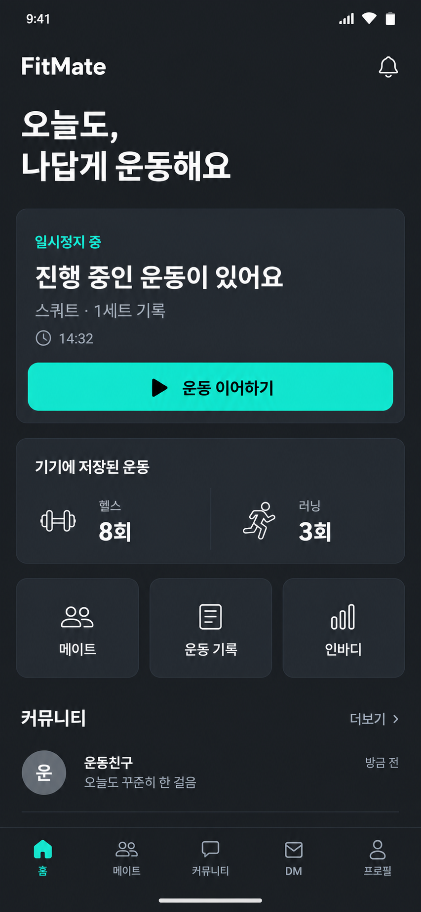](../assets/ui-redesign/01a-home-resume-dark-v1.png) |

- `운동 이어하기`는 보관된 세션의 운동 진행 화면으로 돌아간다. 이 버튼만으로 타이머가 자동 재개된다고 새롭게 정의하지 않는다.
- 경과 시간 14:32와 스쿼트 1세트는 예시다. 기존 일시정지 시 세션·휴식 타이머를 정지하는 동작을 유지한다.
- 아래 기록 요약·바로가기·커뮤니티·5개 탭은 일반 홈과 같은 접근 경로를 유지한다.

## 02a 루틴 — 내 루틴 없음

내 루틴 조회에 성공했지만 목록이 비어 있는 상태다. 빈 이유와 시작할 수 있는 행동을 함께 보여 준다.

| 라이트 | 다크 |
|---|---|
| [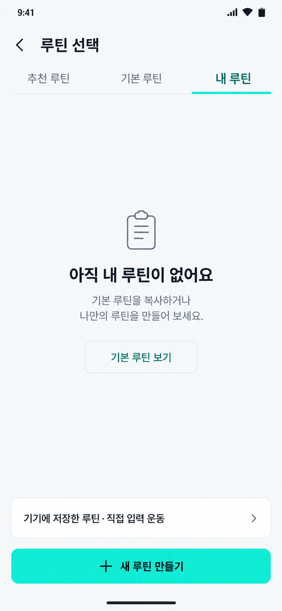](../assets/ui-redesign/02a-routine-empty-light-v1.png) | [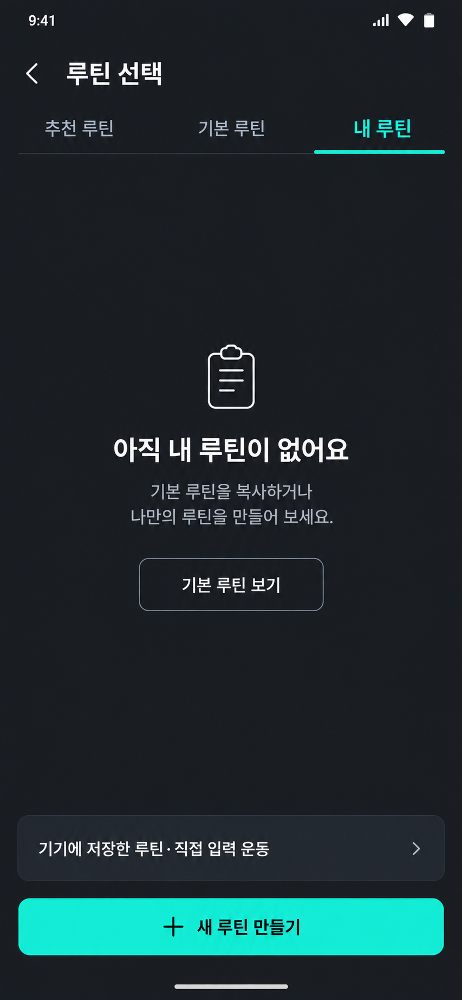](../assets/ui-redesign/02a-routine-empty-dark-v1.png) |

- `기본 루틴 보기`는 기존 기본 루틴 탭으로 이동하는 바로가기 제안이다. 목록을 복사한 것처럼 표시하지 않는다.
- `새 루틴 만들기`와 기기에 저장한 루틴·직접 입력 경로를 유지한다. 만들기 활성 조건은 기존 운동 카탈로그 로딩 상태를 따른다.
- 조회 실패나 로딩 중을 이 빈 상태로 표시하지 않는다.

## 02b 루틴 — 편집 시트

내 루틴의 수정 동작으로 연 편집 시트다. 이름, 선택 운동, 추가 가능한 운동, 저장 순서로 정리했다.

| 라이트 | 다크 |
|---|---|
| [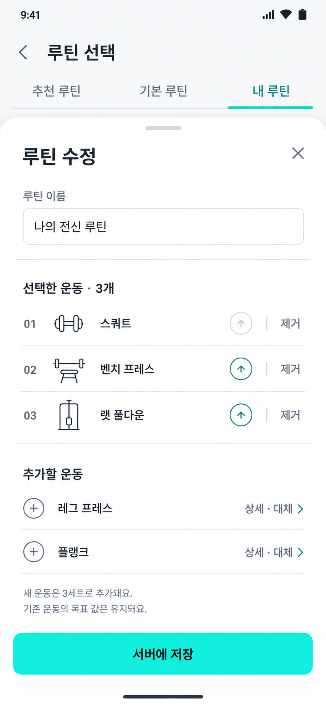](../assets/ui-redesign/02b-routine-edit-light-v1.png) | [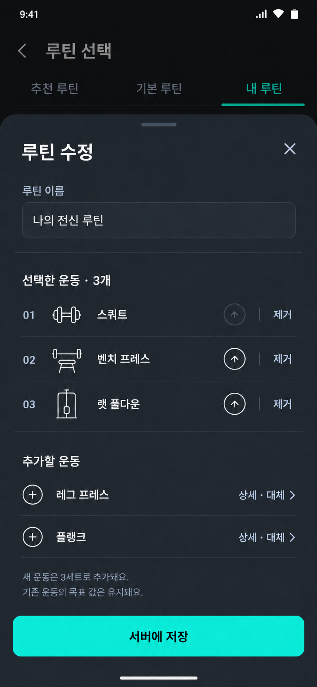](../assets/ui-redesign/02b-routine-edit-dark-v1.png) |

- 기존 이름 수정·운동 추가·위로 이동·제거·상세·대체 기능을 유지한다. 첫 운동의 위로 이동은 비활성이다.
- 기존 운동의 목표 값을 유지하고 새 운동은 기존 로직대로 3세트로 추가한다. 시안에 검색·드래그 재정렬 기능을 추가하지 않았다.
- `서버에 저장`은 기존 수정 API와 버전 처리를 사용한다. 이름·선택 운동·저장 중 여부에 따른 기존 활성 조건과 오류 처리를 유지한다.
- 배경 탭을 `내 루틴` 선택 상태로 보정했다. 시트·키보드·뒤로가기 처리는 실제 구현에서 확인한다.

## 03a 운동 — 기록한 세트 수정

기록한 세트의 기존 수정 진입을 통해 1세트를 편집 중인 상태다. 새 세트 입력과 혼동하지 않도록 제목·배지·하단 버튼을 바꿨다.

| 라이트 | 다크 |
|---|---|
| [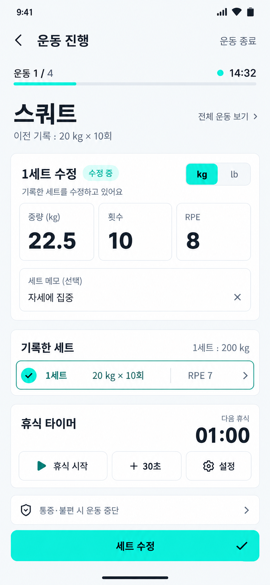](../assets/ui-redesign/03a-set-edit-light-v1.png) | [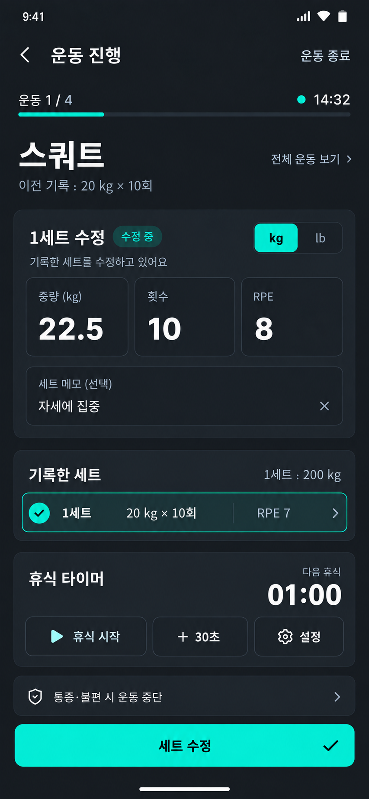](../assets/ui-redesign/03a-set-edit-dark-v1.png) |

- 편집 값은 22.5 kg × 10회, RPE 8이다. 저장 전 기록 행은 기존 20 kg × 10회, RPE 7과 볼륨 200 kg을 유지한다.
- `세트 수정`은 기존 해당 세트를 갱신한다. 새 세트를 추가하지 않으며 기존 중량·횟수·RPE·메모 검증을 그대로 적용한다.
- 기존 로직은 세트 기록과 수정 모두 성공 후 휴식 시간을 설정값으로 초기화하고 휴식을 시작한다. 시안의 대기 타이머는 수정 저장 전 상태다.
- 단위 환산과 기록 삭제 접근은 기존 전체 운동 화면의 동작을 보존한다.

## 03b 운동 — 휴식 중

세트 기록 후 또는 기존 휴식 시작 동작 후 타이머가 실행 중인 상태다. 남은 시간과 일시정지를 쉽게 찾도록 했다.

| 라이트 | 다크 |
|---|---|
| [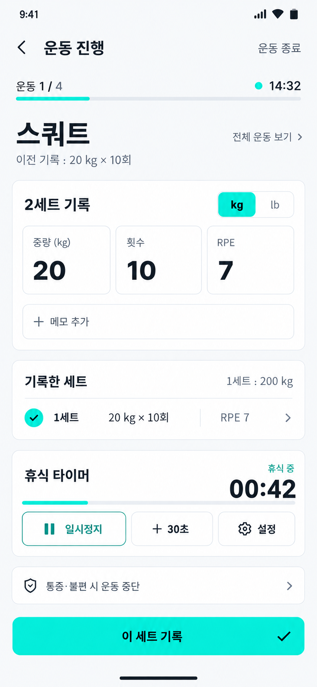](../assets/ui-redesign/03b-rest-running-light-v1.png) | [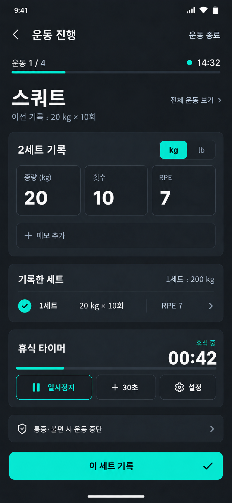](../assets/ui-redesign/03b-rest-running-dark-v1.png) |

- `휴식 중`, 남은 시간 00:42, `일시정지`를 표시한다. 숫자는 예시다.
- 기존 일시정지·재개, 30초 추가, 30/60/90초 설정을 유지한다. 새 프리셋이나 자동 운동 전환은 도입하지 않는다.
- 휴식 조작은 보조 버튼으로 두고 세트 기록의 강조를 유지한다. 시안의 진행선 길이는 도식 표현이며 구현에서는 실제 타이머 상태에 맞춰 계산한다.
- 화면·시트 전환 후 타이머 지속 여부와 운동 일시정지 때의 정지는 기존 상태 관리에 맞춰 검증한다.

## 03c 운동 — 종료 저장 실패

운동 종료 저장 중 네트워크 오류가 발생한 경우의 표현 제안이다. 종료 완료로 오인하지 않도록 오류와 다음 행동을 한곳에 모았다.

| 라이트 | 다크 |
|---|---|
| [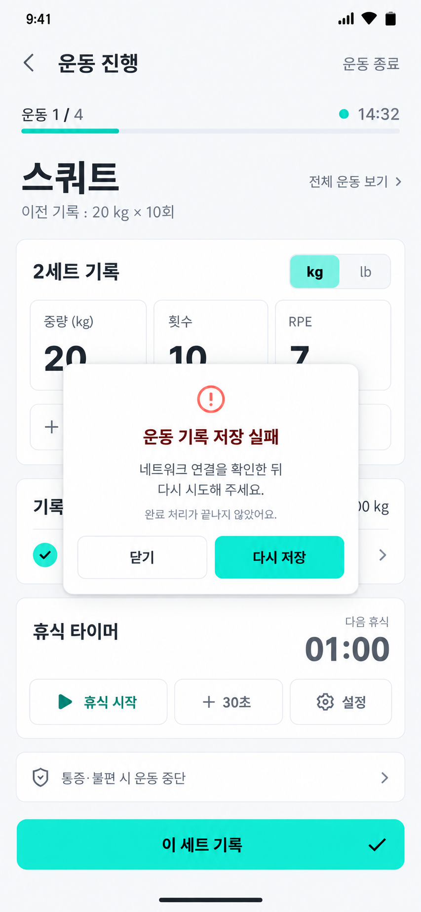](../assets/ui-redesign/03c-save-error-light-v1.png) | [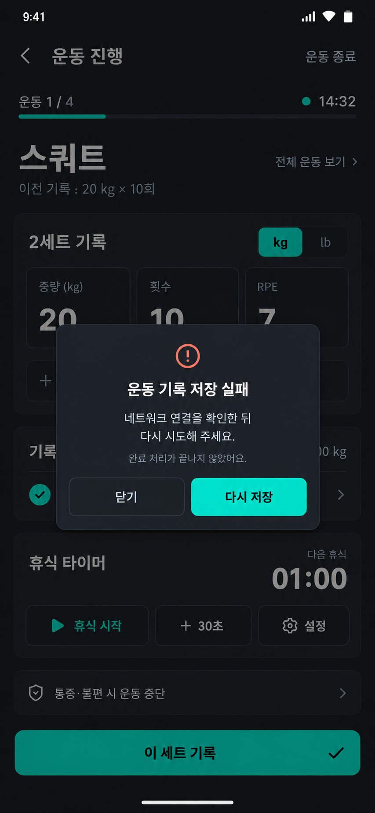](../assets/ui-redesign/03c-save-error-dark-v1.png) |

- `닫기`는 오류 안내를 닫고 운동 화면에 머문다. `다시 저장`은 기존 완료·저장 동작을 다시 호출하는 UI 진입이다.
- 완료 처리 전에는 성공 리포트로 이동하지 않는다. 새 자동 재시도·오프라인 저장 보장·데이터 손실 방지 정책을 추가하지 않는다.
- 이 문구는 네트워크 오류 예시에만 해당한다. 유효성·권한·버전 등 다른 실패 원인을 같은 문구로 덮지 않고 기존 오류 정보를 유지한다.
- 저장 중 중복 실행 방지와 실패 뒤 상태 보존은 실제 구현 단계에서 기존 흐름과 대조한다.

## 검토 결과와 다음 범위

12장의 주요 한글 라벨·입력 값·선택 상태·버튼 위계·화면 잘림을 육안 확인했다. 루틴 편집 배경 탭은 내 루틴으로 보정했다. 추가 PNG 12장 모두 853×1844로 읽기 검증을 통과했고, 기본 시안을 포함한 PNG 18장·프롬프트 JSON의 상태 6개·관련 문서의 로컬 링크 48개를 확인했다. 실제 명암비·터치 영역·키보드·글자 확대·상태 전이는 이미지 검토만으로 검증하지 않는다.

시안 제작 당시 코드에서 대조한 범위는 `ServerRoutines.kt`의 빈 상태·편집·저장 조건, `WorkoutSession.kt`의 세트 수정·휴식 시작·일시정지, `FitMatePrototypeApp.kt`의 재진입·수정 진입·완료 실패 처리다. 시안 제작 이후 해당 묶음을 Android에 적용했으며 [1차 구현·검증 기록](../03-qa/ui-1차-구현-검증.md)에 실제 수행 결과와 미검증 범위를 구분했다.

후속 개인 운동 묶음은 [2차 시안](./검토중-ui-시안-2차-개인운동.md)에 운동 선택·준비·러닝 설정·진행·헬스/러닝 리포트·운동 이력 14장으로 정리했다. 홈 소셜 오류, 루틴 로딩·추천 조건 미충족·저장 중·삭제 확인, 세트 입력 오류·휴식 일시정지·종료 저장 중 등은 아직 별도 이미지로 제작하지 않았으며 구현 전 상태 점검 목록에 유지한다.

이 묶음의 Android 적용이 전체 UI 개편 완료를 뜻하지 않는다. 실제 서버 왕복과 나머지 화면 회귀는 구현·검증 기록의 한계를 따른다.
