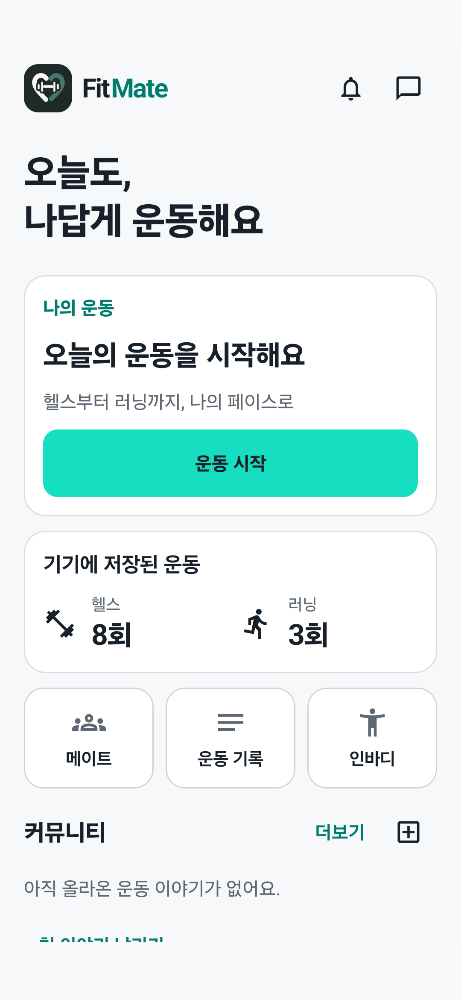
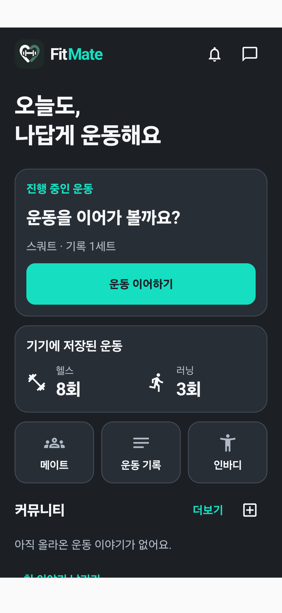
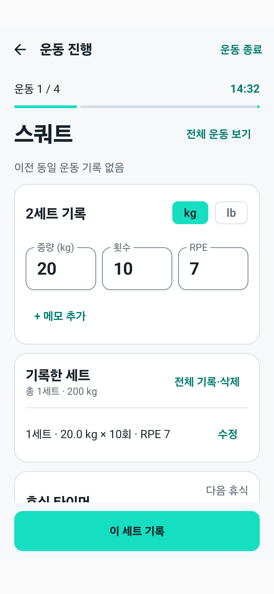
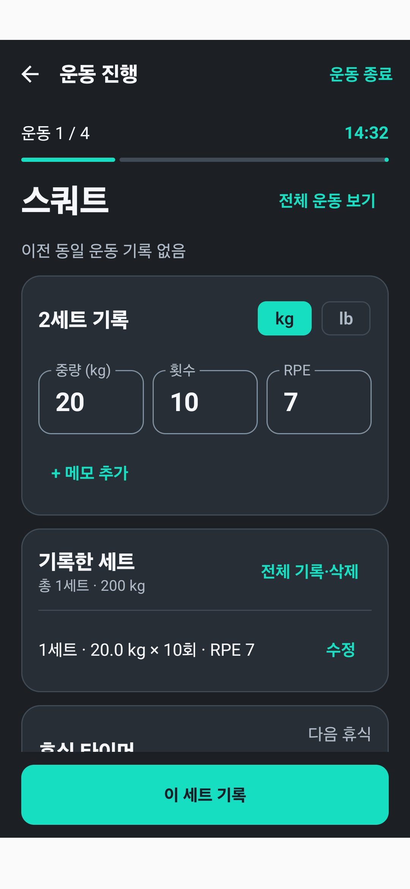

# 검토 중 — 홈·루틴 선택·운동 진행 UI 적용 및 검증

- 작성일: 2026-09-10
- 최종 수정일: 2026-09-10
- 버전: v2
- 상태: 검토 중
- 기준: [1차 시안](../01-spec/검토중-ui-시안-1차.md), [추가 상태](../01-spec/검토중-ui-시안-추가상태.md), [공통 기준](../01-spec/검토중-ui-시안-7차-상태-공통규칙.md)

## 적용 범위

홈·루틴 선택·운동 진행 경로에만 새 색상·카드·주 행동 스타일을 적용했다. 기존 전역 Theme.kt와 Samsung Health 화면·연동·권한은 변경하지 않았다. 앞서 적용한 시작 화면 A안도 유지한다.

| 화면 | 변경 내용 | 기존 동작 유지 |
|---|---|---|
| 홈 | 운동 시작/이어하기 카드 → 기기 운동 요약 → 바로가기 → 커뮤니티 순서 | 기존 시작·재진입 콜백, 알림·DM·작성·좋아요·댓글·커뮤니티 접근. 운동 기록 바로가기는 기존 HISTORY로 연결 |
| 루틴 선택 | 탭 강조, 운동별 행·목표 값·상세 진입, 빈 목록 안내, 만들기/복사/수정/삭제 구분 | 추천 조건, 세 탭, 기존 API·busy·버전, 편집 운동 추가/순서/제거, 기기 루틴·직접 입력 진입 |
| 운동 진행 | 큰 수치 입력, 상단 종료, 하단 세트 기록, 현재 운동의 기록·수정, 휴식 조작, 저장 실패 대화상자 | WorkoutSession의 검증·kg/lb 환산·세트 저장/수정·휴식 시작, 전체 운동·삭제·안전·취소·뒤로가기 콜백, 서버 완료·리포트 |

루틴 목표는 서버의 targetRepsMin/Max 범위를 그대로 표현하며 없는 중량·횟수는 만들어 넣지 않는다. 세트 기록 버튼은 스크롤 영역과 분리했다. 작은 폭이나 큰 글자에서는 중량·횟수·RPE를 세로로 배치한다. 내용은 스크롤되며 휴식·안전 영역이 모든 기기에서 첫 화면에 함께 보인다는 의미는 아니다.

## 자동 및 실기기 검증

| 검증 | 결과 |
|---|---|
| `:app:testDebugUnitTest :app:assembleDebug` | 성공, 단위 테스트 58개·실패/오류/건너뜀 0개. 기존 56개와 목표 범위 표시 테스트 2개 |
| 격리 패키지 빌드 | `-PfitmateIsolatedTest=true :app:testDebugUnitTest :app:assembleDebug :app:assembleDebugAndroidTest` 성공 |
| USB 기기 | Samsung SM-S947N |
| 기기 UI 검사 | `WorkoutRedesignDeviceTest`, 최종 `OK (8 tests)` |
| 앱 적용 | `com.fitmate.app.dev` debug APK를 `adb install -r`로 설치, MainActivity 실행 성공 |

실기기 검사는 별도 `com.fitmate.app.dev.records` 패키지에서 합성 데이터와 테스트 콜백을 사용했다. 실제 계정의 세트·루틴·건강정보를 작성하거나 삭제하지 않았다. 테스트 APK와 격리 앱은 기기에 남아 있다.

8개 검사는 홈 시작/개인 기록/커뮤니티 콜백 분리, 홈 이어하기, 실제 목표 값과 운동 ID 전달, 조회 오류와 빈 목록 구분, 잘못된 중량 거부 후 기존 세트 수정·단위 환산·휴식 시작, 완료 실패 시 기록 유지와 수동 재시도 성공, 320×600dp·200% 글자의 입력/기록 버튼 접근, 개편 비활성 영역의 기존 테마 상속을 다룬다. 최초 오류 대화상자 검사에서는 같은 문구가 본문에도 있어 선택이 중복됐고, 대화상자 내부로 대상을 한정해 수정한 뒤 통과했다.

## 실제 UI 코드 렌더링

아래는 이미지 생성 시안이 아니라 USB 폰에서 테스트한 Compose 코드 캡처다. 홈은 공통 하단 탭을 제외한 본문, 루틴은 목록 카드 컴포넌트만 표시한다. 상하단 여백은 테스트 호스트의 시스템 영역이며 실제 MainActivity 전체 화면 검증과 구분한다. 숫자와 이름은 모두 합성 예시다.

| 홈 라이트 | 홈 다크·이어하기 |
|---|---|
|  |  |

| 운동 진행 라이트 | 운동 진행 다크 |
|---|---|
|  |  |

[루틴 카드 다크](../assets/ui-redesign-implemented/routine-dark.png) · [작은 화면·200% 글자](../assets/ui-redesign-implemented/workout-large-text.png)

## 검증 한계

- 후속 [실기기 서버 연동 검증](./ui-실기기-서버연동-260910.md)에서 기존 백엔드·DB 실행 상태를 확인하고 adb reverse를 복구했다. 실제 앱의 홈 → 루틴 복사·편집 → 세트 기록·수정 → 이어하기 → 완료·리포트·이력 재조회가 라이트·다크 모두 통과했다. 위 8개 컴포넌트 검사와 별개의 실제 서버 왕복 2개 검사다.
- 루틴 삭제, 실제 Samsung Health 진입 회귀, TalkBack, 시스템 테마 자동 전환은 미검증이다. Samsung Health 무변경은 코드 경계와 기존 테마 상속 검사로 확인했다.
- 입력 포커스와 하단 버튼 접근은 확인했다. 테스트 캡처에는 소프트 키보드가 나타나지 않아 실제 키보드와 버튼의 겹침 여부는 미검증으로 남긴다.
- 320×600dp와 글자 200%는 테스트 Composition의 크기·글자 배율이다. 폰의 전역 화면/글자 설정은 변경하지 않았다.
- 나머지 개인 운동·메이트·커뮤니티/DM·프로필/인바디·인증/설정 화면은 후속 개편 범위다.
