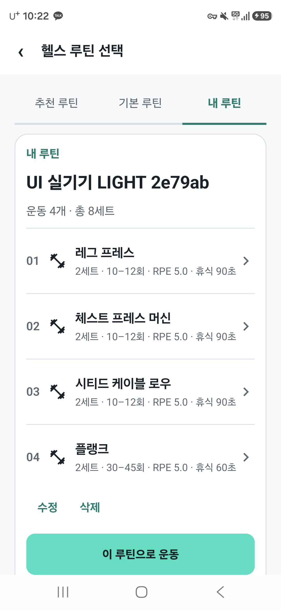
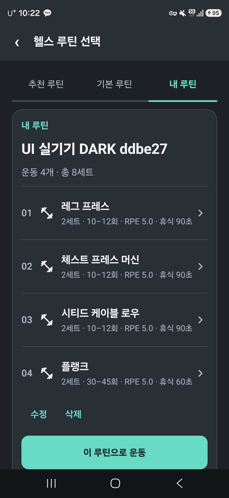
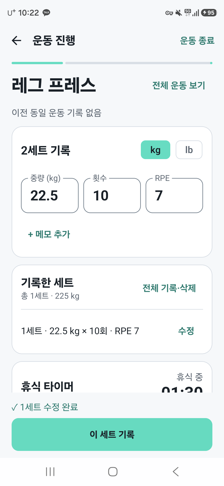
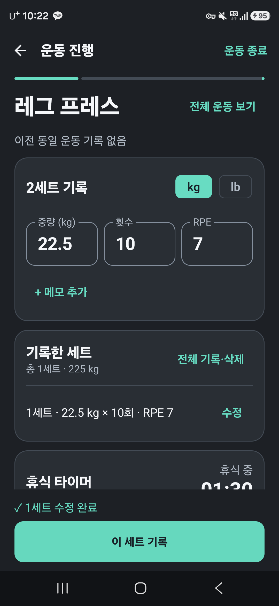

# 검토 중 — UI 개편 실기기·백엔드·MySQL 연동 검증

- 작성일: 2026-09-10
- 최종 수정일: 2026-09-10
- 버전: v1
- 상태: 검토 중
- 기준: [1차 UI 구현 기록](./ui-1차-구현-검증.md)

## 결과

USB Samsung SM-S947N에서 실제 MainActivity를 실행하고 홈 → 루틴 복사·편집 → 운동 준비 → 세트 기록·수정 → 잠시 나가기·이어하기 → 완료 → 리포트 → 홈 → 운동 이력 상세의 전체 경로를 라이트·다크 각각 검증했다. HTTP와 MySQL을 통과하는 opt-in 테스트 최종 결과는 **OK (2 tests)**다.

| 단계 | 확인 결과 |
|---|---|
| 세션 진입 | 별도 합성 계정으로 가입한 세션을 사용해 실제 앱의 계정 조회와 홈 진입 성공 |
| 루틴 | 추천을 내 루틴으로 복사하고 UI에서 이름 변경. 서버 재조회로 이름과 기존 운동 ID·순서 보존 확인 |
| 운동 시작 | 선택한 서버 루틴으로 준비 화면을 거쳐 세션 생성 |
| 세트 기록·수정 | 20kg × 10회·RPE 7 기록 후 같은 세트를 22.5kg으로 수정 |
| 이어하기 | 앱의 뒤로가기 → 잠시 나가기 → 홈의 운동 이어하기로 복귀. 기록 1세트·225kg 표시 유지 |
| 완료 | 서버 리포트 API에서 completedSetCount=1, totalVolumeKg=225 확인 |
| 재조회 | 홈의 운동 기록에서 저장된 루틴 이름을 선택하고 상세 리포트의 225kg 재확인 |
| 기존 일반 앱 | USB 연결 복구 후 기존 계정의 홈·운동 시작·운동 기록 표시 확인. 테스트 종료 시 일반 앱 홈을 열어 둠 |

## 실행 환경 및 원인 정정

MySQL `fitmate-mysql`은 3307에서 이미 healthy였고 FitMate 백엔드도 8080에서 실행 중이었다. 제한된 명령 실행 환경에서는 프로세스·포트 상태가 보이지 않았으며, 권한을 갖춘 재조회에서 기존 실행 상태와 `/api/v1/health`의 UP 응답을 확인했다. 프론트는 Android 앱으로 별도 웹 개발 서버가 필요하지 않다.

`bootRun --args=--spring.profiles.active=local` 시도는 기존 8080 서버와의 포트 충돌로 종료됐다. 이 과정에서 DB 연결 및 Flyway V19까지 19개 migration 검증, 추가 migration 불필요를 확인했다. 기존 서버·컨테이너는 중단하거나 교체하지 않았다. `adb reverse tcp:8080 tcp:8080`으로 폰의 서버 경로를 복구하고 기존 앱의 다시 시도를 눌러 홈 진입을 확인했다.

따라서 앞선 문서의 ‘로컬 서버 연결 불가’는 당시 폰의 연결 상태와 불완전한 상태 조회를 뜻하며, 서버·DB 자체가 꺼졌다고 확정한 근거는 아니었다. 현재는 서버 응답·DB 상태·USB 경로와 실제 앱 연동을 확인했다.

## 검증 코드와 수행 방식

- 코드: `android/app/src/androidTest/java/com/fitmate/app/WorkoutLiveUiDeviceTest.kt`
- 빌드: `gradlew.bat -PfitmateIsolatedTest=true :app:assembleDebug :app:assembleDebugAndroidTest`
- 실행: `adb shell am instrument -w -r -e liveUi true -e class com.fitmate.app.ui.WorkoutLiveUiDeviceTest com.fitmate.app.dev.records.test/androidx.test.runner.AndroidJUnitRunner`
- 최종 결과: 라이트·다크 2개 통과, 17.513초. 최초 라이트 검사에서 편집 입력 문구를 저장 완료로 오인해 API 재조회가 빨랐고, 편집 시트가 실제로 닫힐 때까지 기다리도록 테스트를 수정했다. 이후 두 테마 모두 통과했다. 앱·백엔드 업무 코드는 이번 검사에서 변경하지 않았다.
- 일반 앱 `com.fitmate.app.dev`의 계정·기록은 보존했다. 쓰기 검증은 별도 `com.fitmate.app.dev.records` 패키지의 새 합성 계정으로 실행하고, 종료 시 해당 테스트 앱의 이전 토큰·화면 모드 설정도 복원했다.
- 재실행 과정에서 만든 합성 계정·복사 루틴·운동 기록은 개발 DB에 남겨 두었다. 사용자 데이터나 스키마를 삭제·초기화하지 않았다. Samsung Health 내부 UI·연동 및 유료 AI 분석은 실행하지 않았다.

## 실제 MainActivity 캡처

이미지는 별도 테스트 계정의 실제 서버 데이터다. 시안과 컴포넌트 단독 렌더링이 아닌 정상 앱 경로를 캡처했다. 리포트·이력의 디자인 자체는 후속 UI 개편 대상이므로 기존 스타일이다.

| 루틴 라이트 | 루틴 다크 |
|---|---|
|  |  |

| 세트 수정 후 라이트 | 세트 수정 후 다크 |
|---|---|
|  |  |

[완료 리포트 라이트](../assets/ui-live-260910/report-light.png) · [완료 리포트 다크](../assets/ui-live-260910/report-dark.png) · [이력 재조회 라이트](../assets/ui-live-260910/history-light.png) · [이력 재조회 다크](../assets/ui-live-260910/history-dark.png)

## 남은 범위

로그인 입력 폼·회원가입 화면, 루틴 삭제, 앱 프로세스 종료 후 진행 세션 복원, 소프트 키보드 겹침, TalkBack·시스템 테마 자동 전환, 실제 GPS 러닝·Samsung Health 연동은 이번 두 테스트에 포함하지 않았다. 기존 58개 단위 테스트·8개 격리 UI 테스트는 앞선 구현 기록의 결과이며 이번에 같은 검사를 반복 집계하지 않는다.
